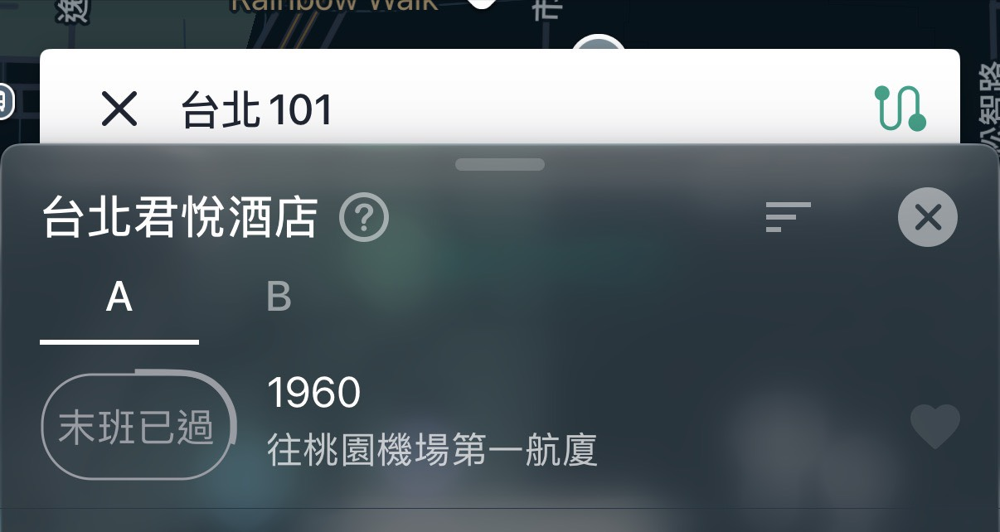
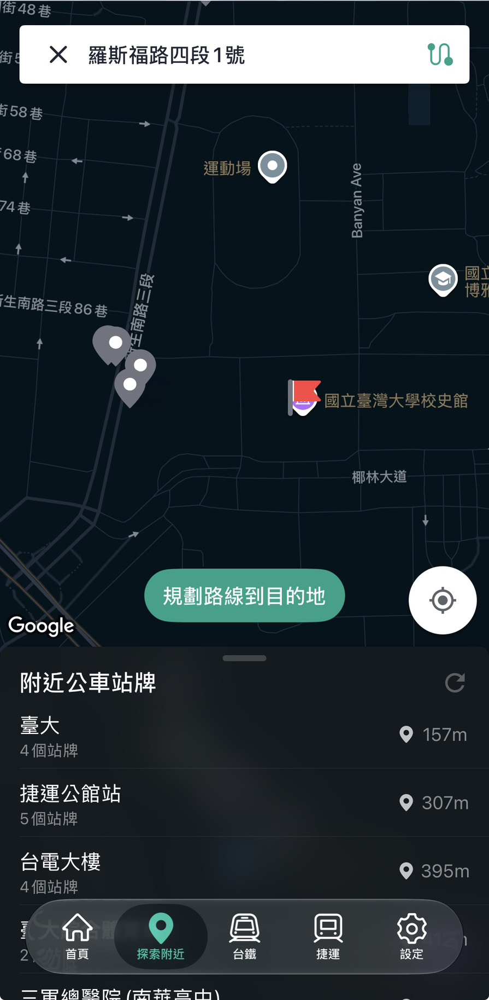
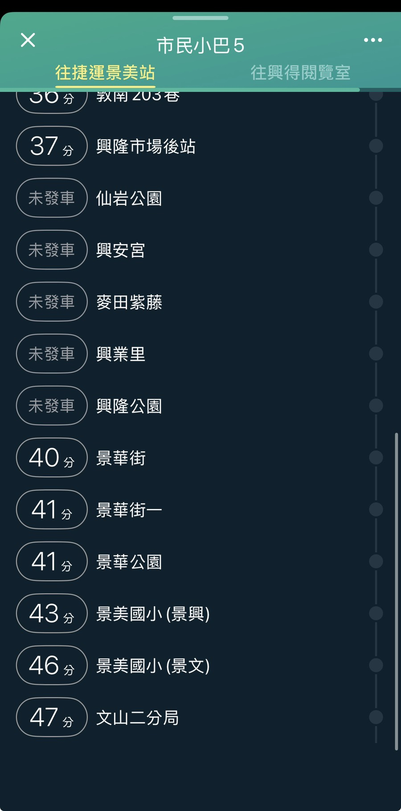

# 驗收紀錄 2026-11-03

驗收標準見 [proposal.md](../proposal.md)。除特別註明，全部在 Docker 整合版（`http://localhost:8080`）測試，LLM 用 `gemini-3.5-flash-lite`。

| 項目 | 結果 |
| --- | --- |
| 1 搜尋定位 | 通過（範圍內 13/13；台北君悅酒店只停公路客運 1960，屬範圍外） |
| 2 直達計算 | 通過（11/4；原始資料獨立重算 3,415 筆一致，Bus+ 抽查 15 組全對） |
| 3 Q1～Q5 | 待測 |
| 4 地標 | 待測 |
| 5 10 句自然語言 | 待測 |
| 6 不捏造 | 待測 |
| 7 速度 | 待測 |
| 8 手機 | 待測 |
| 9 可部署性 | 通過（修正 nginx 逾時後） |

## 第 1 項 搜尋定位

**方法**：3 個地點用搜尋框同一套 `geocode()`（Nominatim）定位，再查 300 m 內的站牌，和 Bus+「探索附近」比對。

**問題**：兩邊對同一個地址的定位點不同，直接比會差很多（羅斯福路四段 1 號幾乎對不上）。

**行動**：用 Bus+ 截圖上每個站名的距離反推 Bus+ 的定位點（在 ±1.2 km 內每 5 m 試一個點，找距離誤差最小的），再在那個點跑我們的附近站查詢，逐站比對（backend `scripts/locate_busplus.py`）。

**結果**：

| 地點 | Bus+ 與 Nominatim 定位相差 | 反推誤差（均方根） | 300 m 內站名（我們／Bus+） |
| --- | --- | --- | --- |
| 興隆路二段 218 號 | 7 m | 2.1 m | 6／6，距離差 ≤ 3 m |
| 台北 101 | 36 m | 1.9 m | 6／7，缺台北君悅酒店；另多列捷運台北101/世貿站（Bus+ 不列捷運） |
| 羅斯福路四段 1 號 | **300 m** | 1.6 m | 1／1（臺大，156 m／157 m） |

- **台北君悅酒店**：原始資料（TDX `City/Taipei`）裡沒有這個站名。Bus+ 顯示只停 1960（往桃園機場第一航廈／往市府轉運站），是公路客運，不在「台北市公車＋台北捷運」範圍內。

  

- **羅斯福路四段 1 號**是台大的地址，校區很大，兩個定位都在校區內：Bus+ 插在校史館（反推的點也在校史館附近，可佐證反推方法），Nominatim 在公館一側。所以我們列出公館（捷運，53 m）、捷運公館站（公車，65 m）、水源市場（248 m），Bus+ 只有臺大一站在 300 m 內。

  

  

- **觀察（原因未確認，持續觀察）**：同樣的 `geocode(street='羅斯福路四段1號')`，第一次是 (25.015120, 121.534723)、下車站 813 個；約 50 分鐘後是 (25.015101, 121.535973)，往東約 126 m、下車站 798 個（上圖），之後連查 4 次都是後者，`label` 兩次相同。用不同參數直接打 Nominatim 又得到第三個點。兩個點 300 m 內都是同樣 3 個站名（公館捷運 53／167 m、捷運公館站 65／146 m、水源市場 248／222 m），不影響判定。
- 直接搜「國立臺灣大學」會定位在校區中央，300 m 內沒有站牌（下車站 0 個），原因同地標清單改用大門門牌。

**最重要的發現**：結果取決於 geocode 的定位點。大範圍地址（校園、機場、公園）不同服務可能差到幾百公尺，附近站牌就完全不同（同一個服務前後結果不同的情況見上方觀察）。地標清單已經改用大門門牌，但使用者輸入的地址無法這樣處理；目前地圖已用紅點標出定位點，使用者發現位置不對時可以直接點地圖重查；回答裡也會印出 Nominatim 的完整地名。

其他 Bus+ 截圖：[興隆路二段 218 號](../images/acceptance-2026-11-03/busplus-xinglong.png)、[台北 101](../images/acceptance-2026-11-03/busplus-101.png)、[羅斯福路四段 1 號清單](../images/acceptance-2026-11-03/busplus-roosevelt-list.png)、[君悅 B 側](../images/acceptance-2026-11-03/busplus-grand-hyatt-b.png)、[本系統放大圖](../images/acceptance-2026-11-03/ours-roosevelt-zoom.png)。

## 第 2 項 直達計算（11/4 測）

**方法**：

1. **獨立重算**：另寫一支程式直接讀 TDX 原始 JSON（`data/raw/`，不經過資料庫和 SQL），對 3 個起點（興隆路二段 218 號、台北 101、羅斯福路四段 1 號）重算「300 m 內上車 → 下游每一站 → 最少站數」，和 Docker 版 `/reach` 逐筆比對（backend `scripts/verify_reach_raw.py`）。
2. **Bus+ 抽查**：從 3 個起點各挑 5 組「路線＋方向」（共 15 組），涵蓋去返程、捷運、單向路線、多個上車站位、兩個子路線、捷運支線（往廣慈/奉天宮）。在 Bus+ 打開同一條路線、同一個方向，核對上車站、方向、下游站名與站數。

**結果**：

| 檢查 | 結果 |
| --- | --- |
| 獨立重算 vs `/reach` | 3 個起點共 3,415 筆（下車站 × 路線：873／683／1,859），站數、上車站全部一致；方向平手的 31 筆兩個方向都算對 |
| Bus+ 抽查 15 組 | 15/15，上車站、方向、下游站、站數全部正確 |

**觀察 1：方向名稱和 Bus+ 不同**。以市民小巴 5 為例，我們顯示「往文山二分局」（程式取站序最後一站），Bus+ 顯示「往捷運景美站」（應是業者公告的方向名稱，未查證）。兩者是同一個方向，站序也一致，不影響計算；但使用者在路邊看車頭時可能對不上。改進方式：匯入 TDX 路線資料（`Route`）裡的官方起訖站名稱（欄位未查證）。

**觀察 2：兩個子路線合併正確**。市民小巴 5 有一條繞仙岩公園 → 興業里 → 興隆公園的子路線和一條直行的子路線，Bus+ 合成一張清單。截圖時繞行的 5 站顯示「未發車」，景華街（40 分）直接接在興隆市場後站（37 分）後面，表示這班走直行子路線；我們對同一個下車站取兩條子路線中較少的站數（景華街 8 站、文山二分局 13 站），和 Bus+ 一致。

**觀察 3：同站數平手時方向不固定**。907通勤有依發車時間分開的子路線，羅斯福路四段 1 號有 31 筆（下車站 × 路線）兩個方向的站數、上車距離都相同（其中 15 筆 API 和重算程式選了不同方向），`per_route` 的排序沒有決定順序，終點站可能顯示「往臺大」或「往華江站」。站數正確，只影響顯示；可在 `ORDER BY` 加上方向作為最後的排序條件。尚未修正。

其他截圖：[Bus+ 市民小巴 5 上半段](../images/acceptance-2026-11-03/busplus-minibus5-top.png)。

## 第 9 項 可部署性

**方法**：在新的空資料夾 clone `backend`（`a59fc71`）、`frontend`（`709de59`）、`deploy`（`273f851`）三個 repo，複製 `.env`，刪除舊的資料庫 volume，執行 `docker compose up -d --build`。

**結果**：

| 檢查 | 預期 | 實際 |
| --- | --- | --- |
| 容器狀態 | `import` Exited (0)，其他 Up | 一致，約 20 秒啟動完成 |
| 匯入筆數（routes / route_patterns / stops / route_stops / landmarks） | 421 / 1,263 / 28,945 / 43,605 / 48 | 一致 |
| `/reach` 測試起點 | 375 個下車站、11 個站位 | 一致；銘傳大學 109 27 站、606／606通勤 30 站，皆去程 |
| 範圍外座標 | 422 | 422 |
| `/ask`「從興隆路二段218號搭公車，不換車能到銘傳大學嗎？」 | 三條路線 | 第一次 **504**；修正後 200，答案正確 |

**發現的問題**：`/ask` 經 nginx 回 504，剛好 60 秒。

- 原因：nginx 的 `proxy_read_timeout` 預設 60 秒；開發模式的 Vite proxy 沒有這個限制，所以之前沒遇到。
- 同時 Gemini 很慢：直接打 api 要 28 秒；只回一個字的請求連續 3 次 15～18 秒，幾分鐘後又變 1.2 秒。log 沒有 429 重試紀錄，不是額度用完，是服務端延遲波動。
- 修正：`nginx.conf` 加 `proxy_read_timeout 180s`（frontend `e2f9cda`），pull 後重建 web，重測 200（41.7 秒）。

## 驗收中發現並修正的問題

### 起點附近沒有站牌時，LLM 回答錯誤

**問題**：搜尋框查「國立臺灣大學」，Nominatim 定位在校區中央，300 m 內沒有站牌。地圖正確顯示「附近 300 m 沒有站牌」，但回答是「走路約 0 公尺就到」；查「國立台灣大學」則回答「查不到這個地點，請換個名稱」。Bus+ 兩種寫法都定位在行政大樓，最近的捷運公館站 298 m。

**原因**：重跑兩題看 `tool_calls`。後端給 LLM 的結果兩題相同（附近 0 站、`destination_known: true`、`places` 空），台／臺不是原因。prompt 沒有規定「定位成功但附近沒有站牌」怎麼回答，LLM 就套用其他規則：「查不到這個地點」是 `destination_known: false` 的回答；「走路 0 公尺」用的 `destination_walk_m` 根本不在結果裡，屬於捏造。同一題重跑，回答也會不同。

**修正**：附近沒有站牌時由程式直接回固定答案（起點地名＋改用門牌或大門的建議），不呼叫第 2 次 Gemini（backend `7f3305b`）。

**驗證**：Docker 重建後兩種寫法都回固定答案（1.4、2.0 秒）；「從興隆路二段218號搭公車，不換車能到銘傳大學嗎？」仍正確。

其他截圖：[本系統「台」](../images/acceptance-2026-11-03/ours-ntu-tai.png)、[Bus+「台」](../images/acceptance-2026-11-03/busplus-ntu-tai.png)、[Bus+「臺」](../images/acceptance-2026-11-03/busplus-ntu.png)。
