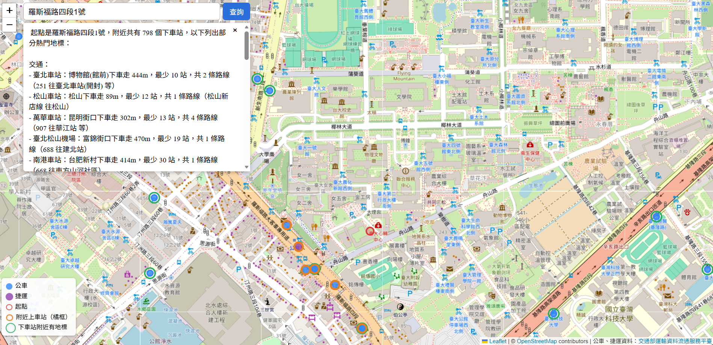
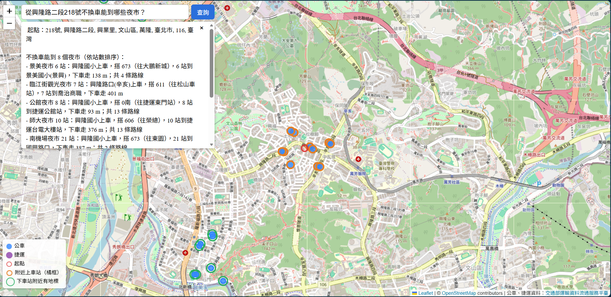
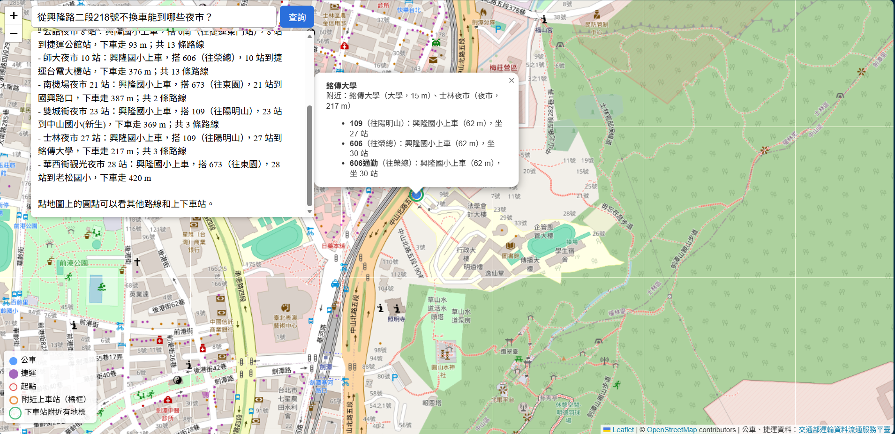
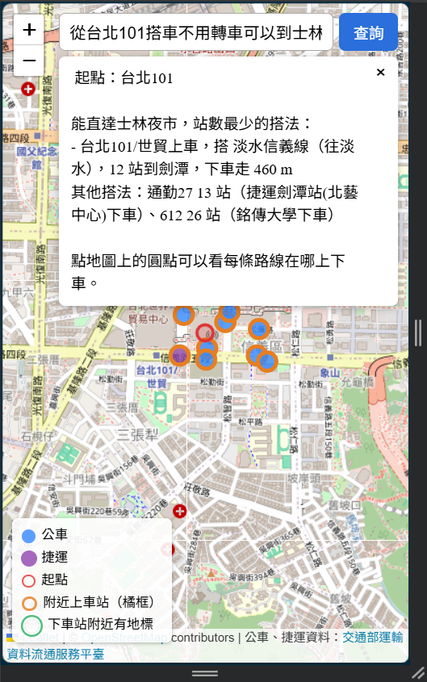
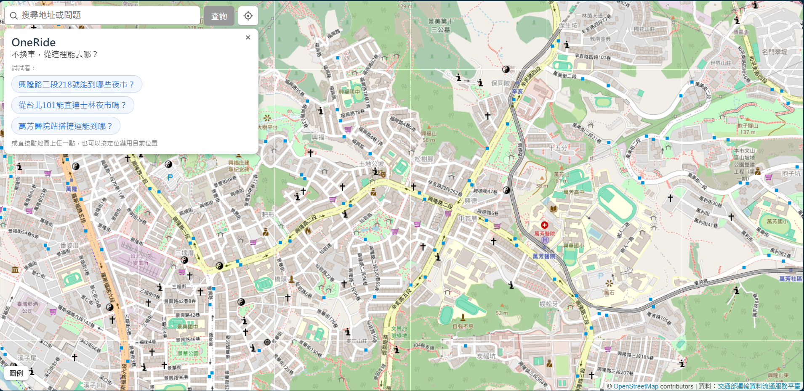
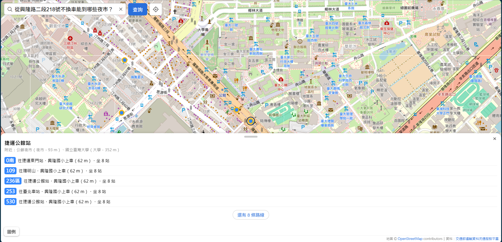
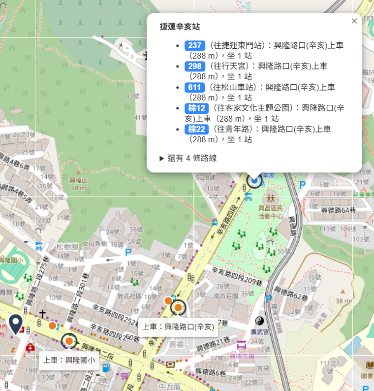
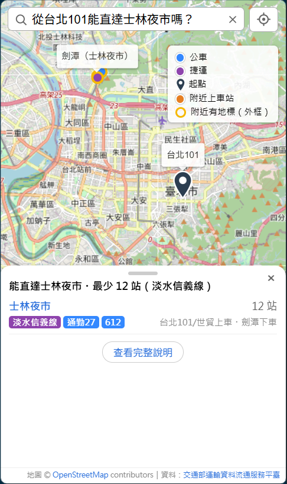
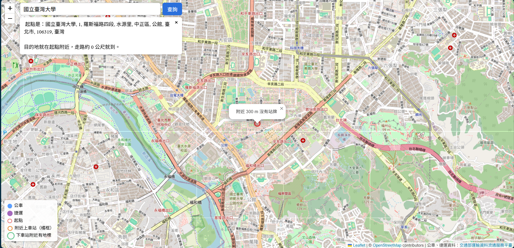

# 驗收紀錄 2026-11-03

驗收標準見 [proposal.md](../proposal.md)。除特別註明，全部在 Docker 整合版（`http://localhost:8080`）測試，LLM 用 `gemini-3.5-flash-lite`。

| 項目 | 結果 |
| --- | --- |
| 1 搜尋定位 | 通過（範圍內 13/13；台北君悅酒店只停公路客運 1960，屬範圍外） |
| 2 直達計算 | 通過（11/4；原始資料獨立重算 3,415 筆一致，Bus+ 抽查 15 組全對） |
| 3 Q1～Q5 | 通過（11/4，修正四輪後；Q4 完整清單在地圖；Q3 於第 7 項用新版補測通過） |
| 4 地標 | 通過（11/4；改版後重測：清單、popup、上下車站標示） |
| 5 10 句自然語言 | 通過（11/4；第一輪 9/10，修正定位後 10/10） |
| 6 不捏造 | 通過（11/4；程式產生的 15 個回答逐筆核對 141 筆，捏造 0） |
| 7 速度 | 通過（11/4；`/reach` 9 次 0.25～0.35 秒，`/ask` 15 題 1.1～2.8 秒，中位數 1.9 秒；Gemini 忙碌時會到 20～35 秒） |
| 8 手機 | 通過（11/4；Edge 裝置模擬，非實機；改版後重測：歡迎卡片、三段式面板、站點卡片、定位、出處） |
| 9 可部署性 | 通過（修正 nginx 逾時後） |

## 第 1 項 搜尋定位

**方法**：3 個地點用搜尋框同一套 `geocode()`（Nominatim）定位，再查 300 m 內的站牌，和 Bus+「探索附近」比對。

**問題**：兩邊對同一個地址的定位點不同，直接比會差很多（羅斯福路四段 1 號幾乎對不上）。

**行動**：用 Bus+ 截圖上每個站名的距離反推 Bus+ 的定位點（在 ±1.2 km 內每 5 m 試一個點，找距離誤差最小的），再在那個點跑我們的附近站查詢，逐站比對（backend `scripts/locate_busplus.py`）。

**結果**：

| 地點 | Bus+ 與 Nominatim 定位相差 | 反推誤差（均方根） | 300 m 內站名（我們／Bus+） |
| --- | --- | --- | --- |
| 興隆路二段 218 號 | 7 m | 2.1 m | 6／6，距離差 ≤ 3 m |
| 台北 101 | 36 m | 1.9 m | 6／7，缺台北君悅酒店；另多列捷運台北101/世貿站（Bus+ 不列捷運） |
| 羅斯福路四段 1 號 | **300 m** | 1.6 m | 1／1（臺大，156 m／157 m） |

- **台北君悅酒店**：原始資料（TDX `City/Taipei`）裡沒有這個站名。Bus+ 顯示只停 1960（往桃園機場第一航廈／往市府轉運站），是公路客運，不在「台北市公車＋台北捷運」範圍內。

  

- **羅斯福路四段 1 號**是台大的地址，校區很大，兩個定位都在校區內：Bus+ 插在校史館（反推的點也在校史館附近，可佐證反推方法），Nominatim 在公館一側。所以我們列出公館（捷運，53 m）、捷運公館站（公車，65 m）、水源市場（248 m），Bus+ 只有臺大一站在 300 m 內。

  

  

- **觀察（原因未確認，持續觀察）**：同樣的 `geocode(street='羅斯福路四段1號')`，第一次是 (25.015120, 121.534723)、下車站 813 個；約 50 分鐘後是 (25.015101, 121.535973)，往東約 126 m、下車站 798 個（上圖），之後連查 4 次都是後者，`label` 兩次相同。用不同參數直接打 Nominatim 又得到第三個點。兩個點 300 m 內都是同樣 3 個站名（公館捷運 53／167 m、捷運公館站 65／146 m、水源市場 248／222 m），不影響判定。
- 直接搜「國立臺灣大學」會定位在校區中央，300 m 內沒有站牌（下車站 0 個），原因同地標清單改用大門門牌。

**最重要的發現**：結果取決於 geocode 的定位點。大範圍地址（校園、機場、公園）不同服務可能差到幾百公尺，附近站牌就完全不同（同一個服務前後結果不同的情況見上方觀察）。地標清單已經改用大門門牌，但使用者輸入的地址無法這樣處理；目前地圖已用紅點標出定位點，使用者發現位置不對時可以直接點地圖重查；回答裡也會印出 Nominatim 的完整地名。

其他 Bus+ 截圖：[興隆路二段 218 號](../images/acceptance-2026-11-03/busplus-xinglong.png)、[台北 101](../images/acceptance-2026-11-03/busplus-101.png)、[羅斯福路四段 1 號清單](../images/acceptance-2026-11-03/busplus-roosevelt-list.png)、[君悅 B 側](../images/acceptance-2026-11-03/busplus-grand-hyatt-b.png)、[本系統放大圖](../images/acceptance-2026-11-03/ours-roosevelt-zoom.png)。

## 第 2 項 直達計算（11/4 測）

**方法**：

1. **獨立重算**：另寫一支程式直接讀 TDX 原始 JSON（`data/raw/`，不經過資料庫和 SQL），對 3 個起點（興隆路二段 218 號、台北 101、羅斯福路四段 1 號）重算「300 m 內上車 → 下游每一站 → 最少站數」，和 Docker 版 `/reach` 逐筆比對（backend `scripts/verify_reach_raw.py`）。
2. **Bus+ 抽查**：從 3 個起點各挑 5 組「路線＋方向」（共 15 組），涵蓋去返程、捷運、單向路線、多個上車站位、兩個子路線、捷運支線（往廣慈/奉天宮）。在 Bus+ 打開同一條路線、同一個方向，核對上車站、方向、下游站名與站數。

**結果**：

| 檢查 | 結果 |
| --- | --- |
| 獨立重算 vs `/reach` | 3 個起點共 3,415 筆（下車站 × 路線：873／683／1,859），站數、上車站全部一致；方向平手的 31 筆兩個方向都算對 |
| Bus+ 抽查 15 組 | 15/15，上車站、方向、下游站、站數全部正確 |

**觀察 1：方向名稱和 Bus+ 不同**。以市民小巴 5 為例，我們顯示「往文山二分局」（程式取站序最後一站），Bus+ 顯示「往捷運景美站」（應是業者公告的方向名稱，未查證）。兩者是同一個方向，站序也一致，不影響計算；但使用者在路邊看車頭時可能對不上。改進方式：匯入 TDX 路線資料（`Route`）裡的官方起訖站名稱。

**已解決（11/4，第 3 項修正第二輪）**：方向名稱改用 TDX `Route` 的起訖站，市民小巴 5 現在顯示「往捷運景美站」，與 Bus+ 一致。

**觀察 2：兩個子路線合併正確**。市民小巴 5 有一條繞仙岩公園 → 興業里 → 興隆公園的子路線和一條直行的子路線，Bus+ 合成一張清單。截圖時繞行的 5 站顯示「未發車」，景華街（40 分）直接接在興隆市場後站（37 分）後面，表示這班走直行子路線；我們對同一個下車站取兩條子路線中較少的站數（景華街 8 站、文山二分局 13 站），和 Bus+ 一致。


**觀察 3：同站數平手時方向不固定**。907通勤有依發車時間分開的子路線，羅斯福路四段 1 號有 31 筆（下車站 × 路線）兩個方向的站數、上車距離都相同（其中 15 筆 API 和重算程式選了不同方向），`per_route` 的排序沒有決定順序，終點站可能顯示「往臺大」或「往華江站」。站數正確，只影響顯示；可在 `ORDER BY` 加上方向作為最後的排序條件。尚未修正。

其他截圖：[Bus+ 市民小巴 5 上半段](../images/acceptance-2026-11-03/busplus-minibus5-top.png)。

## 第 3 項 實驗題目 Q1～Q5（11/4 測）

**方法**：用[基準實驗](../experiments/llm-baseline.md)的原題，在搜尋框（`POST /ask`）各問 1 次，每題間隔 25 秒，對照基準實驗的正確答案。

### 改前（backend `7f3305b`）

| 題 | 測試時間 | 秒數 | LLM 填的參數 | 回答 | 判定 |
| --- | --- | --- | --- | --- | --- |
| Q1 附近站牌有哪些公車 | 06:16 | 16.9 | `street` | 沒有列出站牌與路線，改列地標摘要 | 未通過（地圖點橘框站牌可看到路線） |
| Q2 673 往大鵬新城的站序 | 06:17 | 1.3 | 未呼叫工具 | 「超出查詢範圍」 | 未通過（沒有捏造） |
| Q3 能不能到士林夜市 | 06:17 | 8.1 | `street`、`destination` | 能；銘傳大學下車，109 27 站、606／606通勤 30 站，興隆國小上車 | 通過 |
| Q4 能到哪些地方 | 06:18 | 9.0 | `street` | 375 個下車站，文字列 5 類地標，完整清單在地圖 | 文字是摘要，完整清單靠地圖 |
| Q5 萬芳醫院站搭捷運 | 06:18 | 12.2 | `place` | 起點定位到大同區重慶北路一段的「台灣房屋」，回答整個錯 | 未通過 |

**原因**：

- **Q1**：給 LLM 的精簡結果只有附近的站名（`boarding` 只放站名），沒有每站的路線，LLM 無從回答。資料本身正確（第 1 項已和 Bus+ 比對）。
- **Q2**：工具只有 `reach`，沒有查單一路線站序的功能。LLM 說明做不到、沒有編造站名。屬於設計範圍外，提案時已列為風險題。
- **Q5** 有兩層問題：
  1. 定位：Nominatim 查「萬芳醫院站」得到大同區的「台灣房屋」；查「捷運萬芳醫院站」「萬芳醫院」都正確（文山區興隆路三段）。和第 1 項記錄的「Nominatim 找錯但在範圍內」同類，`in_range` 擋不住。
  2. 篩選：改問「從捷運萬芳醫院站搭捷運不換車能到哪些站？」（8.5 秒），起點正確，但回答仍是地標摘要（公車、捷運混在一起），因為 `reach` 沒有「只要捷運」的參數。
  - 資料本身正確：直接用 `/reach` 查萬芳醫院站（`TRTC-BR04`）座標，捷運往動物園 3 站、往南港展覽館 20 站，與正確答案 23/23 一致。

**順帶記錄**：Q1（16.9 秒）、Q5（12.2 秒）超過第 7 項的 10 秒。Q3 的路線與站名都在 `reach` 結果中。

### 修正

分三輪，每輪都在 Docker 重建後重測 Q1～Q5。

**第一輪（backend `1a01bae`）**：

- Q1：給 LLM 的附近站牌改成每個站位一行，附距離與經過的路線（同名站的兩側分開，不再合併）。
- Q5 定位：起點名稱是捷運站名時（去掉「捷運」「站」、台／臺視為相同），直接用資料庫的捷運站座標，不查 Nominatim。
- Q5 篩選：`reach` 加 `transport`（`metro`／`bus`），由程式篩下車站；只搭捷運時改給依路線方向排好的全部下車站。
- 結果：Q1、Q5 通過。Q2 回答「查不到 673 往大鵬新城…請確認名稱是否正確」：資料的方向名稱取最後一站（「往中正環河路口」），對不到業者公告的「往大鵬新城」（同第 2 項觀察 1），而且這句話會讓使用者以為自己打錯。

**第二輪（backend `59f885a`）**：

- 方向名稱改用業者公告的名稱：抓 TDX `/v2/Bus/Route/City/Taipei`（`data/raw/bus_route_taipei.json`，2026-11-04），每條路線有起站（`DepartureStopNameZh`）、迄站（`DestinationStopNameZh`）。去程往迄站、返程往起站，例如 673 起站大鵬新城、迄站東園 → 返程「往大鵬新城」。用站名檢查 579 個方向都符合這個規則（唯一的例外是站名比對誤判）。存進 `route_patterns.headsign`；捷運、起訖站相同的 108 沒有官方名稱，照舊用最後一站。匯入筆數不變。
- `reach` 加 `route`、`toward`：只留這條路線，依方向列出之後的站；`toward` 對不到任何方向時兩個方向都列出並說明。
- 起點是公車站名時也用資料庫座標（所有同名站牌都在 200 m 內才採用；全市有同名站相距近 20 km，例如「土地公廟」）。
- 結果：Q2 通過，但 Q4 回答「共有 52 個下車站」（實際 375）。程式給的數字正確，是 LLM 抄錯：附近站牌加上路線後，`count` 排在 11 行站牌後面，名稱也不夠明確（52 是資料裡最大的 `min_stops`）。

**第三輪（backend `5af1ee7`、`2caa009`）**：

- 下車站數改名 `destination_count`，放在結果最前面（`5af1ee7`）。
- Q5 同一題 3 次有 1 次把往南港展覽館的 20 站寫成「辛亥（1站）至南港展覽館（20站）」，prompt 規定不要省略也擋不住。清單型的回答（某條路線的站序、只搭捷運）改由程式組好，不呼叫第 2 次 Gemini，和「附近沒有站牌」的處理方式相同（`2caa009`）。
- Gemini 有時把「興隆國小站」填進 `street`，站名比對改成 `street`、`place` 都先比對（站名完全相同才算，帶門牌的地址不會對到）。

**第四輪（backend `7e50a4e`）**：第三輪的 Q4 回答雖然正確，但列了 22 個地標、每行約 60 字（下車站、步行距離、站數、路線數、方向、上車站），站在使用者角度資訊過量，手機上要滑好幾頁；而且只坐 1 站的萬芳醫院、中國科技大學其實走路就到。

- 「能到哪裡」改成短摘要，由程式產生：每類 3 個地標，只寫名稱和最少站數；路線、上下車站等細節交給地圖的 popup；結尾引導「點地圖」或改問「能到哪些夜市」。
- 「走路可到」：起點直線 800 m 內（約 10 分鐘）的地標另列一行，不列進搭車的清單。用距離而不是「坐 1～2 站」判斷：市區 1 站約 300 m，走快速道路的 2 站可能超過 1 km。測試起點最近的地標是中國科技大學 418 m、萬芳醫院 609 m，第三近的世新大學已 1.4 km。100 m 內的地標視為起點本身（例如從台北101出發），不列。直線距離比實際步行短，所以寫「約」。
- Q1 和 Q4 傳給工具的參數原本完全相同（只有 `street`），程式分不出來，所以 `reach` 加 `nearby`（只問附近站牌），附近站牌的回答也改由程式產生。
- 結果：除了「能不能到某地」「能到哪些夜市」，其他問法都不再呼叫第 2 次 Gemini。Q4 從 10.9～12.2 秒降到約 2 秒。

### 改後（backend `7e50a4e`，Docker 重建後）

| 題 | 測試時間 | 秒數 | LLM 填的參數 | 回答由誰寫 | 回答 | 判定 |
| --- | --- | --- | --- | --- | --- | --- |
| Q1 | 07:42 | 2.5 | `street`、`nearby` | 程式 | 11 個站位全部列出，各附距離與路線；興隆國小兩側合計 16 條，與 Citymapper 一致 | 通過 |
| Q2 | 07:42 | 1.3 | `street`＝興隆國小站、`route`＝673、`toward`＝大鵬新城 | 程式 | 673 往大鵬新城，興隆國小上車，依序 12 站到中正環河路口 | 通過（12/12，順序正確） |
| Q3 | 07:43 | 8.5 | `street`、`destination`、`transport`＝bus | Gemini | 能；銘傳大學下車，109 往陽明山 27 站、606／606通勤 往榮總 30 站，興隆國小上車 | 通過 |
| Q4 | 07:43 | 2.2 | `street` | 程式 | 走路可到中國科技大學、萬芳醫院；375 個下車站，5 類各列 3 個地標與站數；完整清單在地圖 | 通過（完整清單在地圖） |
| Q5 | 07:44 | 1.3 | `place`＝捷運萬芳醫院站、`transport`＝metro | 程式 | 往動物園 3 站、往南港展覽館 20 站，依站序逐站列出 | 通過（23/23） |

Q4 回答全文：

```
起點：218號, 興隆路二段, 興業里, 文山區, 萬隆, 臺北市, 116, 臺灣
走路可到：中國科技大學（約 420 m）、萬芳醫院（約 610 m）

不換車能到 375 個站，以下是幾個代表性的地方：
夜市：景美夜市 6 站、臨江街觀光夜市 7 站、公館夜市 8 站
大學：世新大學 6 站、國立臺灣科技大學 6 站、國立臺灣大學 8 站
醫院：國泰綜合醫院 11 站、國立臺灣大學醫學院附設醫院 17 站、臺北榮民總醫院 43 站
景點：大安森林公園 8 站、台北101 10 站、臺北市立動物園 12 站
交通：臺北車站 18 站、松山車站 20 站、萬華車站 24 站

點地圖上的圓點可以看搭哪條車、在哪上下車。想看某一類的全部，可以問「能到哪些夜市？」
```

**結論**：第 3 項**通過**。Q4 的「完整清單」是地圖上的 375 個下車站，文字只給摘要：這是刻意的分工（文字幫使用者挑方向、地圖給完整細節），不是做不到。

**待觀察**：「能到哪些夜市」（`category`）仍由 Gemini 寫，每個夜市列出所有下車站（華西街 4 個），回答也偏長。第 5 項測試時看實際回答，再決定要不要比照 Q4 改成程式產生。

**與基準實驗比較**：基準實驗中三家通用 AI 的 Q1 涵蓋 0～3/6 個站名，本系統 11/11 個站位；Q2 ChatGPT、Gemini 全對、Claude 多補 1 站，本系統全對；Q3 ChatGPT 沒有結論、Gemini 下車站有誤、Claude 正確（只提 606），本系統給出全部 3 條路線與站數；Q4 三家都只給區域或路線名稱，本系統列出 375 個下車站；Q5 ChatGPT 全對、Gemini 把辛亥放錯方向、Claude 把辛亥寫成輔大醫院，本系統 23/23。

**其他影響**：方向名稱改用業者公告的名稱後，測試資料的顯示改變：109「往陽明山國家公園管理處」→「往陽明山」、606／606通勤「往保一總隊」→「往榮總」。站數不變。

## 第 4 項 可直達地標（11/4 測）

**方法**：Windows 的 Edge 開 `http://localhost:8080`（VS Code 轉發；一直轉圈圈時，在「連接埠」分頁停止轉送 8080 再重新加一次就好），搜尋「從興隆路二段218號不換車能到哪些夜市？」，再點銘傳大學的下車站。

**結果**：

- 文字回答：8 個夜市，每個都有路線、方向、站數，例如「景美夜市 6 站：興隆國小上車，搭 673（往大鵬新城），6 站到景美國小(景興)，下車走 138 m；共 4 條路線」；長回答可以捲動。
- 點選後：popup 標題是下車站（銘傳大學），列出附近地標（銘傳大學 15 m、士林夜市 217 m）與 3 條路線，各有方向、上車站與距離、站數（109 往陽明山，興隆國小上車 62 m，坐 27 站）。

**結論**：通過。





其他截圖：[回答捲到底](../images/acceptance-2026-11-03/ours-item4-answer-bottom.png)。

## 第 8 項 手機操作（11/4 測）

**方法**：手機連不到 VM（VS Code 轉發只綁 Windows 的 localhost），改用 Edge DevTools 的裝置模擬（F12 → Ctrl+Shift+M），寬度約 500 px。**不是實機測試。**

**結果**：

| 步驟 | 結果 |
| --- | --- |
| 初始畫面 | 搜尋框不擋縮放按鈕 |
| 搜尋（101→士林夜市） | 回答完整，紅點起點、橘框上車站、紫色捷運站 |
| 點圓點 | 上車站 popup 顯示距離與經過的路線 |
| 長回答（只給地址） | 可以捲動到最後一行 |

**發現的問題**：手機寬度下右下角出處折成兩行，左下角的圖例蓋住「Leaflet | © OpenStreetMap」（只看得到「contributors」）。TDX 的出處完整，但 OSM 也要求出處可見。修正：600 px 以下圖例往上移、字縮小（frontend `4d2f6d0`）。待重新截圖確認。

**結論**：通過（模擬）。



其他截圖：[初始畫面](../images/acceptance-2026-11-03/ours-item8-mobile-initial.png)、[點上車站](../images/acceptance-2026-11-03/ours-item8-mobile-popup.png)、[長回答上半](../images/acceptance-2026-11-03/ours-item8-mobile-overview-top.png)、[長回答下半](../images/acceptance-2026-11-03/ours-item8-mobile-overview-bottom.png)。

## 第 5 項 自然語言 10 句（11/4 測）

**方法**：10 句涵蓋地址、地標、捷運站三種起點，以及目的地、類別、站數、只搭捷運、走路就到、範圍外等條件，盡量沿用 11/2、11/3 測過的問法。每句間隔 25 秒。**正確＝起點、條件都解析對，而且結論正確。**

| # | 問題 | 預期參數與結論 |
| --- | --- | --- |
| S1 | 從興隆路二段218號搭公車，不換車能到銘傳大學嗎？ | `street`、`destination`、bus；能，109 27 站 |
| S2 | 興隆路二段218號附近 10 站以內能到哪裡 | `max_stops`＝10；120 個站 |
| S3 | 士林夜市附近 5 站以內能到哪裡 | `place`、`max_stops`＝5；87 個站 |
| S4 | 從台北101搭車不用轉車可以到士林夜市嗎？ | `place`、`destination`；能，淡水信義線 12 站到劍潭 |
| S5 | 興隆路二段218號附近，不換車能到哪些夜市？ | `category`＝夜市；8 個夜市 |
| S6 | 我住在羅斯福路四段1號，不換車能到哪些醫院？ | `category`＝醫院；8 個醫院 |
| S7 | 我在捷運萬芳醫院站，只搭捷運能到哪裡？ | `transport`＝metro；文湖線 23 站 |
| S8 | 從101搭公車不用轉車可以到松山機場嗎 | `destination`、bus；不能（11/2 已用資料庫確認） |
| S9 | 我在興隆路二段218號，可以直接搭車到興隆國小嗎？ | `destination`；走路約 60 m 就到 |
| S10 | 從桃園機場不換車能到哪裡？ | 不在台北市範圍內 |

### 第一輪（backend `7e50a4e`，07:50～07:54）

9/10 正確，達到通過標準（至少 8 句）。

| # | 結果 | 秒數 | 回答由誰寫 |
| --- | --- | --- | --- |
| S1～S5、S7、S9、S10 | 正確 | 1.2～10.6 | |
| S6 | 正確，但回答約 60 行（8 個醫院，萬芳醫院一間就列了 11 個下車站） | 10.2 | Gemini |
| S8 | **錯誤**：Gemini 參數正確（`place`＝101），但 Nominatim 把「101」找成新北市三芝區（台 2 線的里程），經緯度在方框內，答成「附近沒有站牌」 | 4.0 | 程式 |

超過 10 秒的兩題（S1 10.6、S6 10.2）都是 Gemini 寫回答的題目；由程式產生回答的題目都在 3.3 秒內。

### 修正（backend `d7ef485`）

- **定位**：起點名稱先比對地標清單（座標人工確認過）；名稱完全相同，或只對到一個地標時採用（「101」只包含在「台北101」裡）。Nominatim 的結果另外要求地名有「臺北市」才算範圍內：Nominatim 查「101」前 5 筆都是三芝區，經緯度方框擋不住新北市。副作用：「國立臺灣大學」改用地標清單的大門座標，不再定位到校區中央（11/3 修的「附近沒有站牌」固定回答仍保留）。
- **回答全部由程式產生**：「能不能到某地」「哪些○○」也比照 Q4，Gemini 只負責填參數。使用者通常只想知道怎麼去最方便，所以每個地點只寫一種最好的搭法（站數最少，一樣時下車走路最近），其他路線壓成一行或只寫總數，細節在地圖上。目的地在起點 800 m 內時回答走路就到（和 Q4 的「走路可到」同一個判斷）。找不到地點、範圍外也改成固定訊息。
- **prompt**：只要問題有起點就呼叫 `reach`。改版後的測試中，Gemini 曾自己判斷「桃園機場不在範圍」而沒有呼叫工具；結論雖然對，但範圍應由程式判斷。
- **限制**：「站數最少」不等於「最快」：捷運 12 站約 25 分鐘，公車 27 站可能要 1 小時。沒有行車時間與班距資料，只能用站數近似，所以保留「其他搭法」。

### 正式結果（backend `d7ef485`，08:16～08:21）

| # | Gemini 填的參數 | 回答 | 秒數 | 判定 |
| --- | --- | --- | --- | --- |
| S1 | `street`、`destination`＝銘傳大學、`transport`＝bus | 能；興隆國小上車，109 往陽明山 27 站；其他搭法 606、606通勤 30 站 | 2.6 | ✓ |
| S2 | `street`、`max_stops`＝10 | 走路可到中國科技大學、萬芳醫院；120 個站，3 類地標 | 2.7 | ✓ |
| S3 | `place`＝士林夜市、`max_stops`＝5 | 走路可到銘傳大學；87 個站；雙城街夜市 3 站、新光醫院 1 站、故宮 2 站 | 2.5 | ✓ |
| S4 | `place`＝台北101、`destination`＝士林夜市 | 能；淡水信義線 12 站到劍潭走 460 m；其他搭法 通勤27 13 站、612 26 站 | 2.5 | ✓ |
| S5 | `street`、`category`＝夜市 | 8 個夜市，每個一行（景美夜市 6 站 … 華西街 28 站） | 2.0 | ✓ |
| S6 | `street`、`category`＝醫院 | 8 個醫院，每個一行（榮總 7 站 … 三總 35 站），從約 60 行縮成 8 行 | 1.9 | ✓ |
| S7 | `place`＝捷運萬芳醫院站、`transport`＝metro | 文湖線往動物園 3 站、往南港展覽館 20 站 | 1.1 | ✓ |
| S8 | `place`＝台北101、`destination`＝松山機場、`transport`＝bus | 搭公車不換車沒辦法到松山機場 | 1.1 | ✓ |
| S9 | `street`、`destination`＝興隆國小 | 走路約 60 m 就到 | 16.7 | ✓ |
| S10 | `place`＝桃園機場 | 「臺灣桃園國際機場…」不在台北市範圍內 | 33.6 | ✓ |

**結論**：10/10 正確，第 5 項**通過**。

**之後的程式檢查（backend `67331cb`）**：正式結果之後讀過今天改動的程式，用實際資料重現並修正 4 個這 10 句沒有涵蓋到的情況：

| 問法 | 修正前 | 修正後 |
| --- | --- | --- |
| 從 101 問附近有哪些捷運站（`nearby`＋`metro`） | 列出淡水信義線 27 個下車站 | 附近 1 個捷運站：台北101/世貿 148 m |
| 從士林夜市問能到哪些夜市 | 第一個是「士林夜市 1 站」（起點本身） | 起點本身不列 |
| 10 站以內能到士林夜市嗎（從興隆國小） | 「不換車沒辦法到士林夜市」（其實 27 站可到） | 「不換車 10 站以內沒辦法到士林夜市」 |
| 從捷運萬芳醫院站到萬芳醫院 | 「走路約 0 m 就到」 | 「起點就在萬芳醫院旁邊，不用搭車」 |

S9 的措辭因此改變：目的地在 100 m 內時，回答改成「起點就在興隆國小旁邊，不用搭車」（結論相同）。

**速度（第 7 項的資料）**：S9、S10 變慢的原因是 Gemini。另外分開計時重跑 3 題：Gemini 單次呼叫 24.3～34.5 秒，我們的工具（定位＋查詢）0.7～1.0 秒，log 沒有 503／429 重試紀錄。和 11/3 晚上觀察到的一樣，是 Gemini 服務端的延遲波動，前 8 題（08:16～08:20）都只有 1.1～2.7 秒。

## 第 6 項 不捏造（11/4 測）

**方法**：backend `scripts/verify_no_fabrication.py` 讀存下來的 `/ask` 回應（`answer` 和同一題的 `reach`），用兩種方式檢查：

1. **逐筆核對**：依程式產生回答的格式，拆出每一筆「上車站、路線、方向、站數、下車站」，到 `reach` 找完全相同的一筆；附近站牌的距離與路線、地標的最少站數、下車站總數、某條路線的站序也逐一核對。
2. **名稱掃描**：資料庫所有路線名、站名、地標名（加上這題結果裡的方向名稱），出現在回答裡的，必須也在這題的 `reach` 裡。不依賴格式，所以也能檢查 LLM 寫的舊版回答。起點地名（Nominatim）和 LLM 從問題解析出的參數（例如目的地「松山機場」）來自使用者，不列入。

**結果**：

| 檢查對象 | 回答數 | 逐筆核對 | 捏造 |
| --- | --- | --- | --- |
| 正式版：第 5 項 10 句（`d7ef485`）＋第 3 項 Q1～Q5（`7e50a4e`），回答由程式產生 | 15（範圍外 1 題沒有查詢結果，略過） | 141 筆 | **0** |
| 對照：今天改版前由 Gemini 寫的回答（第 3 項各輪、第 5 項第一輪） | 36 | 119 筆 | 1（Q4「共有 52 個下車站」，實際 375） |
| 反向測試：竄改 S1 的回答（109 改成 25 站、加入不存在的路線 999、紅30、士林官邸） | 1 | 4 筆 | 4 個竄改全部抓到 |

- 反向測試用來確認腳本抓得到錯誤，不是「什麼都檢查不出來」。
- Gemini 寫的回答格式不固定，逐筆核對只對得上一部分，主要靠名稱掃描；所以「1」是下限。另外 Gemini 在 Q5 曾把 20 站縮成「辛亥至南港展覽館」，屬於遺漏而非捏造，不在這項的計算內。
- 調整腳本時排除的誤判：原始資料有站名前面帶空白（「 松山車站」）、方向名稱「汐止社后」被拆成站名「汐止」「社后」、固定說明「（校園、公園、機場）」裡的「公園」剛好是站名。

所有回應存在 [responses-2026-11-04/](responses-2026-11-04/)（依輪次分資料夾，README 有每個檔案的問題、時間、backend commit 和重跑指令）。

**結論**：第 6 項**通過**。回答改由程式產生後，捏造在設計上就不會發生：路線、站名、數字都直接取自查詢結果，腳本則是用來驗證這件事。

## 第 7 項 查詢速度（11/4 測）

**方法**：Docker 版（backend `f8b307e`），用 `curl` 的 `time_total` 量從送出請求到收完回應的時間。

- `/reach`：第 1、2 項的 3 個地點各打 3 次。標準 1 秒內。
- `/ask`：第 3 項 Q1～Q5 加第 5 項 10 句，共 15 題，每題間隔 25 秒（08:48～08:55）。標準 10 秒內。

**結果**：

| 查詢 | 次數 | 最小 | 中位數 | 最大 | 標準 |
| --- | --- | --- | --- | --- | --- |
| `/reach` | 9 | 0.25 秒 | 0.26 秒 | 0.35 秒（羅斯福路四段 1 號，798 個下車站） | 1 秒 ✓ |
| `/ask` | 15 | 1.1 秒 | 1.9 秒 | 2.8 秒 | 10 秒 ✓ |

15 題的回答與第 3、5 項正式結果相同，第 6 項腳本核對 144 筆，問題 0 個。

**Q3 補測**：第 3 項的 Q3 是在回答改由程式產生之前測的，這次用新版重測：「能直達士林夜市，站數最少的搭法：興隆國小上車，搭 109（往陽明山），27 站到銘傳大學，下車走 217 m」，其他搭法 606、606通勤，1.9 秒，通過。

**Gemini 延遲波動（照實記錄）**：

- `/ask` 的時間幾乎都是 Gemini：同一天 08:20～08:47 Gemini 單次呼叫要 20～35 秒（工具本身 0.7～1.0 秒，沒有 503／429 重試紀錄），這段時間 `/ask` 會超過 10 秒；08:48 之後恢復到 1～3 秒。11/3 晚上也觀察到同樣的情況。
- 改版前（Gemini 呼叫 2 次，第 2 次讀 5 萬字的結果寫回答）同一批問題是 1.2～12.2 秒，超過 10 秒的都是 Gemini 寫回答的題目；改版後只呼叫 1 次、輸入也短，正常時段都在 3 秒內。
- 結論：正常時段通過；Gemini 忙碌時無法保證 10 秒內，這是外部服務的限制。nginx `proxy_read_timeout` 已設 180 秒，慢的時候不會出錯，只是等比較久。

## 介面改版後的回歸測試（11/4 下午）

**背景**：驗收第 8 項後，以「使用者友善、畫面字少」為原則改版（backend PR #7、frontend PR #7，合併後 backend `57f8cec`、frontend `775c359`），產品命名為 OneRide。後端回答多了 `segments`（路線、地點的標記）和 `view`（一行摘要＋精簡清單），回答格式也有調整（捷運不寫「搭」、其他搭法改成「通勤27（13 站，…下車）」），所以在 8080 重跑會受影響的項目。

**第 3、5 項（12:42～12:49，15 題）**：結論全部和正式結果相同。

| 題 | 秒數 | 摘要（`view.summary`） |
| --- | --- | --- |
| Q1 | 3.0 | 附近 300 m 有 11 個站牌 |
| Q2 | 1.0 | 673 往大鵬新城・12 站 |
| Q3 | 1.8 | 能直達士林夜市・最少 27 站（109） |
| Q4 | 3.0 | 不換車能到 375 個站 |
| Q5 | 1.3 | 文湖線・2 個方向・共 23 站 |
| S1 | 1.4 | 能直達銘傳大學・最少 27 站（109） |
| S2 | 3.4 | 不換車能到 120 個站 |
| S3 | 6.1 | 不換車能到 87 個站 |
| S4 | 4.1 | 能直達士林夜市・最少 12 站（淡水信義線） |
| S5 | 3.1 | 能到 8 個夜市・最近：景美夜市 6 站 |
| S6 | 4.1 | 能到 8 個醫院・最近：臺北榮民總醫院 7 站 |
| S7 | 1.1 | 文湖線・2 個方向・共 23 站 |
| S8 | **11.9** | 不換車到不了松山機場 |
| S9 | **11.1** | 興隆國小就在附近，走路就到 |
| S10 | 7.5 | 「臺灣桃園國際機場（桃園市大園區）」不在台北市範圍內 |

**第 6 項**：`verify_no_fabrication.py` 核對這 15 個新格式回應，144 筆，問題 0 個。

**第 7 項**：`/reach` 9 次 0.24～0.32 秒。`/ask` 中位數 3.1 秒，S8、S9 超過 10 秒；從 12:47 起每題都變慢。分開計時重測這兩題：Gemini 3.5、7.9 秒，工具（定位＋查詢）0.3、0.6 秒，所以仍是 Gemini 的延遲波動，與改版無關。正常時段的結論維持「通過」，Gemini 忙碌時無法保證 10 秒內。

**第 4、8 項**：改版後在 8080 重新截圖（Edge，手機為裝置模擬；定位用實際位置，在台科大）。

| 項目 | 檢查 | 結果 |
| --- | --- | --- |
| 4 | 「能到哪些夜市」：每個夜市一行，有站數、路線色塊、上下車站 | 通過 |
| 4 | 點捷運公館站：popup 先列 5 條路線（路線、方向、上車站、站數），其餘收在「還有 8 條路線」 | 通過 |
| 4 | 點下車站：同時標出上車站與下車站（frontend PR #8、backend PR #8 之後） | 通過 |
| 8 | 歡迎卡片：三個範例可點、圖例不被蓋住 | 通過 |
| 8 | 搜尋：查詢中轉圈；101→士林夜市框住兩端、摘要＋清單 | 通過 |
| 8 | 點站：底部顯示站點卡片（下車站、上車站） | 通過 |
| 8 | 定位：允許後畫出附近上車站與下車站 | 通過 |
| 8 | 出處：面板出現時面板底部標示 OSM、TDX | 通過 |









其他截圖：[手機歡迎卡片](../images/acceptance-2026-11-03/oneride-mobile-welcome.png)、[查詢中](../images/acceptance-2026-11-03/oneride-mobile-loading.png)、[站點卡片（小北街）](../images/acceptance-2026-11-03/oneride-mobile-card-xiaobei.png)、[定位](../images/acceptance-2026-11-03/oneride-mobile-locate.png)、[上車站卡片](../images/acceptance-2026-11-03/oneride-mobile-boarding-card.png)。

## 最終版完整測試（11/4 傍晚，backend `e261a38`、frontend `f88060f`）

**方法**：對 8080 跑 `full_test.py`（存在 [responses-2026-11-04/final-full-test/](responses-2026-11-04/final-full-test/)），共 133 項自動檢查：網頁檔案（首頁、manifest、圖示、不存在的網址）、`/reach`（3 個地點的下車站數、每條路線的上車站 ID、速度、範圍外與缺參數回 422、附近沒有站牌的點）、`/ask`（第 3、5 項 15 題＋歡迎卡片 3 個範例＋9 個邊界題；每題檢查 segments 接起來等於回答、沒有殘留標記、清單與連結的站都在結果裡）。另用 `verify_no_fabrication.py` 核對全部回應。

**結果**：133 項全部通過；捏造 0。`/reach` 最慢 0.36 秒。邊界題：

| 問法 | 回答 |
| --- | --- |
| 和查詢無關（今天天氣如何） | Gemini 說明可以怎麼問，沒有查詢 |
| 沒說起點 | 請使用者說出發地 |
| 找不到的地點（火星基地） | Nominatim 找到桃園的「中興市民活動中心」，回答範圍外（結論沒錯，但地點是猜的） |
| 只搭捷運但附近沒有捷運站 | 「起點附近 300 m 內沒有捷運站」 |
| 附近有哪些捷運站（101） | 1 個：台北101/世貿 148 m |
| 不存在的路線（999） | 「起點附近 300 m 內沒有 999 經過」 |
| 類別＋站數（臺大醫院 10 站內的夜市） | 9 個夜市 |
| 站數條件下到不了 | 「不換車 10 站以內沒辦法到士林夜市」 |
| 大範圍地標（國立臺灣大學） | 用地標清單的大門座標，617 個站，走路可到公館夜市 |

**觀察**：

- `/ask` 這次中位數 18.6 秒、最大 43.7 秒（27 題中 20 題超過 10 秒），同一天 12:42 是中位數 3.1 秒；工具本身都在 1 秒內，延遲來自 Gemini（同第 7 項）。
- 「羅斯福路四段1號 能到哪些醫院」這次是 6 個（12:46 是 8 個）：Nominatim 給的點往西偏約 300 m（121.5360→121.5332），地名相同。同第 1 項的觀察：大範圍地址的定位點會變。

## 第 9 項 可部署性

**方法**：在新的空資料夾 clone `backend`（`a59fc71`）、`frontend`（`709de59`）、`deploy`（`273f851`）三個 repo，複製 `.env`，刪除舊的資料庫 volume，執行 `docker compose up -d --build`。

**結果**：

| 檢查 | 預期 | 實際 |
| --- | --- | --- |
| 容器狀態 | `import` Exited (0)，其他 Up | 一致，約 20 秒啟動完成 |
| 匯入筆數（routes / route_patterns / stops / route_stops / landmarks） | 421 / 1,263 / 28,945 / 43,605 / 48 | 一致 |
| `/reach` 測試起點 | 375 個下車站、11 個站位 | 一致；銘傳大學 109 27 站、606／606通勤 30 站，皆去程 |
| 範圍外座標 | 422 | 422 |
| `/ask`「從興隆路二段218號搭公車，不換車能到銘傳大學嗎？」 | 三條路線 | 第一次 **504**；修正後 200，答案正確 |

**發現的問題**：`/ask` 經 nginx 回 504，剛好 60 秒。

- 原因：nginx 的 `proxy_read_timeout` 預設 60 秒；開發模式的 Vite proxy 沒有這個限制，所以之前沒遇到。
- 同時 Gemini 很慢：直接打 api 要 28 秒；只回一個字的請求連續 3 次 15～18 秒，幾分鐘後又變 1.2 秒。log 沒有 429 重試紀錄，不是額度用完，是服務端延遲波動。
- 修正：`nginx.conf` 加 `proxy_read_timeout 180s`（frontend `e2f9cda`），pull 後重建 web，重測 200（41.7 秒）。

## 驗收中發現並修正的問題

### 起點附近沒有站牌時，LLM 回答錯誤

**問題**：搜尋框查「國立臺灣大學」，Nominatim 定位在校區中央，300 m 內沒有站牌。地圖正確顯示「附近 300 m 沒有站牌」，但回答是「走路約 0 公尺就到」；查「國立台灣大學」則回答「查不到這個地點，請換個名稱」。Bus+ 兩種寫法都定位在行政大樓，最近的捷運公館站 298 m。



**原因**：重跑兩題看 `tool_calls`。後端給 LLM 的結果兩題相同（附近 0 站、`destination_known: true`、`places` 空），台／臺不是原因。prompt 沒有規定「定位成功但附近沒有站牌」怎麼回答，LLM 就套用其他規則：「查不到這個地點」是 `destination_known: false` 的回答；「走路 0 公尺」用的 `destination_walk_m` 根本不在結果裡，屬於捏造。同一題重跑，回答也會不同。

**修正**：附近沒有站牌時由程式直接回固定答案（起點地名＋改用門牌或大門的建議），不呼叫第 2 次 Gemini（backend `7f3305b`）。

**驗證**：Docker 重建後兩種寫法都回固定答案（1.4、2.0 秒）；「從興隆路二段218號搭公車，不換車能到銘傳大學嗎？」仍正確。

其他截圖：[本系統「台」](../images/acceptance-2026-11-03/ours-ntu-tai.png)、[Bus+「台」](../images/acceptance-2026-11-03/busplus-ntu-tai.png)、[Bus+「臺」](../images/acceptance-2026-11-03/busplus-ntu.png)。
