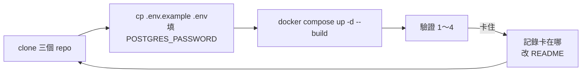

# 第 9 項 可部署性：請他人照 README 部署（11/6）

**標準**：請他人照 README，在乾淨環境從 clone 開始；填好 `.env` 後以 `docker compose up` 一行指令啟動。

11/3 的第 9 項是自己在新資料夾重新 clone 驗證的（見 [2026-11-03.md](2026-11-03.md#第-9-項-可部署性)），不算「他人」，所以重做一次。

## 事前準備（部署前一天）

- [x] 11/5 照 README 在全新資料夾演練一次（另開 port 8090、不填 Gemini 金鑰）：數字全部一致。發現並修正：
  - 沒填 Gemini 金鑰時，交給 Gemini 的問題回 HTTP 500 → 改回固定說明（backend）。
  - 資料庫映像檔只有 amd64，Apple 晶片的 Mac 會找不到相符版本 → compose 指定 `platform: linux/amd64`（deploy）。
  - README 補上：GitHub 權限、HTTPS clone、`.env` 各欄位、沒有金鑰時哪些功能能用、常見問題、驗證數字（地標 102）。
- [ ] 把同學的 GitHub 帳號加進 `transit-reach`（讀取權限）
- [ ] 確認同學的電腦有 Docker（`docker compose version`）

## 流程

**我只在旁邊看、記錄，不出手幫忙操作**；卡住時先讓對方看 README 的「常見問題」，還是不行才口頭說明，並記下來改 README。

## 紀錄

| 項目 | 內容 |
| --- | --- |
| 部署的人 | |
| 電腦、作業系統 | （例如 Windows 11 + Docker Desktop、MacBook M2） |
| 有沒有 Gemini 金鑰 | |
| 開始 → 網頁打得開 | ：～： （共 分鐘） |
| repo 版本 | backend `` / frontend `` / deploy ``（`git log --oneline -1`） |

## 驗證（照 README「驗證」）

| # | 檢查 | 預期 | 實際 |
| --- | --- | --- | --- |
| 1 | `docker compose ps -a` | `import` Exited (0)，其他 Up | |
| 2 | 匯入筆數 | routes 421 / route_patterns 1263 / stops 28945 / route_stops 43605 / landmarks 102 | |
| 3 | `/api/reach` 測試起點 | 上車站 11 個站位、下車站 375 個；銘傳大學 109（27 站）、606、606通勤（30 站） | |
| 4 | `/api/ask` 銘傳大學 | 三條路線，`metrics.path` 是 `rule` | |
| 5 | 網頁長按興隆路二段 218 號 | 面板出現、點圓點看到路線 | |
| 6 | （有金鑰才測）搜尋「我想從台科大去吃饒河夜市」 | 有回答，`path` 是 `llm` | |

## 卡住的地方與 README 的修改

| 卡在哪 | 原因 | README 怎麼改 |
| --- | --- | --- |
| | | |

## 結論

（通過／不通過，一句話）
