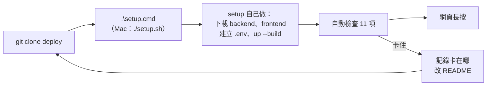

# 第 9 項 可部署性：請他人照 README 部署（11/6）

**標準**：請他人照 README，在乾淨環境從 clone 開始；填好 `.env` 後以 `docker compose up` 一行指令啟動。

11/3 的第 9 項是自己在新資料夾重新 clone 驗證的（見 [2026-11-03.md](2026-11-03.md#第-9-項-可部署性)），不算「他人」，所以重做一次。

**結果：通過。** 實驗室同學在 Windows 照 README 一鍵部署，`setup.cmd` 執行 1 分 30 秒，自動檢查 11 項全部通過，數字和 11/3、11/5 一致。

## 事前準備

- [x] 11/5 照 README 在全新資料夾演練一次（另開 port 8090、不填 Gemini 金鑰）：數字全部一致。發現並修正：
  - 沒填 Gemini 金鑰時，交給 Gemini 的問題回 HTTP 500 → 改回固定說明（backend）。
  - 資料庫映像檔只有 amd64，Apple 晶片的 Mac 會找不到相符版本 → compose 指定 `platform: linux/amd64`（deploy）。
  - README 補上：GitHub 權限、HTTPS clone、`.env` 各欄位、沒有金鑰時哪些功能能用、常見問題、驗證數字（地標 102）。
- [x] 11/6 部署前用「第一次部署的人」的角度重看 README，改成一鍵部署（deploy PR #2）：
  - README 的驗證用 bash 寫法的 `curl`；Windows PowerShell 的 `curl` 是 `Invoke-WebRequest` 的別名，`\` 換行、JSON 引號也會出錯 → 改成在容器裡跑的自動檢查 `docker compose run --rm check`，各作業系統同一行。
  - 資料庫健康檢查的時間差：實測第一次初始化時約 3 秒（2.5～5.9 秒）Unix socket 回報可連、TCP 還連不上，原本第 5 秒的第一次檢查正落在這段 → 改用 `pg_isready -h 127.0.0.1`＋`start_period: 120s`。
  - `setup.sh`（Mac、Linux）、`setup.ps1`＋`setup.cmd`（Windows）：檢查工具 → 下載 backend、frontend → 建立 `.env`（自動產生密碼）→ `docker compose up -d --build` → 自動檢查。
  - README 補：接受 org 邀請才 clone 得到、Mac HTTPS clone 不能用密碼。
- [x] 把同學的 GitHub 帳號加進 `transit-reach`（讀取權限），同學接受邀請
- [x] 確認同學的電腦有 Docker：已裝 Docker Desktop，但還需要 WSL（見下方「卡住的地方」）

## 流程

`setup` 只是把 README「手動部署」的步驟包起來，裡面啟動用的仍是 `docker compose up -d --build`，符合標準的「一行指令啟動」。

**我只在旁邊看、記錄，不出手幫忙操作**；卡住時先讓對方看 README 的「常見問題」，還是不行才口頭說明，並記下來改 README。

## 紀錄

| 項目 | 內容 |
| --- | --- |
| 部署的人 | 實驗室同學（第一次接觸這個專案） |
| 電腦、作業系統 | Windows 10 ＋ Docker Desktop（WSL2） |
| 有沒有 Gemini 金鑰 | 沒有（問金鑰時按 Enter 略過） |
| 指令 | `git clone https://github.com/transit-reach/deploy.git` → `cd deploy` → `.\setup.cmd` |
| 開始 → 網頁打得開 | setup 印出的耗時 1 分 30 秒（另加 clone deploy 約 1 秒）。其中下載資料庫映像檔 41 秒、打包 24.5 秒；同學的網路約 7～9 MB/s，比 README 寫的 3～10 分鐘快 |
| repo 版本 | backend `f5c671b` / frontend `8e52041` / deploy `d34ae92`（setup 最後印出） |

## 驗證（setup 的自動檢查＋網頁手動檢查）

| # | 檢查 | 預期 | 實際 |
| --- | --- | --- | --- |
| 1 | 啟動順序 | `import` Exited (0)，其他 Up | 通過（setup 第 4 步成功；api 要等 import 成功結束才會啟動，自動檢查也連得上） |
| 2 | 匯入筆數 | routes 421 / route_patterns 1263 / stops 28945 / route_stops 43605 / landmarks 102 | 通過，5 張表都一致 |
| 3 | `/api/reach` 測試起點 | 上車站 11 個站位、下車站 375 個；銘傳大學 109（27 站）、606、606通勤（30 站） | 通過：11、375；109 27 站、606 30 站、606通勤 30 站 |
| 4 | `/api/ask` 銘傳大學 | 三條路線，`metrics.path` 是 `rule` | 通過：`rule`，三條路線同上 |
| 5 | 網頁長按興隆路二段 218 號 | 面板出現、點圓點看到路線 | 通過（同學在瀏覽器操作） |
| 6 | （有金鑰才測）搜尋「我想從台科大去吃饒河夜市」 | 有回答，`path` 是 `llm` | 不適用（沒有金鑰）；自動檢查顯示「Gemini 金鑰：沒有設定」 |

另外確認了 Windows 才會遇到的幾點（之前只在 PowerShell 7 容器測過）：Windows PowerShell 5.1 顯示中文正常（`setup.ps1` 存成 UTF-8 with BOM）、`setup.cmd` 不用改執行原則就能跑、docker 寫到 stderr 的進度沒有被當成錯誤、照 deploy 的 HTTPS 網址推出另外兩個 repo、`.env` 自動產生密碼。

## 卡住的地方與 README 的修改

| 卡在哪 | 原因 | README 怎麼改 |
| --- | --- | --- |
| Docker Desktop 需要 WSL（部署前的準備） | README 只寫「可能要啟用 WSL2」，沒給指令 | 「事前準備」改成假設什麼都沒裝：流程圖＋系統管理員 PowerShell 一次裝 WSL、git、Docker Desktop，重開一次；常見問題補 WSL、虛擬化兩列（deploy `d34ae92`） |
| 沒卡住，但放在 OneDrive 同步的桌面資料夾 | `.env` 有資料庫密碼（填了金鑰也會在裡面），會被同步到雲端 | 一鍵部署段落建議 `C:\oneride`，不要放 OneDrive 同步的資料夾 |

## 結論

通過：他人在 Windows 照 README 從 clone 開始，一行 `setup.cmd`（內部執行 `docker compose up -d --build`）1 分 30 秒完成部署，自動檢查 11 項全部通過，網頁長按、點圓點正常。
