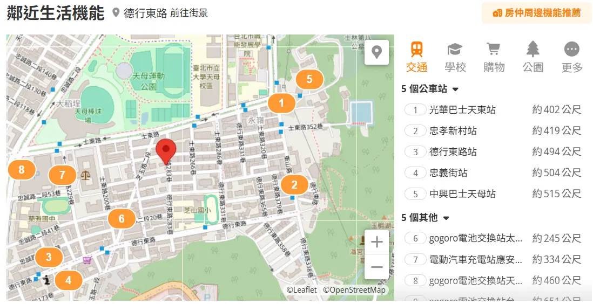
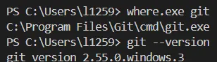
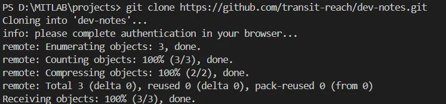

# 2026-10-21 選題與可行性分析

## 今日目標

- [x] 確定專題題目與 MVP 範圍
- [x] 調查競品，找出差異化
- [x] 確認資料來源與使用限制
- [x] 建立筆記用的 GitHub Organization 與 repo

## 1. 選題：從構想到定案

**原本的問題**：想做一個工具，輸入目的地後顯示經過該地的大眾運輸路線，知道從那裡能搭到哪些地方。

**過程中的調整**：

| 調整 | 原因 |
| --- | --- |
| 核心改成「**不換車**能直達哪裡」 | 「經過的路線」只是中間資料，使用者真正想知道的是能去哪裡；而限定不換車讓問題邊界清楚 |
| 刪掉「約地點」的情境 | 對這個工具的實用性不高 |
| 刪掉「通勤直達檢查」（輸入兩個地址） | 屬於 A 到 B 規劃，Google Maps 已做得更完整，保留反而跟差異化矛盾 |
| 技術選型先不寫死 | 還沒比較過工具，設計階段比較後再決定 |

**結果**：完成提案，見 [proposal.md](../proposal.md)。

## 2. 競品調查

**做了什麼**：實際使用 Google Maps、台北等公車、Mapnificent、591 租屋網、樂屋網，記錄各自能做到什麼。

**發現**：租屋平台會列出物件附近的捷運站、公車站與距離，以及購物、學校等生活機能。只需要知道「附近有沒有站」的人，這些資訊已經足夠；但沒有工具告訴你「這些站能直達哪裡」。

by 591 租屋網
by 樂屋網
## 3. 資料來源：交通部 TDX 平台

**原本的問題**：公車、捷運的路線與站序資料從哪裡來？要錢嗎？

**參考資料**：

- [TDX 運輸資料流通服務平臺](https://tdx.transportdata.tw/)
- [TDX 會員註冊指引](https://motc-ptx.gitbook.io/tdx-xin-shou-zhi-yin/xi-tong-jie-shao/hui-yuan-zhu-ce-zhi-yin)

**整理**：

- 我用學校信箱申請**學研單位會員**。
- 未訂閱付費方案的會員每月有 3 點免費額度（約 3,000 次呼叫），API 金鑰每分鐘最多呼叫 5 次。
- 公車站序資料包含路線、方向、站名、站序、經緯度，正好是直達計算需要的欄位。

**決策**：不在每次查詢時即時呼叫 TDX，而是定期把靜態資料匯入自己的資料庫，查詢時只讀資料庫。原因是每分鐘 5 次的限制，以及查詢速度。

## 4. 筆記工具：為什麼用 GitHub

| 方案 | 問題 |
| --- | --- |
| Google Drive + Google 文件 | 可行，但程式碼會放在 GitHub，筆記和程式碼分兩處 |
| Anytype 匯出 Markdown 放 Drive | Drive 不會渲染 Markdown；匯出的圖片是相對路徑，上傳後會斷掉 |
| **Markdown 放 GitHub repo**（採用） | GitHub 會渲染 Markdown 與圖片，筆記和程式碼在同一處，有版本紀錄 |

已經跟學長確認可以用 GitHub。

**結果**：建立 Organization `transit-reach` 與 repo `dev-notes`。

## 5. 踩坑紀錄

### 5-1. PowerShell 找不到 git

**現象**：電腦有 Git Bash，但在 PowerShell 執行 `git --version` 報錯。

**原因**：當初安裝 Git for Windows 時，PATH 選項選了只給 Git Bash 使用，所以 `C:\Program Files\Git\cmd` 不在 PATH 裡。另外 PATH 裡還有 Vivado 內建的舊版 git（2.16.2）。

**驗證**：

```powershell
Test-Path "C:\Program Files\Git\cmd\git.exe"   # True，代表有裝只是不在 PATH
```

**解法**：把 `C:\Program Files\Git\cmd` 加進系統 PATH，並排在 Vivado 那行上面，重開 PowerShell。



**學到的觀念**：Windows 會依照 PATH 由上往下尋找執行檔，同名程式會用到排在前面的那個。

### 5-2. git clone 認證失敗

**現象**：

```
remote: Invalid username or token. Password authentication is not supported for Git operations.
fatal: Authentication failed for 'https://github.com/transit-reach/dev-notes.git/'
```

**原因**：Windows 認證管理員裡存著一組以前留下的 GitHub 帳密，git 直接拿來用，沒有跳出登入畫面。GitHub 已不接受用密碼操作 git。

**解法**：

```powershell
cmdkey /list | findstr github             # 找到 LegacyGeneric:target=https://github.com/
cmdkey /delete:https://github.com/        # 刪掉舊帳密
git clone https://github.com/transit-reach/dev-notes.git
```

重新 clone 時，Git Credential Manager 跳出瀏覽器授權，完成後 clone 成功。


## 明日計畫

- VMware 安裝 Ubuntu 24.04
- 設定 SSH，從 VS Code Remote-SSH 連進 VM
- 在 VM 產生 SSH key 並加到 GitHub
- 安裝 uv、Docker
- 取得 TDX 金鑰後第一次呼叫 API，觀察資料結構
