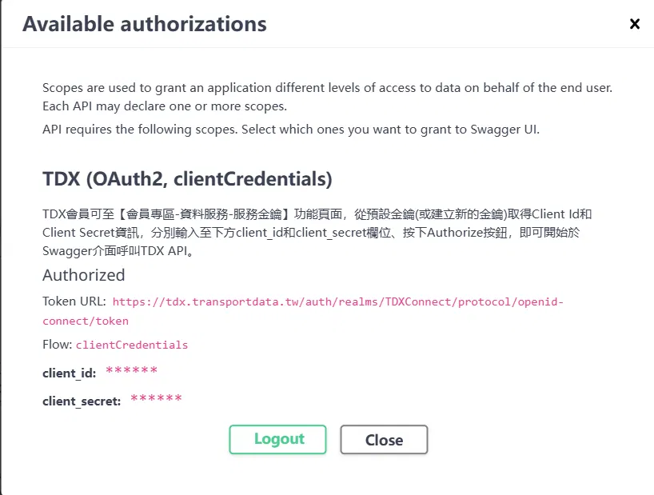
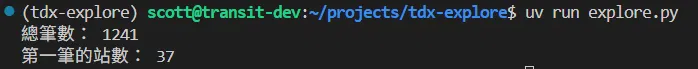
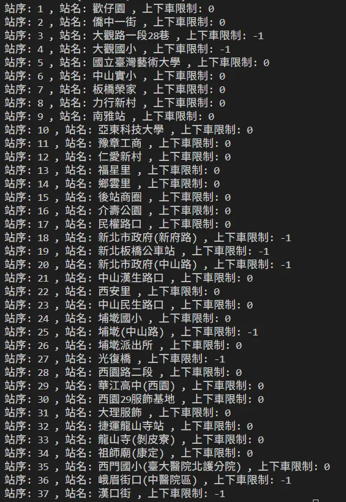
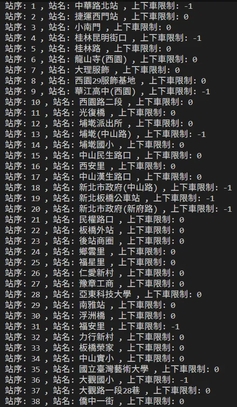

# 2026-10-26 驗證 TDX API 與分析公車資料

## 今日目標

- [x] 用 TDX 官方 Swagger 驗證取資料腳本中的網址與參數
- [x] 閱讀 API Schema，找出影響資料庫設計的欄位
- [x] 自己寫程式分析已下載的公車資料
- [x] 檢查 `StopBoarding`（上下車限制）欄位的可信度

## 1. 用 Swagger 驗證網址與參數

TDX「資料服務 → 基礎服務 → 公共運輸-公車」頁面就是 Swagger UI，可以按 Authorize 填入金鑰後直接試打 API。

| 腳本中的寫法 | Swagger 上的依據 |
| --- | --- |
| `BASE_URL = ".../api/basic"` | 頁面的 Servers 欄位 |
| `AUTH_URL = ".../openid-connect/token"` | Authorize 視窗的 Token URL |
| `grant_type = client_credentials` | Authorize 視窗的 Flow: clientCredentials |
| `Authorization: Bearer <token>` | 試打產生的 Curl 指令 |
| `$format=JSON` | Request URL 的 `%24format=JSON`（`%24` 是 `$` 的網址編碼） |


**Response header 中的發現：**

| Header | 意義 | 對專案的用途 |
| --- | --- | --- |
| `ratelimit-limit: 5`、`ratelimit-remaining: 4`、`ratelimit-reset: 60` | 每分鐘 5 次，剩餘次數，60 秒後重置 | 證實腳本 `sleep(12)` 的依據；之後可改成依剩餘次數決定是否等待 |
| `content-encoding: br`、`vary: Accept-Encoding` | 瀏覽器支援 Brotli，伺服器就選 br 壓縮 | 實際看到 `Accept-Encoding` 的協商結果 |
| `last-modified` 與 304 說明 | 帶 `If-Modified-Since` 請求，資料沒更新時回 304 且不傳內容 | 每日匯入時可先判斷是否更新，節省流量與額度 |

## 2. Schema 中影響設計的欄位

| 欄位 | 定義 | 影響 |
| --- | --- | --- |
| `Direction` | 0 去程、1 返程、2 迴圈、10 循環線、255 未知 | 不只兩種方向，環狀路線需要特別處理 |
| `StopBoarding` | -1 可下車、0 可上下車、1 可上車 | 可能影響「哪些站能當上車站」 |
| `StationID`、`StationGroupID` | 站牌所屬的站位、組站位 | 可用來合併同一地點的站牌 |
| `PositionLon`、`PositionLat` | nullable | 沒有座標的站無法做半徑搜尋 |
| `RouteUID`、`SubRouteUID`、`StopUID` | 業管機關簡碼 + ID | 全國唯一，適合當資料庫主鍵 |

## 3. 分析公車資料

讀取已下載的 JSON 檔，不重新呼叫 API：

```python
data = json.loads(Path("data/raw/bus_stop_of_route_taipei.json").read_text(encoding="utf-8"))

route_names, subroute_ids, direction_count = set(), set(), {}
for item in data:
    route_names.add(item["RouteName"]["Zh_tw"])
    subroute_ids.add(item["SubRouteUID"])
    d = item["Direction"]
    direction_count[d] = direction_count.get(d, 0) + 1
```



| 項目 | 結果 |
| --- | --- |
| 資料筆數 | 1241 |
| 路線號碼 | 416 |
| 子路線 | 731 |
| 方向 | 0：628 筆、1：613 筆 |

**推論的修正：**

- 原本推測「1241 ＝ 子路線數 × 2 個方向」，但 731 × 2 = 1462，與實際不符。
- 由方向筆數推算：兩個方向都有的子路線 510 個，只有去程 118 個，只有返程 103 個。
- 接著猜測單向的子路線是迴圈或循環線，但台北市資料的 `Direction` **只有 0 和 1**，猜測不成立。
- 目前推測：台北市的環狀路線以單一筆 `Direction = 0` 表示，另有區間車或特殊班次只跑單程（待驗證）。

## 4. `StopBoarding` 欄位是否可信

**問題**：統計所有站的上下車限制，結果為 `0`（可上下車）34,805 個、`-1`（可下車）8,430 個，約兩成的站被標為「只可下車」。若照定義排除這些站當上車站，會影響約兩成的結果。

**行動與結果：**

1. 列出 234 去程 37 站：-1 不只在終點，也出現在起點附近與路線中段。
2. 在 Bus+ 查詢這些站：沒有任何「僅供下車」的標示。
3. 比對 234 返程 38 站：

| 站名 | 去程 | 返程 |
| --- | --- | --- |
| 新北市政府（兩站）、新北板橋公車站、埔墘(中山路)、大觀國小 | -1 | -1 |
| 中華路北站（返程**起點**） | — | -1 |
| 漢口街（去程終點） | -1 | — |
| 僑中一街（返程終點） | — | 0 |

**去程**：



**回程**：



**矛盾**：

- 返程的**起點**被標為「只可下車」，實際上不可能。
- 兩個方向的終點標示不一致。
- 同一站在兩個方向都是 -1，無法用端點繞行或單行道解釋。

**結論**：台北市資料的 `StopBoarding = -1` 與 TDX Schema 的定義不符，實際意義待確認。可能與收費分段（Bus+ 顯示的「緩衝區」）有關，尚未驗證。

**決策**：資料庫保留此欄位；MVP 的直達計算暫不使用它排除上車站，避免無故少掉兩成的站。

## 5. 對資料庫設計的影響

- 計算單位是「子路線 ＋ 方向」，不是路線號碼。
- 環狀路線不能只靠 `Direction` 判斷，需另外檢查起訖站。
- 主鍵使用 TDX 的 UID 欄位。
- `StopBoarding`、`StationID`、`StationGroupID` 都存入，供之後驗證與去重使用。

## 明日計畫

- 草擬資料庫 schema
- 驗證環狀路線的推測：找出只有單一方向的子路線，檢查起訖站是否相同
- （選做）在 Bus+ 比對 234 的「緩衝區」位置與 -1 站是否吻合
- 建立 `backend` repo
