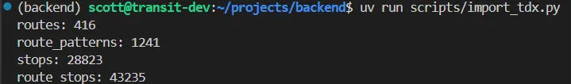
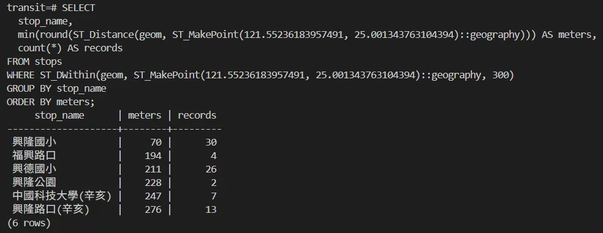

# 2026-10-27 資料庫設計與資料匯入

## 今日目標

- [x] 用實際資料驗證 schema 的設計假設
- [x] schema 定案，寫成 SQL
- [x] 建立 `backend` repo，用 Docker 啟動 PostgreSQL + PostGIS
- [x] 匯入台北市公車站序資料
- [x] 第一個空間查詢，與實驗 Q1 的正確答案比對

## 1. 資料庫設計

資料中有三種「東西」：路線、子路線方向、站牌。站牌與子路線方向是**多對多**（一個站牌有多條路線經過、一條路線經過多個站牌），因此用「站序」表記錄兩者的關係；路線與子路線方向是**一對多**，在子路線方向表中記錄所屬路線即可。

| 表 | 主鍵 | 主要欄位 |
| --- | --- | --- |
| `routes` | `route_uid` | 路線號碼、交通類型（公車／捷運） |
| `route_patterns` | `subroute_uid` + `direction` | 所屬路線、子路線名稱 |
| `stops` | `stop_uid` | 站名、`station_id`、`station_group_id`、`geom`（PostGIS 空間欄位） |
| `route_stops` | `subroute_uid` + `direction` + `stop_sequence` | 站牌、`stop_boarding`（保留，暫不使用） |

`route_stops` 的主鍵若只用 `stop_sequence` 會重複（每條路線都有第 19 站），必須加上子路線與方向。

### 驗證設計假設：站牌是否被多條路線共用？

| 項目 | 數量 |
| --- | --- |
| 站序總筆數 | 43,235 |
| 不重複的 `StopUID` | 28,823 |
| 不重複的 `StationID` | 5,375 |

`StopUID` 接近站序總數，`StationID` 則平均被 8 筆站序共用。實際資料中也看到同名、同座標、同 `StationID`，但 `StopUID` 不同的例子：

| | 234 | 內科21 |
| --- | --- | --- |
| `StopUID` | TPE33210 | TPE200279 |
| 站名 | 歡仔園 | 歡仔園 |
| 座標 | 121.4447909, 25.0118181 | 121.4447909, 25.0118181 |
| `StationID` | 2717 | 2717 |

**結論**：台北市資料中，`StopUID` 是「某條路線在此停靠的紀錄」，`StationID` 才是實體站位。設計不需大改：半徑搜尋直接用每個 `StopUID` 的座標即可找出所有路線；`station_id` 用於畫面上合併同一地點的站牌。站名不能作為判斷依據，例如 234 經過兩個不同位置的「新北市政府」。

## 2. 工具選擇

| 工具 | 用途 | 為什麼選它 |
| --- | --- | --- |
| Docker | 把服務打包成容器執行 | 一行 `docker compose up` 即可在任何機器重現相同環境；PostGIS 用官方映像檔，免去手動安裝相依套件 |
| PostgreSQL | 關聯式資料庫 | 資料是表格加多對多關聯，適合關聯式資料庫；搭配 PostGIS 有完整的空間功能 |
| PostGIS | 空間資料型態、空間函式與空間索引 | 「附近 300 公尺的站牌」與「下游站附近的地標」可直接寫在 SQL 中；以台北市約 2.9 萬個站牌的規模，Python 逐一計算也可行，但 PostGIS 讓查詢邏輯集中，資料量變大時有索引支撐 |
| SQL | 定義、寫入、查詢資料 | 直達計算本質上是多張表的 JOIN 加上空間查詢，直接寫 SQL 比 ORM 清楚，也較好除錯 |

空間欄位使用 `geography(Point, 4326)`：以球面計算，距離單位直接是公尺。

## 3. 踩坑紀錄：PostGIS 沒有被啟用

**問題**：資料庫啟動後執行 `SELECT postgis_version();`，出現：

```
ERROR:  function postgis_version() does not exist
```

**原因**：`postgis/postgis` 映像檔會在第一次啟動時，執行 `/docker-entrypoint-initdb.d` 內建的腳本來啟用 PostGIS。`compose.yaml` 把專案的 `db/init` 資料夾掛載到同一個位置，蓋掉了內建腳本。

**解法**：在 schema 檔 `db/init/01_schema.sql` 的第一行明確啟用：

```sql
CREATE EXTENSION IF NOT EXISTS postgis;
```

`db/init` 的 SQL 只在資料庫第一次建立時執行，因此用 `docker compose down -v` 刪除資料後重新啟動。

**驗證**：未手動執行任何指令，`postgis_version()` 即回傳 `3.5`，四張表也自動建立。

**學到的觀念**：資料庫需要哪些擴充功能，應該在 schema 中明確寫出，不依賴映像檔的隱藏行為。

## 4. 資料匯入

匯入程式以 AI 提供的架構為基礎，自行完成欄位對應與除錯。重點設計：

| 問題 | 做法 |
| --- | --- |
| 外鍵限制寫入順序 | `routes` → `route_patterns` → `stops` → `route_stops` |
| 同一個 `StopUID` 出現在多筆路線資料中 | 以主鍵為鍵存入 Python dict，自動去除重複 |
| 每天重新匯入 | 先 `TRUNCATE` 四張表再寫入，全部包在同一個交易中，中途出錯就整個取消 |
| 站名可能含特殊字元 | 使用 `%s` 佔位符，避免 SQL injection |

**除錯**：第一次執行出現

```
psycopg.ProgrammingError: cannot adapt type 'dict' using placeholder '%s'
```

從 Traceback 最下方往上讀，錯誤發生在寫入 `routes` 時，三個值中只有路線名稱可能是 dict。原因是 `item["RouteName"]` 本身是 `{"Zh_tw": ..., "En": ...}`，改為 `item["RouteName"]["Zh_tw"]` 後成功。由於寫入包在交易中，出錯時前面的 `TRUNCATE` 也一併撤銷，資料庫沒有被清空。

**結果**：

| 表 | 匯入筆數 | 先前的資料分析 |
| --- | --- | --- |
| `routes` | 416 | 路線號碼 416 |
| `route_patterns` | 1,241 | 資料筆數 1,241 |
| `stops` | 28,823 | 不重複 StopUID 28,823 |
| `route_stops` | 43,235 | 站序總數 43,235 |

兩支獨立的程式得到相同數字；所有站牌都有座標（`geom IS NULL` 為 0 筆）。



## 5. 第一個空間查詢：與實驗 Q1 比對

查詢興隆路二段 218 號（經度 121.55236183957491，緯度 25.001343763104394，取自 Google Maps）300 公尺內的站牌：

```sql
SELECT stop_name,
       min(round(ST_Distance(geom, ST_MakePoint(121.5523618, 25.0013438)::geography))) AS meters,
       count(*) AS records
FROM stops
WHERE ST_DWithin(geom, ST_MakePoint(121.5523618, 25.0013438)::geography, 300)
GROUP BY stop_name
ORDER BY meters;
```

| 站名 | 本系統 | Bus+ |
| --- | --- | --- |
| 興隆國小 | 70 m | 65 m |
| 福興路口 | 194 m | 206 m |
| 興德國小 | 211 m | 217 m |
| 興隆公園 | 228 m | 225 m |
| 中國科技大學(辛亥) | 247 m | 235 m |
| 興隆路口(辛亥) | 276 m | 272 m |



找出的 6 個站與 Bus+ 完全一致。實驗中三家通用 AI 對同一題的站牌涵蓋率為 0%～50%，本系統為 100%。距離差距在 12 公尺以內，來自起點座標不同，以及同一站名下有多個實體站牌。

驗收時需固定測試用的起點座標，避免距離 300 公尺邊界附近的站因座標差異而被納入或排除。

## 明日計畫

- 用 JOIN 找出經過這 6 個站的所有路線，補上實驗 Q1 的路線正確答案
- 直達查詢：依方向與站序找出每條路線的下游站
- 匯入捷運站序
