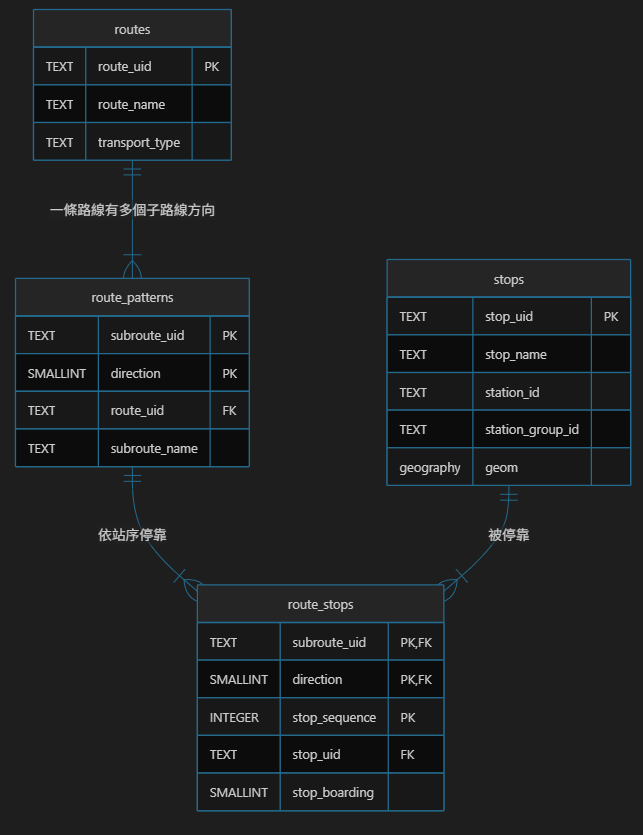

# 2026-10-28 ER 圖與 AI 交通工具調查

## 今日目標

- [x] 依學長建議，畫資料庫 ER 圖
- [x] 依學長建議，調查是否有 AI 工具做類似功能
- [x] 實測台灣可用的地圖 App AI 功能
- [ ] JOIN 查詢：找出經過附近站牌的路線（移到明天）

## 1. 資料庫 ER 圖

整理在 [design/database.md](../design/database.md)，包含 ER 圖、欄位說明、各表筆數與設計重點。

## 2. 調查：有沒有 AI 工具做類似的功能

**問題**：通用 AI（ChatGPT、Gemini、Claude）之外，交通 App 或政府單位是否已有 AI 工具能回答「從這裡不換車能到哪裡」？

**行動**：搜尋中英文新聞、各 App 官方公告、GitHub 與 MCP 目錄、arXiv。

**結果**：

| 類別 | 工具 | 做什麼 | 能否回答「從這裡能直達哪裡」 |
| --- | --- | --- | --- |
| 地圖 App 的 AI | Google Maps + Gemini（台灣可用） | 詢問地點、導航中語音對話 | 否，以找地點與開車為主 |
| | Ask Maps（台灣未開放） | 對話式規劃行程、找地點 | 否，需先知道目的地 |
| | Citymapper 專屬推薦（台灣可用） | AI 推薦 A 到 B 路線並摘要優缺點 | 否，需先給終點 |
| 台灣政府 | 雙北 AI 公車站長（2026/7 正式上線） | 在站牌掃 QR Code，以口語詢問路線、到站時間、票價 | 待實測 |
| 開發者工具 | Maps Grounding Lite（Google）、`thsrc_mcp` 等 MCP server | 讓 LLM 查地點、路線距離、高鐵時刻 | 否，Google 的路線工具只支援開車與步行，沒有公車站序 |
| 學術研究 | TransitGPT（arXiv 2024） | LLM 寫程式查詢 GTFS 交通資料 | 架構參考，非產品 |
| 非 AI | Direkt Bahn Guru | 地圖標出歐洲火車站的所有直達目的地 | 是，但只有城際火車 |
| | 蜘蛛圖（spider map） | 公車亭張貼的「從這一區出發，各路線往哪裡」示意圖 | 是，但人工繪製、只有大站才有 |

**結論**：沒有找到能從任意地點列出所有直達目的地的 AI 工具。功能最接近的是非 AI 的 Direkt Bahn Guru 與蜘蛛圖，兩者證明「從這裡能直達哪裡」的需求確實存在。

## 3. 實測台灣可用的 AI 功能

詳細結果見[基準實驗的補充測試](../experiments/llm-baseline.md#補充測試google-maps)。

| 工具 | 測試題 | 結果 |
| --- | --- | --- |
| Google Maps 搜尋框 | Q1 | 簡化問法 6/6 站；原 Q1 問法只對 1 站 |
| Google Maps 導航中的 Gemini | Q1 | 1/6 站 |
| Citymapper 附近站牌 | Q1 | 6/6 站，且直接顯示每條路線的終點方向 |
| Citymapper 專屬推薦（AI） | Q3 | 答對：606，興隆國小上車、銘傳大學下車，坐 30 站 |

**最重要的發現：Gemini 把問題改寫成一般搜尋**

導航中的 Gemini 回答時，畫面顯示的搜尋詞是「興隆路二段 公車站」：門牌號碼被丟掉，結果因此偏離起點，最近的興隆國小沒有被列出。

這和本專案的架構相同（LLM 理解問題後呼叫工具），差別在於它呼叫的是一般地點搜尋，而不是依站序、方向計算的直達查詢。**LLM 回答的品質取決於背後的工具**，這支持了提案中「路線資料一律來自後端查詢」的設計。

**另一個發現：AI 工具已能處理 A 到 B，缺的是反向問題**

Citymapper 的 AI 在給定終點時能正確找出直達路線，但必須先知道目的地。本工具不需要和它們比 A 到 B，而是補上「不給目的地，直接列出能直達的地方」（Q4）。

## 4. 學到的觀念：搜尋框算不算 AI？

Google Maps 的搜尋框內部會用機器學習判斷輸入類型、排序結果，所以不能說它「不是 AI」。和 Gemini 等生成式 AI 的差別在**輸出形式**：

| | 搜尋框 | 生成式 AI |
| --- | --- | --- |
| 輸出 | 排序後的地點清單 | 針對問題生成的回答 |
| 「有哪些公車經過」 | 不回答，只換一批地點 | 會試著回答 |

實驗紀錄中因此以「是否生成回答」區分，用「地點搜尋」描述搜尋框。

## 5. 驗收標準第 2 點的具體測法

提案中「直達計算」的驗收方式是「3 個測試地點各抽查 5 條路線，與 Bus+ 站序比對」。具體做法：

- 抽查單位是「路線＋方向」，並刻意包含：去程與返程、附近多站共用的路線、只有單一方向的子路線、上車站在路線後段的路線。
- 每筆檢查上車站（300 m 內最近的一站）、方向、下游站清單、站數、同路線同方向是否重複。

學長已確認驗收標準，提案第 2 點已改為上述測法。

## 明日計畫

- 到興隆國小站實測雙北 AI 公車站長
- 更新提案的競品比較表
- JOIN 查詢：找出經過附近站牌的路線，與 Citymapper 列出的興隆國小路線比對
