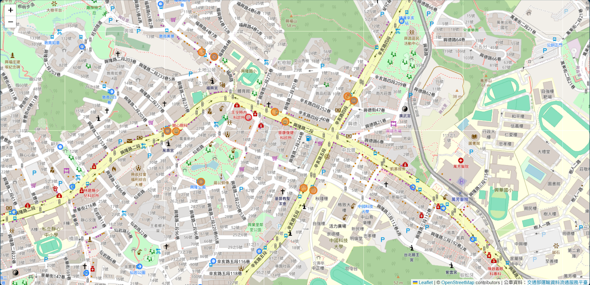
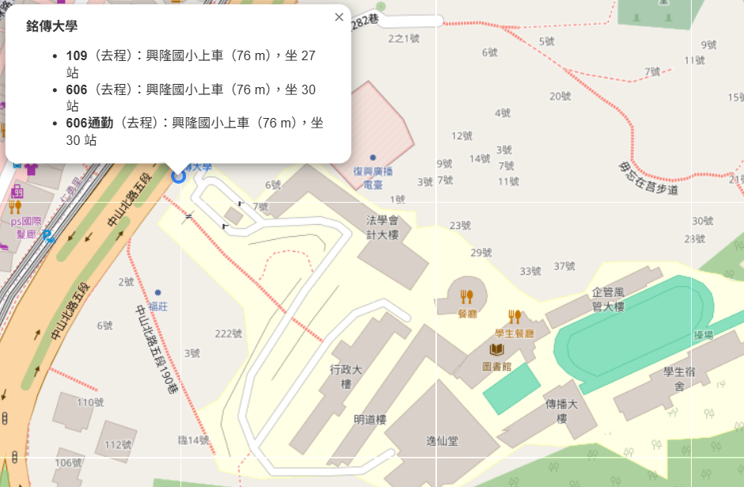
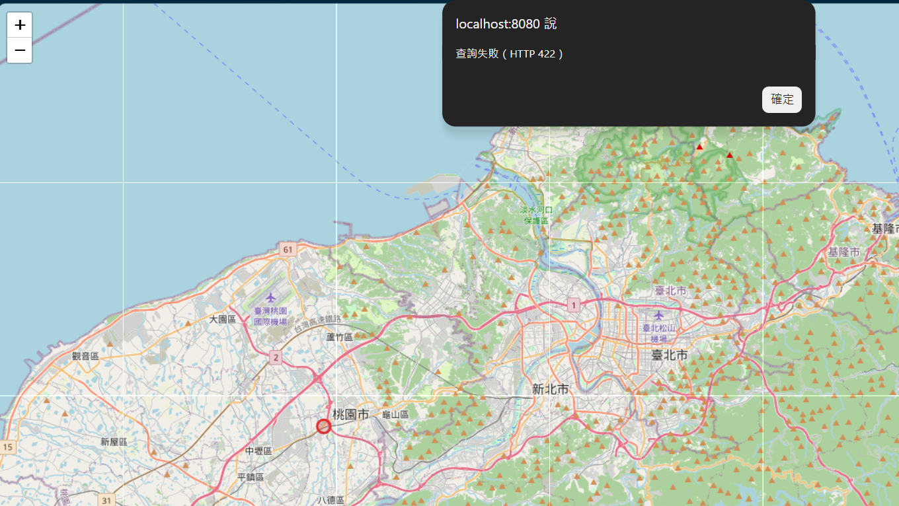
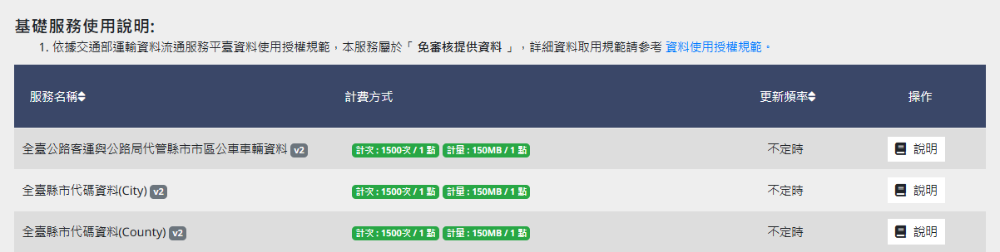
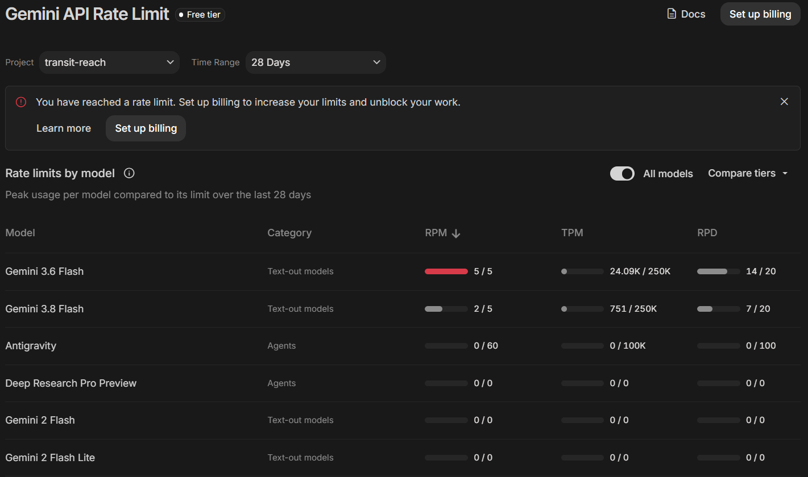
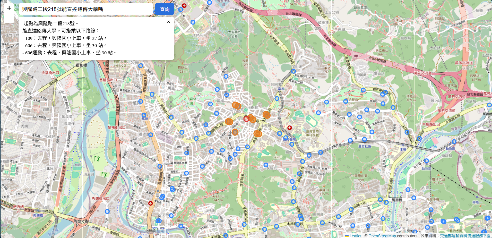
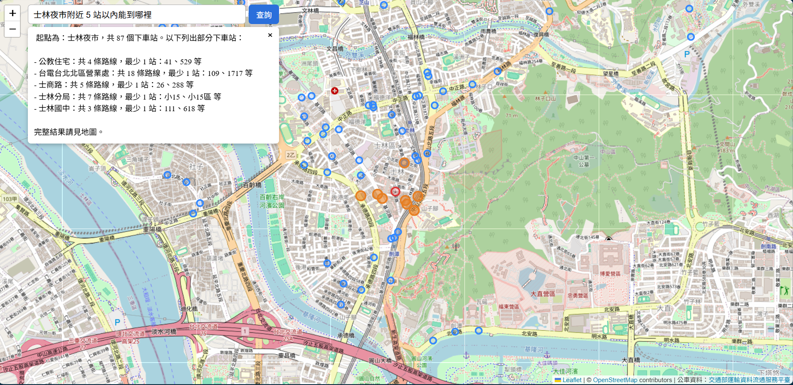
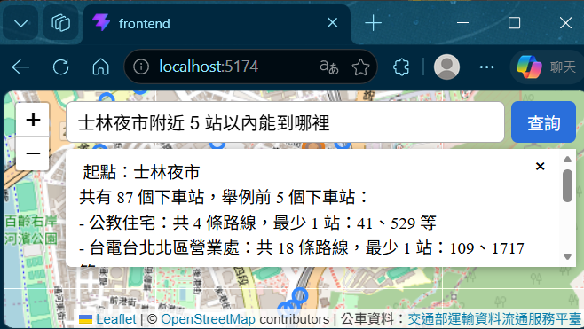
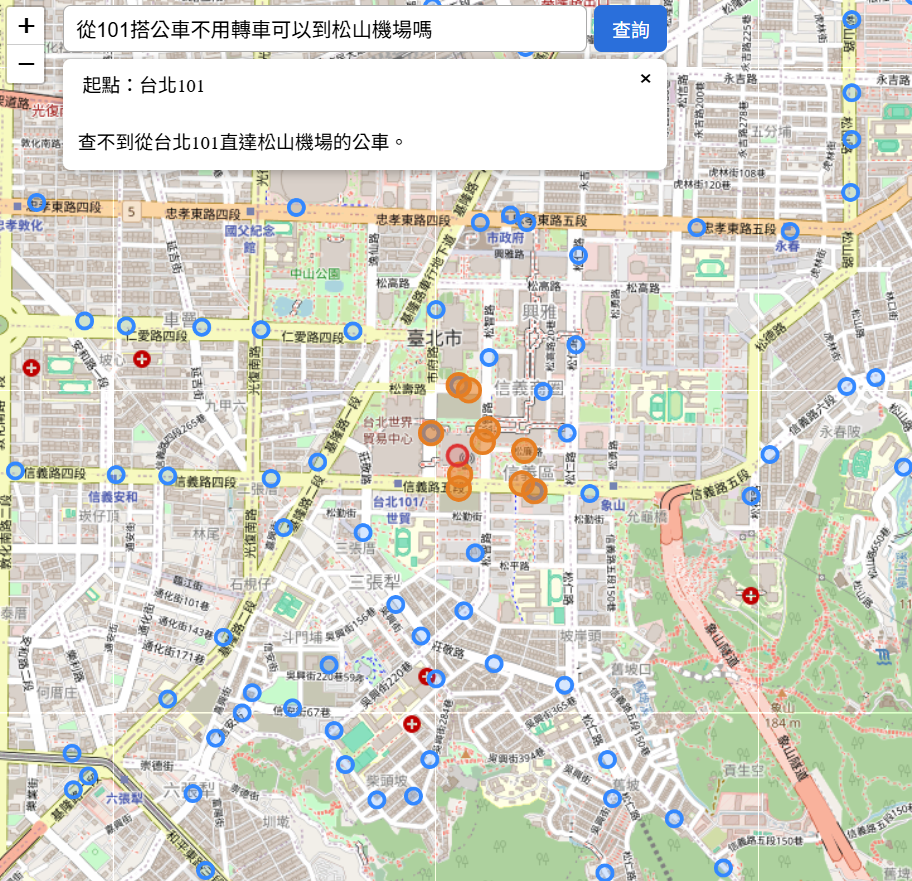
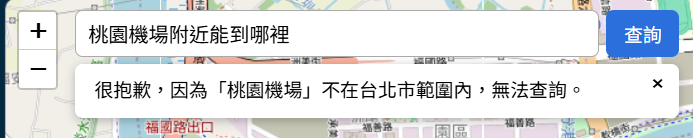

# 2026-11-02 Docker 整合測試與自然語言查詢

## 今日目標

- [x] Docker 整合測試：填好 `.env` 後一行指令啟動資料庫、匯入、後端、前端
- [x] 確認 TDX 資料的授權條款：能不能放進 git、要怎麼標示出處
- [x] LLM function calling：`POST /ask`，用一句話查詢
- [x] 前端搜尋框
- [ ] 匯入捷運站序、下車站對應到地標（移到明天）

## 1. Docker 整合測試

**問題**：前後端分在不同 repo，整合用的 compose 檔要放哪裡？資料庫建好之後，還要先匯入資料，API 才能用。

**參考**：Docker Compose 文件（`depends_on` 的 `condition`、`healthcheck`）、nginx `proxy_pass`、uv 官方 Docker 映像檔。

**行動**：

- 每個 repo 只放自己的 `Dockerfile`；整合用的 `compose.yaml` 放在新的 `transit-reach/deploy` repo。這樣 backend 和 frontend 互不知道對方。
- 四個服務依序啟動：

  | 服務 | 做什麼 | 什麼時候啟動 |
  | --- | --- | --- |
  | `db` | PostgreSQL + PostGIS，schema 沿用 backend 的 `db/init/` | 一開始 |
  | `import` | 匯入 TDX 資料，做完就結束 | `db` 健康檢查通過（`service_healthy`） |
  | `api` | FastAPI | `import` 成功結束（`service_completed_successfully`） |
  | `web` | nginx 提供前端打包好的靜態檔，`/api/` 轉給 `api` | `api` 啟動後 |

- 前端用兩階段建置：Node.js 映像檔執行 `npm run build`，再把 `dist/` 複製到 nginx 映像檔。最後的映像檔裡沒有 Node.js 和 `node_modules`。
- nginx 的 `proxy_pass http://api:8000/;` 結尾有 `/`，會去掉 `/api` 前綴再轉發，作用和開發時的 Vite proxy 一樣，所以前端程式不用改。

**結果**：從 GitHub 重新 clone 三個 repo，填好 `.env` 後執行 `docker compose up -d --build`，一行指令就能全部啟動。

| 驗證項目 | 結果 |
| --- | --- |
| `docker compose ps -a` | `import` 為 Exited (0)，其他為 Up |
| 附近上車站／下車站 | 11 個站位、375 個下車站，和開發環境一致 |
| 銘傳大學 | 109（27 站）、606、606通勤（30 站），都是去程 |
| 點台北市外 | 後端回 422，畫面顯示查詢失敗 |







## 2. TDX 資料的授權

**問題**：要讓別人 clone 下來一行指令就能跑，原始資料最好放進 git，否則每個人都要自己申請 TDX 金鑰再下載。可以這樣做嗎？

**參考**：TDX 資料授權利用條款（https://tdx.transportdata.tw/term）、TDX 基礎服務頁的資料分類。

**行動**：

- 公車站序屬於基礎服務的「免審核提供資料」。條款第四條允許重製、散布，所以 2026-10-27 取得的原始資料放進 backend 的 `data/raw/`。
- 條款第五條：公開展示時必須標示資料來源「交通部運輸資料流通服務平臺」，否則**視為自始未取得授權**。所以地圖右下角加上出處，backend 的 README 也寫明來源、條款連結與取得日期。



**結果**：整合測試不需要 TDX 金鑰；固定使用同一份資料，驗證數字可以重現。

## 3. 自然語言查詢：LLM function calling

**問題**：使用者想直接問「從興隆路二段 218 號能不能直達銘傳大學」，而不是自己在地圖上找到這個點再點。但通用 AI 會自己編路線（見基準實驗），要怎麼讓 LLM 只負責理解問題？

**參考**：Gemini API 的 function calling 文件、OpenStreetMap Nominatim 的搜尋 API 與使用規範。

**行動**：

- 分工：LLM 只負責理解問題和寫回答；座標、路線、數量都由程式提供。

  | 工作 | 誰做 |
  | --- | --- |
  | 從問題找出起點、站數條件 | LLM（Gemini） |
  | 地址、地標 → 經緯度 | Nominatim（OpenStreetMap） |
  | 是否在台北市範圍內 | 程式 |
  | 附近站牌、直達路線 | 資料庫（`/reach` 的查詢） |
  | 路線數、最少站數 | 程式算好再交給 LLM |
  | 用中文寫出回答 | LLM |

- 流程：一題呼叫 Gemini 2 次。

  ```mermaid
  sequenceDiagram
      participant F as 前端
      participant B as 後端
      participant G as Gemini
      participant N as Nominatim
      participant D as 資料庫

      F->>B: 問題
      B->>G: 第 1 次：問題＋工具說明
      G-->>B: 呼叫 reach（起點、站數條件）
      B->>N: 地址或地標
      N-->>B: 經緯度
      Note over B: 檢查是否在台北市範圍內
      B->>D: 直達查詢
      D-->>B: 附近站牌、下車站
      B->>G: 第 2 次：精簡結果
      G-->>B: 中文回答
      B-->>F: 回答＋完整結果（畫地圖）
  ```

- 給 LLM 的是精簡版（拿掉經緯度、`station_id`），約 3 萬字；給前端畫地圖的是完整版，約 13 萬字。
- 免費額度不夠用：`gemini-3.5-flash` 每分鐘 5 次、每天 20 次，測不到一個小時就用完了。

  

  - 原本把「查經緯度」和「查直達」做成兩個工具，一題要呼叫 Gemini 3 次。改成一個工具，由後端接著做完，一題降為 2 次。
  - 預設改用 `gemini-3.5-flash-lite`：每分鐘 15 次、每天 500 次，約 3 秒回答。保留 `.env` 的 `GEMINI_MODEL`，可以換回 Flash。
- 每次呼叫 Gemini 最多等 60 秒；最多來回 5 輪，用完就回固定的「查詢失敗」訊息。曾遇過伺服器忙碌、一直沒有回應的情況。

**結果**：

| 問題 | 結果 |
| --- | --- |
| 從興隆路二段218號搭公車，不換車能到銘傳大學嗎？ | 109（27 站）、606、606通勤（30 站），都是去程，約 3 秒 |
| 興隆路二段218號附近 10 站以內能到哪裡 | 120 個下車站 |
| 士林夜市附近 5 站以內能到哪裡 | 87 個下車站 |
| 台北車站 8 站內能到哪 | 199 個下車站 |
| 我住在羅斯福路四段1號，坐公車可以直接到哪？ | 起點在公館，628 個下車站 |
| 從101搭公車不用轉車可以到松山機場嗎 | 查不到。另外直接查資料庫確認：101 的 453 個下車站裡確實沒有松山機場 |
| 桃園機場、新竹火車站 | 回答不在台北市範圍內 |

## 4. 前端搜尋框

**問題**：查詢結果要同時顯示在文字和地圖上；LLM 的回答可能很長。

**參考**：Vue 的 `v-model`、`@submit.prevent`、文字插值 `{{ }}` 與 `v-html` 的差別。

**行動**：

- 地圖左上方加搜尋框，送出後呼叫 `/api/ask`。有結果就把地圖移到起點，用和點地圖相同的函式畫出紅、橘、藍點。
- 回答用純文字顯示，不用 `v-html`：LLM 的輸出不能當成 HTML 執行，否則回答裡夾帶的 `` 會變成可執行的程式（XSS）。
- 回答面板最多佔畫面高度的 40%，超過就捲動。
- 順便修正：點地圖查詢失敗時，原本仍會畫出紅點，現在改成不畫。
- deploy 的 compose 把 `GEMINI_API_KEY`、`GEMINI_MODEL` 傳給 api，Docker 版也能用搜尋框。

**結果**：開發模式和 Docker 版（8080）都測過。手機寬度時，搜尋框不會擋住縮放按鈕。











## 最重要的發現：要算、要查的，都不能交給 LLM

**1. LLM 會數錯**

問捷運萬芳醫院站附近能到哪，Flash Lite 回答「共 13 條路線」。實際上，同名的兩個站位分別有 6 條和 9 條路線，它把兩個站合在一起又算錯。改成由程式算好每個下車站的路線數和最少站數，放在結果裡；prompt 規定直接用這兩個數字，同名站分開寫。改完後兩個站分開列出，數字正確。

**2. 錯得很像對的：Nominatim 限定範圍**

一開始用 Nominatim 的 `bounded=1`，只搜尋台北範圍內的地點。結果查「桃園機場」，找到台北市內的「桃園機場捷運台北車站」，系統就回答了一個看起來很合理的結果。改成不限定範圍，先找到真正的地點，再由程式檢查是否在台北市內，範圍外就照實回答。

**3. 地址要先拆開**

Nominatim 用整串地址查常常找不到。要拆成「路名＋門牌」，再指定城市為臺北市；而且門牌前要有空格（「興隆路二段 218號」），否則一樣查不到。現在由程式自動補空格。

**4. 「能不能到某地」目前靠 LLM 找站名**

101 有 453 個下車站，要由 LLM 在清單裡找「松山機場」。這次答對了，但清單很長時可能漏看。比較可靠的做法是加一個目的地參數，由程式比對站名，LLM 只負責轉述。

## 學到的觀念

**Gemini API 不記得上一輪**

每次呼叫都要把整段對話重送：使用者的問題、LLM 要呼叫的工具、工具的結果。做了一個實驗，把「LLM 要呼叫的工具」這一段拿掉：LLM 看不到自己剛剛呼叫過，於是一直重新呼叫同一個工具，用完 5 輪都沒有回答。

**Compose 的啟動順序**

`depends_on` 預設只等容器「開始執行」，不等它準備好。要加條件：

| 條件 | 意思 | 用在 |
| --- | --- | --- |
| `service_healthy` | 健康檢查通過 | 等資料庫可以連線 |
| `service_completed_successfully` | 執行完並以 0 結束 | 等匯入做完 |

**YAML 的合併只做一層**

`api` 用 `<<: *backend` 繼承共用設定。如果 `api` 自己再寫一個 `environment:`，會整個取代繼承來的 `environment`，而不是兩邊合併。所以 Gemini 的設定放在共用的區塊裡。

**`docker compose restart` 不會讀新的環境變數**

`restart` 只是把原本的容器關掉再打開，環境變數還是建立當時的值。改了 `.env` 之後要用 `docker compose up -d <服務>`，compose 發現設定不同，就會重建容器。

## 明日計畫

- 匯入捷運站序（格式和公車不同）
- 下車站對應到地標（TDX 觀光景點），讓「只要夜市」這類條件可以查
- 驗收 9 項（第 5 項：10 句不同說法的問題至少答對 8 句）、最終報告
