# 2026-11-03 捷運匯入、地標對應與驗收開始

## 今日目標

- [x] 匯入台北捷運站序
- [x] 方向改成顯示終點站（「往松山」），取代「去程／返程」
- [x] 下車站對應到地標，支援「只要夜市」這類條件
- [x] 前端分開顯示公車與捷運，標出附近有地標的下車站
- [x] 驗收第 9 項（Docker 從零部署）、第 1 項（搜尋定位）
- [ ] 驗收第 2～8 項（移到明天）

## 1. 匯入捷運站序

**問題**：原本只有公車資料。10/27 抓的 `StationOfLine` 有兩個問題：

- 沒有座標，無法判斷 300 m 內有哪些捷運站。
- 支線混在同一條線裡：中和新蘆線在 O21 迴龍之後接 O50 三重國小～O54 蘆洲，照 `Sequence` 排序會算出「迴龍直達三重國小」這種不存在的路線。小碧潭（G03A）、新北投（R22A）也一樣。

**參考**：TDX 捷運 API：`StationOfRoute`（依營運路線列站序）、`Station`（車站座標）、`Line`（線名）。

**行動**：

- 改用 `StationOfRoute`。它的格式和公車的 `StopOfRoute` 幾乎一樣：`RouteID` 對應子路線，`Direction` 已經分好 0／1，支線也拆開了（G-3 小碧潭、O-2 蘆洲、R-3 新北投）；兩個方向的站序都照行駛順序編號。
- 照原本的四張表放進資料庫，`direct_reach` 的 SQL 不用改：

  | 表 | 捷運的一筆 | 範例 |
  | --- | --- | --- |
  | `routes` | 一條線 | `TRTC-BL` 板南線 |
  | `route_patterns` | 一條營運路線的一個方向 | `TRTC-BL-1`，頂埔－南港展覽館 |
  | `stops` | 一個車站 | `TRTC-BL12` 台北車站 |
  | `route_stops` | 第幾站 | `TRTC-BL-1`、方向 0、第 12 站 |

- ID 都加上 `TRTC-` 前綴，不會和公車的 ID（純數字）撞在一起。
- 新增的 3 個檔案（2026-11-03 取得）放進 `data/raw/`，README 改成表格，列出每個檔案的 API 和取得日期。

**結果**：

| 驗證 | 預期 | 實際 |
| --- | --- | --- |
| 筆數 | 421 / 1,263 / 28,945 / 43,605 | 一致（加 5 條線、22 個方向、122 站、370 筆站序） |
| 測試起點（興隆路二段 218 號） | 375 個下車站，和匯入前相同 | 一致 |
| 公館 → 新店、西門、松山 | 6、5、12 站 | 一致 |
| 公館 → 小碧潭 | 不能直達（要在七張換車） | 查不到 |
| 迴龍 → 蘆洲、三重國小 | 不能直達 | 查不到 |

最後兩項證明支線是分開算的。

## 2. 方向改成顯示終點站

**問題**：捷運寫「板南線 去程」看不懂。

**行動**：在查詢最前面加一個 CTE `terminal`，用 `DISTINCT ON (subroute_uid, direction)` 搭配 `ORDER BY stop_sequence DESC`，每個子路線方向只留站序最大的一站，也就是終點站。API 多回傳 `headsign`，popup 和 LLM 的回答都改成「往○○」。

**結果**：109 往陽明山國家公園管理處、606 往保一總隊、松山新店線往松山。沒有任何一筆是空的；查詢時間從 0.05 秒增加到 0.18 秒，仍在驗收要求的 1 秒內。

## 3. 下車站對應到地標

**問題**：驗收第 4、5 項要能顯示「可直達的地標」，也要能篩選「只要夜市」。原本打算用 TDX 的觀光景點 API，但 `/v2/Tourism/ScenicSpot/{City}` 回傳 404。另一份 TDX 套件（NYCU_TDX）用的也是同一個路徑，換成 v3 或其他 base URL 也都 404。

**行動**：

- 自己整理 48 個地標，分 5 類：夜市 12、大學 11、醫院 8、景點 12、交通 5。座標用 Nominatim 查，每筆都保留 Nominatim 回傳的完整地名，方便人工檢查。
- 人工檢查後，發現 Nominatim 查錯的例子：

  | 查詢 | Nominatim 找到 | 範圍檢查擋得住嗎 |
  | --- | --- | --- |
  | 國立國父紀念館 | 新北市永和的國父紀念館 | 擋不住（在範圍內） |
  | 長庚醫院 | 桃園龜山的林口長庚 | 擋不住 |
  | 動物園正門 | 大安動物醫院 | 擋不住 |
  | 國立臺灣大學 正門 | 基隆的海洋大學 | 擋得住 |

  名稱查不準的改寫法（例如「國父紀念館 信義區」）。
- 動物園、松山機場、台大三個佔地大的地標，Nominatim 給的是區域中心，300 m 內沒有任何站牌（動物園中心離最近的站 611 m），所以改查大門或航廈的門牌。
- 地標對下車站的距離定為 **500 m**，比上車站的 300 m 寬。原因是地標是一整塊區域、座標只是中心：士林夜市的中心離劍潭站 460 m，用 300 m 會漏掉「搭淡水信義線到劍潭」。改之前先量過影響：

  | | 300 m | 500 m |
  | --- | --- | --- |
  | 測試起點：附近有地標的下車站 | 46 | 114 |
  | 台北 101 → 士林夜市 | 只有 612 | 多了淡水信義線（劍潭）、通勤27 |

  範圍放寬後配對變多，所以每個地標都附上步行距離，讓使用者和 LLM 分得出遠近。

**結果**：`/reach` 的每個下車站多一個 `landmarks` 欄位（名稱、類別、距離）；從測試起點能到 30 個地標。銘傳大學站附近是「銘傳大學 15 m、士林夜市 217 m」，和 Q3 的正確答案一致（到士林夜市是在銘傳大學下車）。

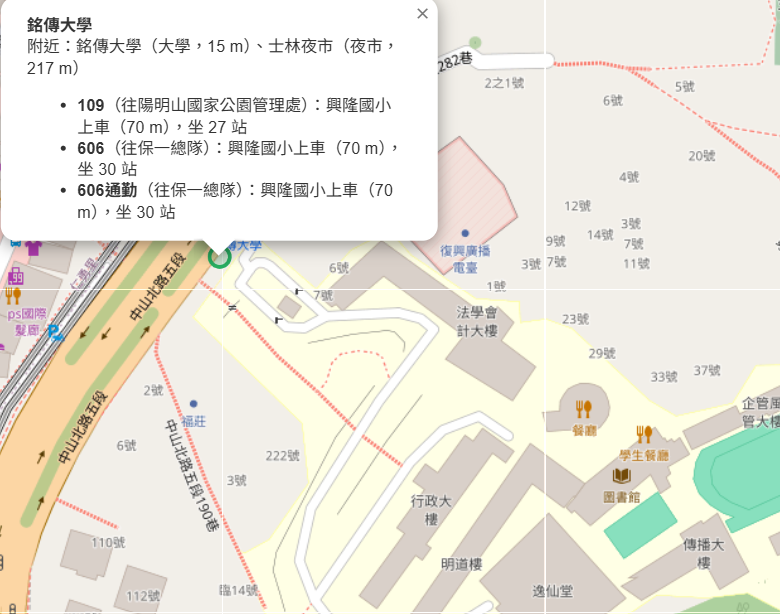

## 4. 自然語言查詢的改進

**問題**：加上地標之後，實測發現幾個問題：

- 問「能不能到士林夜市」時，LLM 沒有地方填目的地，就順手填了 `category: 大學` 或 `place: 士林夜市`。如果目的地不在地標清單裡，答案會被篩掉。
- prompt 要求「同一個地標先列距離近的」，Flash Lite 還是把 460 m 排在第一個。
- 只輸入地址時，回答列的是坐 1 站就到的普通站牌，而不是能到的地標。
- 回答出現 `###`（LLM 用了 Markdown 標題，但畫面是純文字）。
- Gemini 回 503（模型忙碌）時，程式沒有處理，前端只看到 HTTP 500。

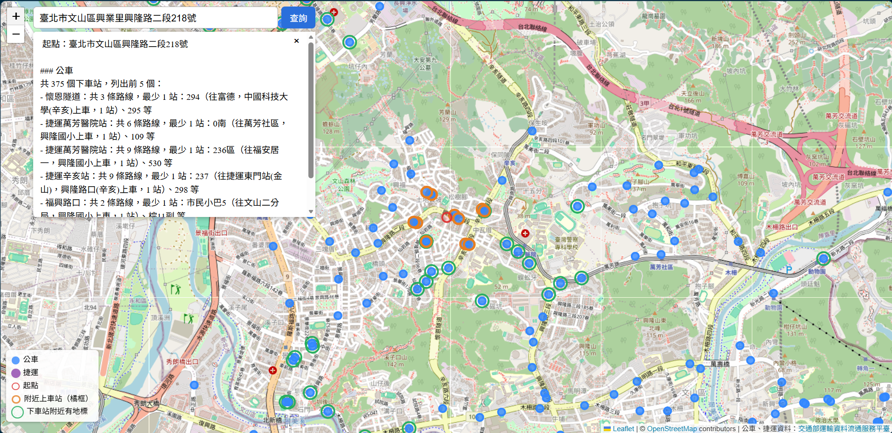

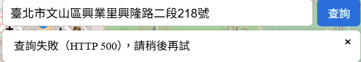

**行動**：原則是**能由程式做的，就不交給 LLM**。

- `reach` 工具加 `destination` 參數；有目的地時程式直接忽略 `category`。目的地的比對由程式做（「台」「臺」視為相同）。
- 結果先由程式分組、排好順序（地點 → 下車站，依步行距離），LLM 只要照順序寫。
- 區分三種情況：資料裡沒有這個名稱（`destination_known`）、目的地就在起點附近（`destination_walk_m`，回答「走路約 62 公尺」）、真的不能直達。
- 只給地址時，程式整理 `landmark_summary`：每個地標取站數最少的下車站，依類別分組。
- 捷運、公車的路線分開給，回答也分「捷運：」「公車：」兩段；prompt 規定不能用 Markdown 符號，前端也會去掉行首的 `#`。
- 遇到 503、429 時等 2 秒、4 秒各重試一次，還是失敗就回傳「AI 服務目前忙碌」的文字，不再變成 500。

**結果**：

| 問題 | LLM 填的參數 | 結果 | 秒數 |
| --- | --- | --- | --- |
| 從台北101搭車不用轉車可以到士林夜市嗎？ | place、destination | 捷運：淡水信義線到劍潭（12 站，走 460 m）；公車：612、通勤27 | 3～6 |
| 從興隆路二段218號搭公車，不換車能到銘傳大學嗎？ | street、destination | 109（27 站）、606／606通勤（30 站），每條都寫出來 | 3 |
| 我在興隆路二段218號，可以直接搭車到興隆國小嗎？ | street、destination | 就在附近，走路約 62 公尺 | 2.6 |
| 興隆路二段218號附近，不換車能到哪些夜市？ | street、category | 景美、臨江街、公館、師大、南機場… | 4～9 |
| 臺北市文山區興業里興隆路二段218號 | street | 依類別列出夜市、大學、景點、醫院 | 6.7 |
| 從101搭公車…到松山機場 | — | 不能直達（和資料庫一致） | — |

同一題的回應時間在 3 秒到 38 秒之間波動，下午也遇到好幾次 503，都是 Gemini 端的狀況。驗收第 7 項（10 秒內）要多量幾次，並照實記錄。

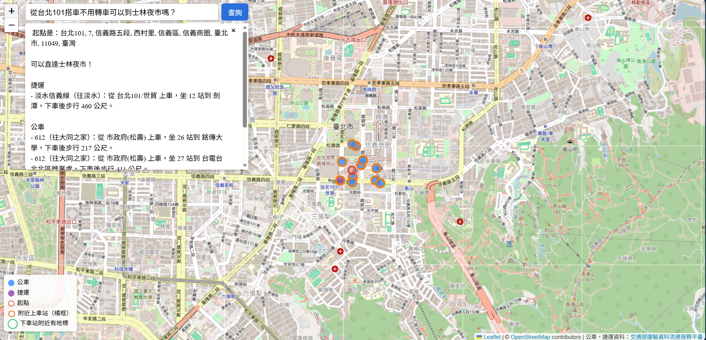

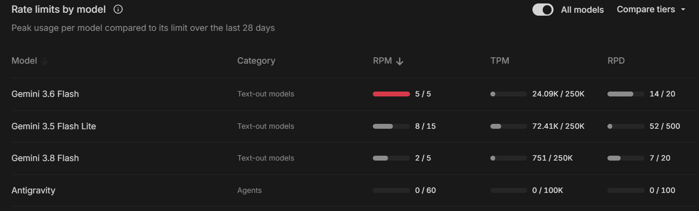

## 5. 前端：分開公車與捷運、標出地標

**問題**：實測時，捷運和公車的下車站都是藍點，看不出差別；附近上車站也一律是橘點。第一版用「綠框」表示有地標，結果蓋過填色，紫色和藍色分不出來。

**行動**：

- 填色表示種類：公車藍、捷運紫（上車站和下車站都一樣）。附近上車站是橘色粗框。
- 附近有地標的下車站，在圓點外面多畫一圈綠環，中間留空隙，不蓋住填色。
- Canvas 是後畫的蓋在先畫的上面，所以分三輪畫：綠環 → 公車 → 捷運（捷運畫大一點）。地圖縮小時，捷運站也不會被蓋住。
- 左下角加圖例，右下角的出處改成「公車、捷運資料」。

**結果**：

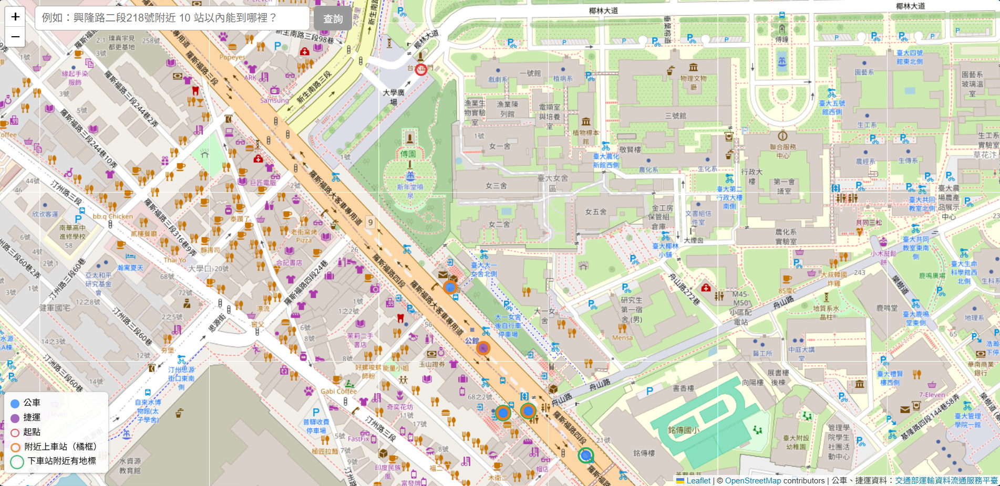

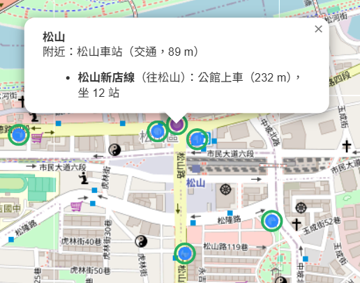

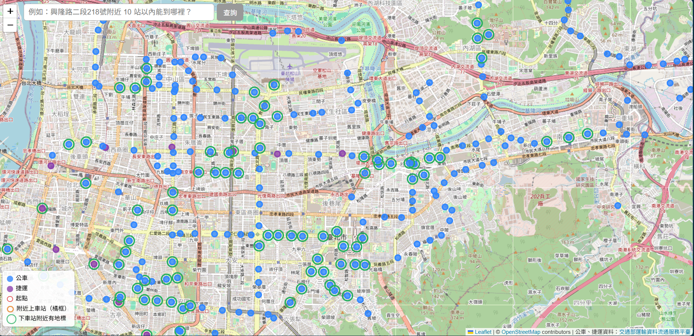

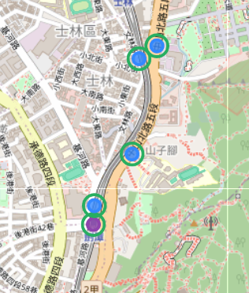

**已知限制**：TDX 每個捷運站只有一個座標。在公館站附近點了一個離 TDX 座標 334 m 的位置，捷運就沒有被算進上車站，雖然實際上離出口很近。

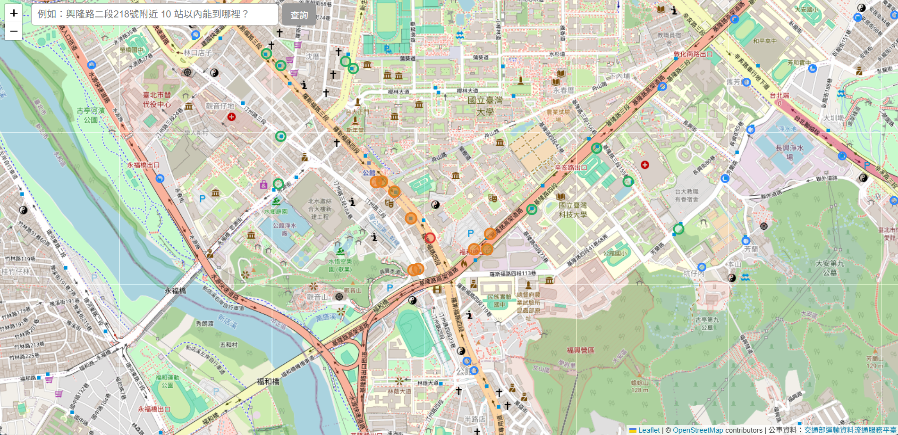

## 6. 驗收開始：第 9 項、第 1 項

結果與所有截圖記在 [acceptance/2026-11-03.md](../acceptance/2026-11-03.md)，這裡只寫重點。

### 第 9 項 可部署性：通過（修正 nginx 逾時後）

**行動**：在空資料夾重新 clone backend、frontend、deploy，複製 `.env`，刪掉 11/2 留下的資料庫 volume（否則會沿用舊的 schema，不算從零開始），執行 `docker compose up -d --build`。

**結果**：約 20 秒啟動完成，匯入筆數 421 / 1,263 / 28,945 / 43,605 / 地標 48 都一致；`/reach` 0.23～0.35 秒，數字和開發模式相同。

**問題**：搜尋框在 Docker 版回 504，剛好 60 秒。nginx 的 `proxy_read_timeout` 預設 60 秒，而 Gemini 當時很慢（直接打 api 要 28 秒）；開發模式的 Vite proxy 沒有這個限制，所以之前沒遇到。

**行動**：`nginx.conf` 加 `proxy_read_timeout 180s`，重建後回 200。

**Gemini 為什麼慢**：只回一個字的請求也要 15～18 秒，幾分鐘後又變 1.2 秒；log 沒有 429 重試紀錄，所以不是額度用完被拒絕，是服務端的延遲波動。Google 開發者論壇也有人回報美西早上（台灣深夜）Flash-Lite 延遲變成平常的三倍以上。

### 第 1 項 搜尋定位：通過（範圍內 13/13）

**問題**：3 個地點和 Bus+「探索附近」比，台北 101、羅斯福路四段 1 號的距離差很多。原因是兩邊對同一個地址的定位點不同，直接比沒有意義。

**行動**：用 Bus+ 截圖上每個站名的距離反推 Bus+ 的定位點（每 5 m 試一個點，找距離誤差最小的），再在那個點跑我們的附近站查詢。三個地點反推的誤差都在 2 m 以內；羅斯福路四段 1 號反推的點在台大校史館附近，和 Bus+ 地圖上紅旗的位置一致，可以佐證這個方法。

**結果**：

| 地點 | Bus+ 與 Nominatim 定位相差 | 300 m 內站名（我們／Bus+） |
| --- | --- | --- |
| 興隆路二段 218 號 | 7 m | 6／6，距離差 ≤ 3 m |
| 台北 101 | 36 m | 6／7，缺台北君悅酒店 |
| 羅斯福路四段 1 號（台大） | 300 m | 1／1 |

台北君悅酒店只停 1960（往桃園機場），是公路客運，TDX `City/Taipei` 的資料裡沒有，屬於範圍外。

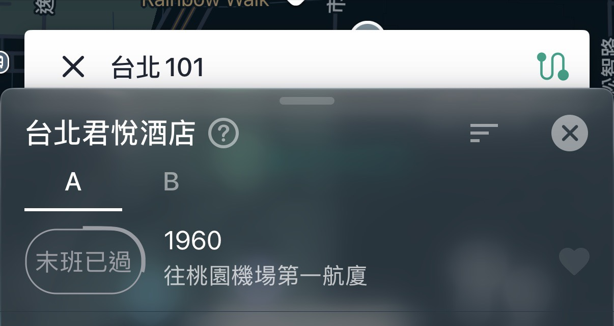

羅斯福路四段 1 號是台大的地址，Bus+ 定位在校史館，Nominatim 定位在公館一側，兩個都在校區內，附近站牌完全不同。另外觀察到同一個查詢，Nominatim 前後兩次給了相差約 126 m 的點，原因還沒確認，繼續觀察。

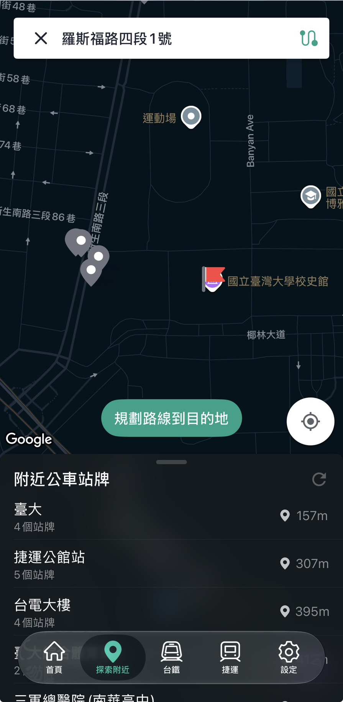

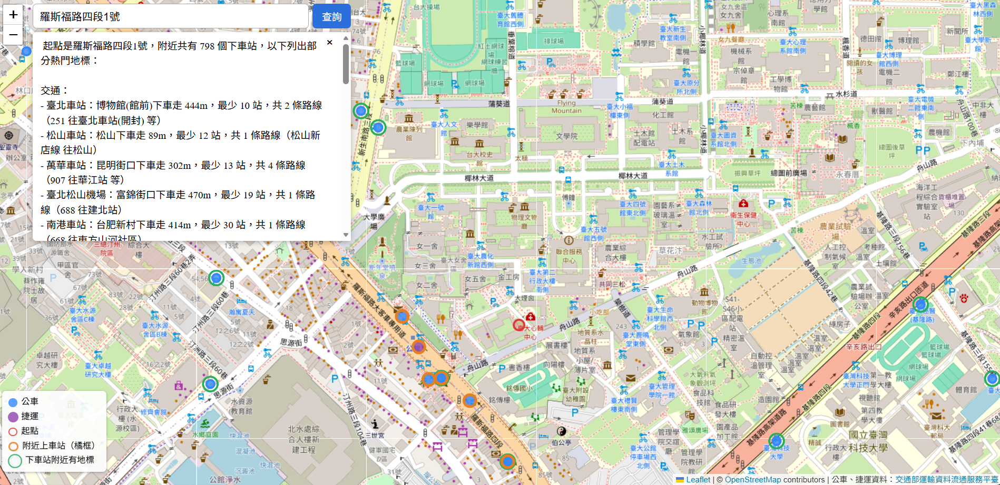

### 驗收中發現的 bug：起點附近沒有站牌時，LLM 回答錯誤

**問題**：搜尋「國立臺灣大學」，Nominatim 定位在校區中央，300 m 內沒有站牌。地圖正確顯示「附近 300 m 沒有站牌」，回答卻是「走路約 0 公尺就到」；改搜「國立台灣大學」則回答「查不到這個地點」。

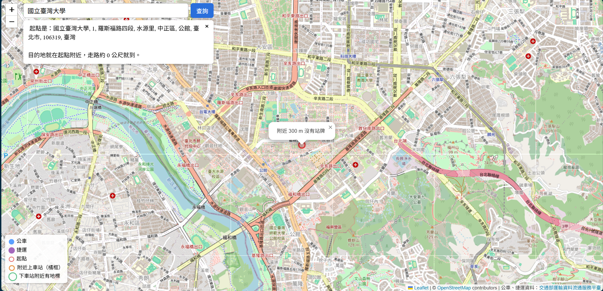

**原因**：重跑兩題看 LLM 填的參數，後端給 LLM 的結果兩題相同，台／臺不是原因。prompt 沒有規定「定位成功但附近沒有站牌」怎麼回答，LLM 就套用其他規則；「走路 0 公尺」用到的欄位根本不在結果裡，屬於捏造。

**行動**：這種情況由程式直接回固定答案（起點地名＋改用門牌或大門的建議），不再呼叫第 2 次 Gemini。

**結果**：兩種寫法都回固定答案（1.4～3.6 秒），原本的銘傳大學題目仍正確。

## 最重要的發現

**排序、篩選、計數交給程式，LLM 只負責理解問題和寫回答。** 今天 LLM 出錯的地方（排序錯誤、多填 `category`、把目的地填進起點），都是在程式能確定答案的地方讓 LLM 自己判斷。改成由程式先排好、篩好之後，回答就穩定了，給 LLM 的資料也變少。這延續了提案「路線資料只來自資料庫」的原則。

**用一個點代表一塊區域，是今天大部分距離問題的根源。** 捷運站（公館站出口離座標 334 m）、夜市（士林夜市中心離劍潭站 460 m）、動物園（中心離最近的站 611 m）都是同一類問題。今天的做法是改用大門的位置，以及把地標的距離放寬到 500 m；更好的做法是用出口座標或區域範圍，列為之後的改進。

**驗收時，系統的結果取決於 geocode 的定位點。** 大範圍的地址（校園、公園、機場）在不同服務可能差到幾百公尺，附近站牌就完全不同。和外部工具比對前，要先確認兩邊用的是同一個點。

**LLM 遇到 prompt 沒有規定的情況，會套用其他規則，甚至捏造。** 結論能由程式確定的（附近沒有站牌、不在範圍內），就直接由程式回答。

## 學到的觀念

- **`DISTINCT ON` 留哪一列，由 `ORDER BY` 決定**：同一個寫法，`stop_sequence DESC` 取終點站，照距離排序取最近的上車站。
- **Python 的 dict 和 list 合併**：dict 用 `|=`（key 相同會被覆蓋，所以 ID 加前綴避免撞到），list 用 `+=`（直接串接）。
- **Canvas 的畫圖順序**：後畫的蓋在先畫的上面。要讓少數重要的點（捷運）不被蓋住，就最後畫。
- **nginx 反向代理預設只等 60 秒**（`proxy_read_timeout`），超過就回 504；後端可能很慢時要調高。開發用的 Vite proxy 沒有這個限制，所以只在 Docker 版出現。
- **「慢」和「被限流」要分開看**：額度用完會回 429，看 log 有沒有重試紀錄就能分辨；送一個極短的請求量時間，可以排除是自己送的資料太多。
- **地理編碼的結果一定要人工看完整地名**：「在範圍內」不代表找對了（永和國父紀念館、林口長庚都在範圍內）。

## 明日計畫

繼續驗收第 2～8 項，結果記在 `acceptance/2026-11-03.md`：第 2 項（3 個地點 × 5 組路線＋方向，和 Bus+ 站序比對）→ 第 3、5、6、7 項（LLM 相關，記錄每題的測試時間）→ 第 4、8 項（畫面截圖）。完成後寫最終報告。
