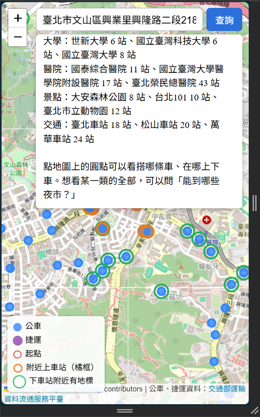
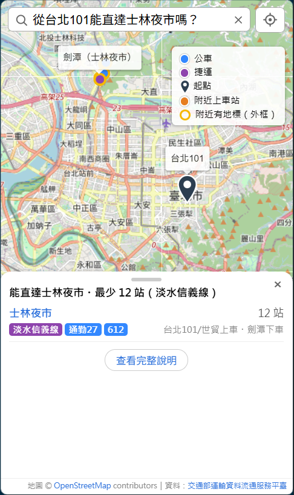
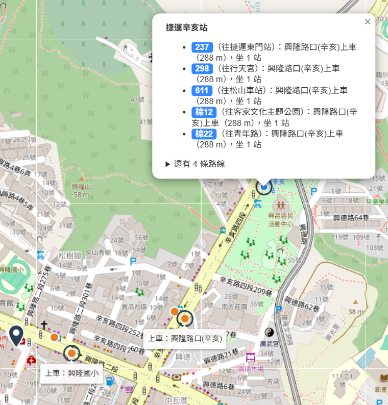
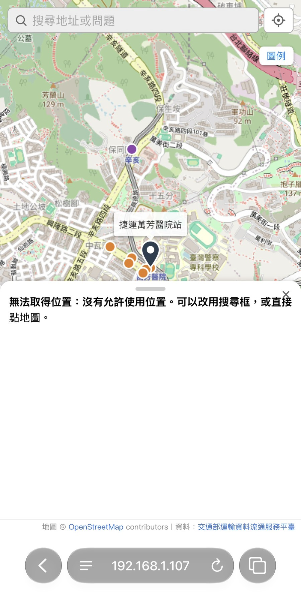
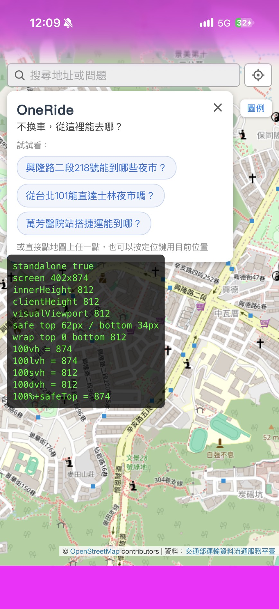
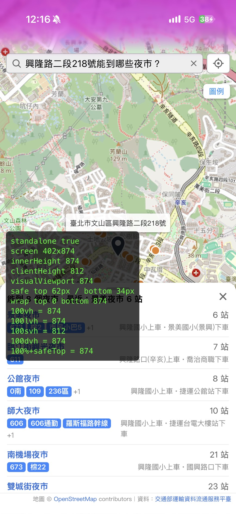

# 2026-11-04 驗收完成、OneRide 介面改版、System 1／System 2

## 今日目標

- [x] 驗收第 2～8 項（9 項全部通過）
- [x] 修正驗收發現的問題（方向名稱、LLM 寫回答出錯、定位錯誤）
- [x] 介面改版：手機優先、畫面字少（命名 OneRide）
- [x] 手機實機測試（HTTPS、加到主畫面）
- [x] 學長建議：System 1／System 2（推論題變選擇題）、耗時與 token 指標
- [ ] 步行到目的地（移到明天）
- [ ] A／B／C 完整比較實驗、最終報告（移到明天）

## 1. 驗收：9 項全部通過

詳細紀錄在 [acceptance/2026-11-03.md](../acceptance/2026-11-03.md)，所有回應存在 [acceptance/responses-2026-11-04/](../acceptance/responses-2026-11-04/)。

| # | 項目 | 結果 |
| --- | --- | --- |
| 1 | 搜尋定位 | 範圍內 13/13（11/3） |
| 2 | 直達計算 | 原始資料獨立重算 3,415 筆一致；Bus+ 抽查 15 組全對 |
| 3 | Q1～Q5 | 全部正確（改前 Q1、Q2、Q5 答不了） |
| 4 | 地標 | 清單有路線、方向、站數；點選後標出上下車站 |
| 5 | 10 句自然語言 | 第一輪 9/10，修正定位後 10/10 |
| 6 | 不捏造 | 程式產生的 15 個回答逐筆核對 141 筆，捏造 0 |
| 7 | 速度 | `/reach` 0.24～0.36 秒；`/ask` 正常時段 1.1～2.8 秒（中位數 1.9） |
| 8 | 手機 | 裝置模擬＋iPhone 實機 |
| 9 | 可部署性 | 一行指令啟動（11/3） |

改版後在 8080 再跑一輪完整測試：133 項自動檢查全部通過（網頁檔案、`/reach` 邊界、`/ask` 27 題含 9 個邊界題）。

## 2. 驗收發現的問題與修正

**問題 1：方向名稱和車頭對不上**。Q2「673 往大鵬新城」答不出來：資料的方向取站序最後一站（「往中正環河路口」），對不到業者公告的名稱。

- 參考：TDX `/v2/Bus/Route/City/Taipei` 有起站 `DepartureStopNameZh`、迄站 `DestinationStopNameZh`；去程往迄站、返程往起站。
- 行動：抓 Route 存進 `data/raw/`，`route_patterns` 加 `headsign` 欄位；捷運與環狀線（108）沒有官方名稱，照舊用最後一站。用站名檢查 579 個方向都符合規則。
- 結果：673 往大鵬新城 12 站全對；109「往陽明山」、606「往榮總」、市民小巴5「往捷運景美站」都和車頭、Bus+ 一致。

**問題 2：LLM 寫回答會出錯**。由 Gemini 根據查詢結果寫回答時：

- Q4 把下車站總數 375 寫成「52 個下車站」（結果裡 52 是某一站的站數）
- Q5 有一次把往南港展覽館的 20 站縮成「辛亥（1站）至南港展覽館（20站）」，prompt 規定不要省略也擋不住
- 超過 10 秒的題目，全都是 Gemini 寫回答的題目（要讀約 5 萬字的查詢結果）

行動：**回答全部改由程式產生，LLM 只負責理解問題、填參數**。

結果：用腳本（`scripts/verify_no_fabrication.py`）把回答裡每一筆「上車站、路線、方向、站數、下車站」對回查詢結果：

| 回答 | 逐筆核對 | 捏造 |
| --- | --- | --- |
| 改版後（程式產生），15 題 | 141 筆 | 0 |
| 改版前（Gemini 寫），36 題 | 119 筆 | 1（「52 個下車站」） |
| 故意竄改的回答 | 4 筆 | 4 個都抓到 |

**問題 3：地點找錯**。「101」被 Nominatim 找成新北市三芝區（省道里程），經緯度又在範圍方框內，答成「附近沒有站牌」。

- 行動：起點名稱先比對資料庫（捷運站、地標清單、公車站名），對不到才查 Nominatim；Nominatim 的結果地名要有「臺北市」才算範圍內。
- 結果：「101」「萬芳醫院站」「興隆國小站」都直接用資料庫座標，不再找錯。

## 3. 介面改版：OneRide

**問題**：站在使用者角度資訊過量。「能到哪裡」列 22 個地標、每行約 60 字；「哪些醫院」約 60 行，手機要滑十幾頁。popup 路線太多會撐出畫面。

| 改版前（手機，只給地址） | 改版後（手機，101→士林夜市） |
| --- | --- |
|  |  |

**參考**：地圖 App 常見的底部面板（peek／half／full 三種高度），一開始只給最重要的資訊。

**行動**：

- 分層顯示：一行摘要 → 每個地點一行（名稱、站數、路線色塊） → 完整說明。後端多回傳 `view`（摘要＋清單）、`segments`（回答裡哪段是路線、哪段是地點），前端不用自己比對文字（路線「52」不會被誤認成「52 個下車站」）。
- 每個地點只寫站數最少的一種搭法，其他路線壓成一行；目的地在 800 m 內改說「走路就到」。
- 點下車站時，同時標出這條路線的上車站和下車站（後端多回傳 `board_station_id`：同名站常有馬路兩側兩個站位）。
- 手機：點站牌顯示底部卡片；popup 超過 5 條路線先收起；鍵盤搜尋鍵送出；新手指引放三個可點的範例問題；查詢中可以按 × 中斷。
- 圓點、圖示、外框顏色都先做並排比較再選定（白框扁平、金黃外框）。

## 4. 手機實機測試

**問題**：

1. 手機連不到 VM：VS Code 轉發只開在 Windows 的 localhost。
2. 用區網 IP（http）連進來，定位一律失敗，訊息卻是「沒有允許使用位置」，看起來像手機權限問題。
3. 加到主畫面全螢幕後，底部有一條白底。

**參考**：瀏覽器只在 HTTPS 或 localhost 提供定位（secure context），http 網頁的錯誤代碼和使用者按「不允許」相同。

**行動**：

- Tailscale：VM 用 `tailscale serve` 提供 HTTPS 網址，只有登入同一帳號的裝置連得到。
- 定位前先檢查是不是安全連線，不是的話直接說明要 HTTPS。
- PWA：manifest、主畫面圖示、載入畫面，從主畫面打開是全螢幕。
- 白條不再用猜的：做一個暫時的檢測畫面，在 iPhone 上直接量各種高度。

**結果**：

| 量到的值 | 數字 |
| --- | --- |
| 螢幕高度 | 874 |
| `innerHeight`、`100%`、`100svh` | 812（少了狀態列 62） |
| `100lvh` | 874 |

全螢幕時改用 `100lvh`，地圖和面板都填滿到底。定位、加到主畫面、全螢幕在 iPhone 實測都正常。

## 5. System 1／System 2：把推論題變選擇題（學長建議）

**問題**：學長建議把 LLM 的推論題變成選擇題（System 1），並加入 AI agent 常見的指標（耗時、token）。

**行動**：

- 選擇題：工具新增必填的 `intent`（附近站牌、能不能到某地、能到哪些○○、能到哪裡、某條路線站序、只搭捷運，6 選 1），程式依 intent 決定查法。
- System 1：常見問法用規則解析（門牌地址或資料庫認得的名稱＋問題類型＋條件），有把握才接手。原本也把 LLM 解析過的同一句記起來（快取），但實驗中命中 0 次，解析錯還會被重複使用，所以拿掉了。
- System 2：規則沒把握才交給 Gemini 做選擇題。
- 每題回傳並記錄 `metrics`：走哪一層、Gemini 呼叫次數、token、各階段耗時。
- 實驗題目：今天用過的 22 題（dev），加上寫規則前另外寫的 12 題換句話說（held-out），看規則有沒有只背題目。

**結果**（C 組＝System 1＋LLM 備援，[紀錄](../experiments/system1-2026-11-04/)）：

| 題組 | 題數 | 正確 | 不用 LLM | 耗時中位數 | 每題平均 token |
| --- | --- | --- | --- | --- | --- |
| dev | 22 | 22 | 19 | 0.8 秒 | 152 |
| held-out | 12 | 12 | 9 | 0.3 秒 | 277 |
| 全部 | 34 | 34 | 28（82%） | 0.8 秒 | 196 |

交給 LLM 的 6 題：範圍外（桃園機場、新竹火車站）、和查詢無關、沒說起點，以及兩種少見說法。B 組（全部交給 LLM）、A 組（改版前的純 LLM）明天用最終版一起跑。

## 最重要的發現

**LLM 適合理解問題，不適合寫數字和清單。** 讓 LLM 根據查詢結果寫回答，會抄錯數字（375→52）、自行省略，也是慢的主因。改成 LLM 只做選擇題、回答由程式產生之後，捏造從 1 降到 0，速度從最慢 12 秒降到 3 秒內；常見問法連 LLM 都不用叫。

**外部服務的變動要照實記錄**：Gemini 同一題從 1 秒到 44 秒都量過（工具本身都在 1 秒內）；Nominatim 對同一個地址給過相差 300 m 的點。

## 學到的觀念

- **System 1／System 2**：快、便宜、規則化的處理放前面，只有不確定時才交給慢、貴的 LLM 推論；LLM 的輸出也限制成選項，結果容易驗證。
- **Secure context**：定位、加到主畫面這類功能只在 HTTPS 或 localhost 能用；區網 IP 的 http 不算。
- **iOS 全螢幕的高度**：`100%`、`innerHeight` 會少算狀態列，`100lvh` 才是整個螢幕。行動裝置的版面問題要在實機上量，模擬器看不出來。
- **先量再修**：圖磚、顏色、版面都先做比較或檢測，量到數字再改，比反覆猜測快。

## 明日計畫

1. 步行到目的地：地圖標出目的地、下車站到目的地的虛線與距離、「步行路線」按鈕（開 Google 地圖導航）。
2. 用最終版完整跑 A／B／C 比較實驗（正確率、耗時、token），發 backend PR。
3. 最終報告：9 項驗收、設計決策（LLM 只做選擇題、分層顯示、出處處理）、指標比較、限制與之後的改進。
