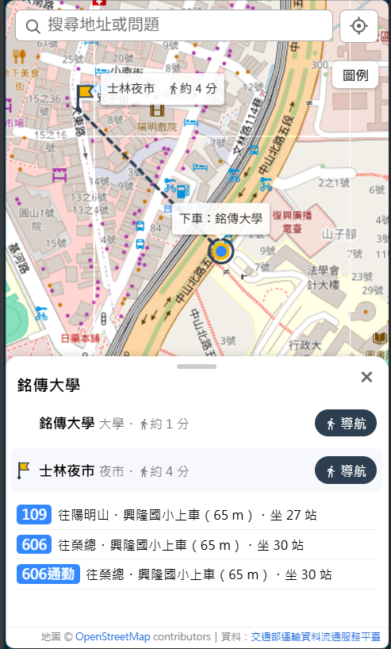
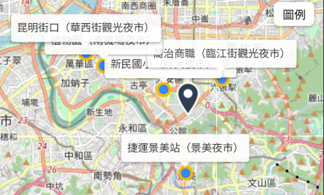
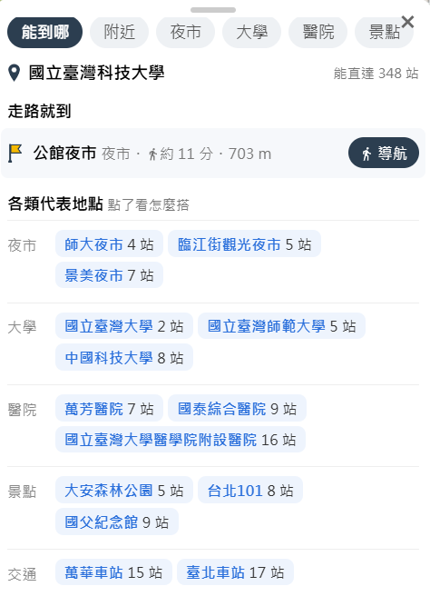
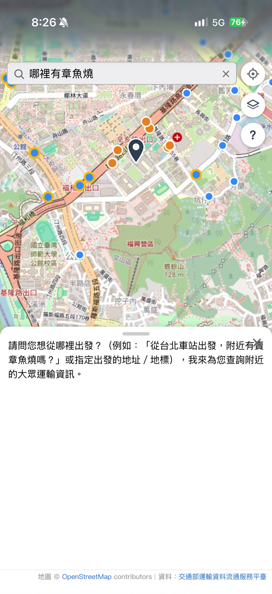
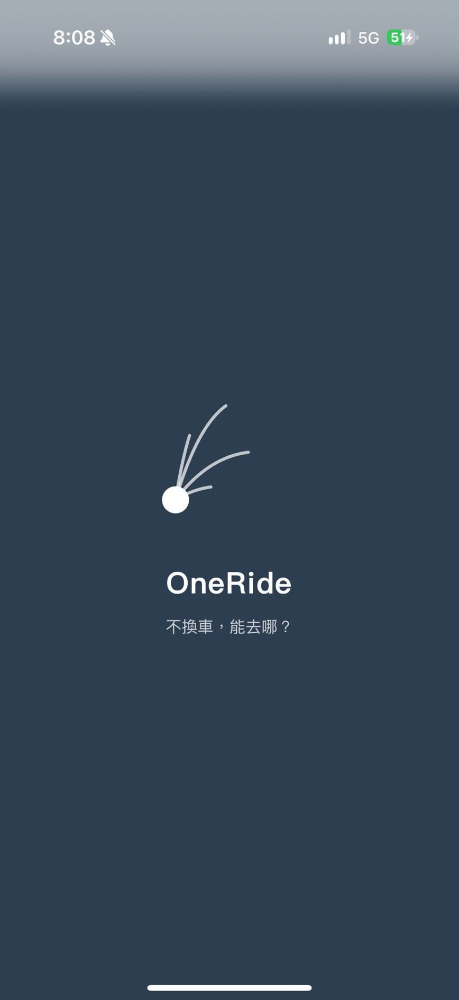

# 2026-11-05 步行到地標、互動原則與統一版型、百貨商場與電影院、部署演練與報告準備

（11/4 晚上到 11/5 晚上；第 1～8 段是 11/5 早上以前，第 9～15 段是 11/5 晚上）

## 今日目標

- [x] 步行到目的地：地標的虛線、約幾分、Google 地圖導航
- [x] 地圖：站名小字、選取時其他點變淡、飛到下車站、長按設起點
- [x] 整理互動原則，照原則修正所有入口
- [x] 統一版型：分頁、每一種搭法、附近站牌、路線站序
- [x] 看不懂、沒資料的問題由程式回答；沒說起點時沿用畫面上的起點
- [x] 搜尋框邊打字邊建議
- [x] iPhone 實機測試（Tailscale HTTPS），含晚上實測 PR #12、#13
- [x] 地標補百貨商場、電影院；問到店家時說明為什麼沒有
- [x] 回覆學長對驗收方式與範圍的問題
- [x] 第 9 項部署前，自己照 README 從零演練一次
- [x] 開發文件更新成現在的做法
- [x] A／B／C 實驗準備（冒煙測試）
- [x] 最終報告草稿與投影片初稿
- [ ] A／B／C 正式實驗（等外部題目）

## 1. 步行到地標

**問題**：知道在哪一站下車，但不知道下車後要走多遠、往哪走。

**參考**：Google 地圖的步行時間要用 Directions API（要金鑰、綁信用卡），所以不用。日本不動產廣告的換算是「徒步 1 分＝80 m」；沿馬路走通常比直線長二到四成（繞行係數）。

**行動**：

- 後端的地標多回傳座標；前端從下車站畫虛線到地標，加上小旗和「約 4 分・217 m」（直線距離 × 1.3 ÷ 80，畫面寫「約」）。
- 「導航」用座標開 Google 地圖步行導航；用名稱可能搜到別處（例如銘傳大學有桃園校區）。
- 地圖縮小時虛線只剩十幾 px，會被圓點蓋住：短於 40 px 先不畫，放大或點地標列才出現。

**結果**：

## 2. 地圖：重點清楚，不搶使用者的控制

**問題**：

1. 縮小時幾百個點疊成一團；放大後要一個個點才知道站名。
2. 點下車站後，其他站還是一樣顯眼。
3. 點一下地圖就換起點，收卡片、滑地圖時常誤觸。
4. 回答提到的地點標籤互相重疊。

**行動**：

- zoom 16 以上標站名小字：照優先順序（捷運 → 有地標 → 上車站 → 一般公車站）一個個放，會和已經放好的重疊就跳過（碰撞避讓）。回答的地點標籤也用同一套，依序試上、右、下、左四個方向。
- zoom 13 以下，一般公車站縮成小點；捷運站、有地標的站維持原本大小。
- 點下車站：其他點變淡，1.2 秒後飛到下車站附近；使用者一拖動或滾輪就取消。
- 設起點改成長按（和 Google 地圖一樣）；點一下只會收起一層，什麼都沒開時在點的位置提示要長按。
- 分類頁的地圖只畫每個地點最推薦的那一站（例如夜市頁從 42 個下車站剩 5 個）。

## 3. 互動原則與「入口 × 操作」表

**問題**：同一個功能從不同入口進來，行為不一樣。例如新手指引查完，點地圖不會收起；收起面板後，長按的提示被面板蓋住；「台科大」每次的結果都不一樣。

**行動**：先整理 8 條互動原則，再用「入口 × 操作」表逐格檢查（入口：長按、搜尋、新手指引、定位；操作：點一下、長按、點站、點清單、×、拖拉），都寫進 frontend 的 `CLAUDE.md`：

1. 結果一致：同一個輸入永遠得到同一種結果。
2. 點一下＝收起一層，長按＝設起點。
3. 提示一定看得到。
4. 卡片跟著選取走，能回到原本的結果。
5. 面板手勢一致：每一層都能拖拉，按鈕只是輔助。
6. 字少分層。
7. 不搶使用者的控制。
8. 視覺先預覽再決定；出處標示不能拿掉。

**結果**：照表修掉的不一致包括：長按、定位也出現面板和分頁（原本只有搜尋有）；長按、搜尋、定位、分頁走同一個查詢流程，新的中斷舊的，查詢有編號，只畫最後一次。

## 4. 結果一致：「台科大」每次答案不同

**問題**：「台科大」出現過四種結果：能到哪、到不了台科大、附近站牌、查不到。

**原因**：資料庫不認得簡稱，而且只有地名、沒有問題類型，所以每次都交給 Gemini 自己選。

**行動**：

- 21 個地標加上簡稱（台科大、師大、北車、榮總、通化夜市…），起點和目的地都認得。
- 只輸入地名就固定當成「能到哪」，「台科大附近」當成「附近站牌」。
- Gemini 的 temperature 設成 0。
- 面板上方加分頁（能到哪、附近、夜市、大學、醫院、景點、交通），按下去直接帶參數查，不經規則、也不經 Gemini。

**結果**：「台科大」走規則，Gemini 0 次，每次都一樣。

## 5. 統一版型

**問題**：原本的完整說明是前端把後端的文字拆開來排，拆不出「每一種搭法」；各分頁的版型也不一樣。

**行動**：

- 後端的回答多帶結構化資料：每個地點的每一種搭法、走路就到的地標座標、附近站牌依站位分開、路線站序；前端照資料排，不再拆文字。
- 每一頁都是同一個版型：分頁 → 起點 → 走路就到 → 主要內容 → 提示。
- 站數最少的搭法用綠點標出，其他先收起來；全部展開後還放得進面板，就直接展開。
- 附近站牌：同名的兩側站位合成一列，點開依站位列出路線（兩側停的路線不一樣）。
- 能到哪：類別名稱和「全部 N 個 ›」切到那一類的分頁；地圖保留全部的點（看得出能到的範圍）。
- 樣式都先做預覽頁並排比較，再選一種。

**結果**：

## 6. 看不懂、沒資料的問題

**問題**：問「哪裡有章魚燒」，Gemini 自己寫的回答舉了答不出來的例子（「附近有賣章魚燒嗎？」），也沒用畫面上已經有的起點。

**行動**：

- Gemini 多一個工具 `explain`，只選原因（沒有資料，加上問的是什麼；或和搭車無關），說明文字由程式產生。Gemini 沒呼叫工具時，也不顯示它寫的字。
- 沒說起點（「能到哪些夜市？」）時，前端把畫面上目前的起點一起送出，後端沿用，起點旁邊註明「沿用目前的起點」；沒有起點時回「從哪裡出發？」，並提供「用我的位置」，定位後接著查原本那一題。
- 長按、定位後搜尋框寫著「選的位置」，使用者會直接接著打（「選的位置能到士林夜市？」）：問題開頭是「選的位置」「這裡」這類說法時，當成沿用目前的起點。
- 問「要多久」「怎麼去」照樣查能不能到，用站數回答。

**結果**：

- 用 48 種問法測試：規則接手 35 種，逐題確認；修掉兩個答錯（「台科大能到那些夜市」答成能到哪、「去吃饒河夜市」答成查不到地點）。其他 13 種交給 Gemini，結果都合理（西門町逛夜市、台大到 101、範圍外、天氣、你好）。這 48 種做成回歸測試 `scripts/eval_phrasings.py`，改規則後跑一次。
- 已知限制：「從信義區公所能到哪」，Nominatim 找成別的地點（面板上會顯示找到的起點名稱）。

## 7. 搜尋框邊打字邊建議

**參考**：Google 地圖的搜尋框在送出之前，就讓使用者點選一個確定的地點；我們原本是送出之後才猜意思。

**行動**：新增 `GET /suggest`，比對地標（含簡稱）、捷運站、公車站名（同名但分散各地、定位不到的不列）；前端在輸入框下方列出建議，點了用那個地點查能到哪。輸入裡出現問題的字（能、到、附近、嗎…）就收起來，不干擾打完整的問句。

**結果**：「台科」→ 國立臺灣科技大學（大學・台科大）；「101」→ 台北101 排在同名公車站前面。晚上 iPhone 實測通過（第 9 段）。

## 8. iPhone 實機測試

| 問題 | 原因 | 修正 |
| --- | --- | --- |
| 第一次打開底圖全灰，滑到別處才出現 | 圖磚第一次載入失敗後，Leaflet 不會重抓 | 失敗的圖磚重試 3 次；網頁設 `no-cache`，部署後不會用到舊頁面 |
| 載入畫面上方一層淺灰的霧 | 主畫面全螢幕時，狀態列下的霧化取網頁最底層的背景色（原本是白色） | `html`、`body` 背景設成深藍灰，實機確認消失 |
| 長按、搜尋後地圖移動時，點會瞬間變大 | Leaflet 的縮放動畫是把整張 Canvas 用 CSS 放大，結束才重畫 | 程式移動地圖一律用飛的，每一格重畫；實機確認修好 |
| 按圓形按鈕閃一下藍框 | 手機瀏覽器的點擊高亮 | 關掉，按鈕改用自己的按下效果 |

另外改了右上角的按鈕：圖例改成「圖層」圖示、新手指引改成「？」，都是圓形，有面板時也不會被蓋住。載入畫面也改成動畫：一個起點依序長出好幾條弧線，到公車藍、捷運紫、地標金黃的終點，就是「不換車，能去哪？」。

**驗證**：在 Docker 版（8080）跑 135 項自動檢查，134 項通過；1 項是預期中的改變（「和查詢無關」現在會呼叫 `explain` 工具）。`/ask` 27 題，中位數 0.7 秒、最大 3.9 秒。規則測試 34 題由規則接手 29 題，答錯 0；不捏造檢查 269 筆，問題 0。

## 9. 手機實測 PR #12、#13

iPhone（Tailscale HTTPS）實測沒說起點、選的位置接著問、章魚燒、天氣、邊打字邊建議，全部通過。

## 10. 地標補百貨商場、電影院

**問題**：問「能到哪些餐廳、電影院、百貨公司、咖啡廳、便利商店」都查不到，地標只有夜市、大學、醫院、景點、交通 48 個。

**參考**：OpenStreetMap 的 Overpass API 可以用標籤查一個行政區內的地點（`amenity=cinema`、`shop=department_store`、`shop=mall`），資料授權 ODbL，標示「© OpenStreetMap contributors」即可（地圖右下角原本就有）。

**行動**：

- 依性質分兩種處理：
  - **稀少的地點**（電影院、百貨商場，台北各二、三十個）：加成新類別，「能到哪些電影院」有意義。
  - **到處都有的店**（餐廳、咖啡廳、便利商店）：幾乎每個下車站附近都有，列出來沒有幫助，也無法逐筆核對 → 不收資料，改成說明原因。
- Overpass 撈出台北市 115 筆，人工挑選：去掉超市、地下街、小店、已歇業的戲院（喜滿客西門絕色店 2024/3 熄燈），7 個不確定的據點確認都在營業後收進來。改成正式名稱、加簡稱（京站、美麗華、SOGO忠孝館…），每筆記下 OSM 物件編號。
- 規則認得「百貨公司、百貨、商場、購物中心、影城、戲院」；問到店家時規則直接回說明，不呼叫 Gemini；前端分頁加「百貨」「電影院」。

**結果**：

| 項目 | 結果 |
| --- | --- |
| 地標 | 48 → 102（百貨商場 32、電影院 22） |
| 興隆路二段218號能到哪些百貨公司？ | 規則接手，最近是遠企購物中心 6 站 |
| 台科大能到哪些咖啡廳？ | 「咖啡廳這類店到處都有，OneRide 沒有收錄…」，不呼叫 Gemini |
| 回歸測試 | `eval_phrasings.py` 56／56（新增 8 種）；`eval_modes.py rules` 29／34、答錯 0（和改之前一樣） |

## 11. 學長對驗收方式的建議

最終報告 11/16（一）15:30。學長的 5 點與處理方式：

| 學長的問題或建議 | 處理 |
| --- | --- |
| 第 9 項請誰照 README 部署？ | 11/6 請實驗室同學從 clone 開始部署（11/3 是自己重新 clone，不算「他人」） |
| AI 產生的程式哪裡改過、為什麼改 | 報告整理成對照表 |
| 第 5 項的題目是自己出的，可能和規則有同樣的盲點 | 請實驗室同學另外出題，分開計算，也放進 A／B／C 實驗 |
| 步行到目的地是必做還是延伸 | 延伸功能（不在 9 項驗收內）；報告以現場跑一次系統為主 |
| 開發文件更新成現在的做法 | 新增系統架構文件，提案文末加「實作後的調整」 |

## 12. 部署演練：照 README 從零跑一次

**問題**：明天要請同學照 README 部署，先確認 README 照著做真的跑得起來，以及別人會卡在哪裡。

**行動**：在暫存資料夾全新 clone 三個 repo、不填 Gemini 金鑰、改用 8090（不影響 8080），照 README 跑 `docker compose up -d --build`。

**結果**：數字全部一致（匯入 421／1263／28945／43605／102、11 個上車站位、375 個下車站、銘傳大學三條路線），但找到三個別人會遇到的問題：

| 問題 | 原因 | 修正 |
| --- | --- | --- |
| 沒填金鑰時，規則看不懂的問題回 HTTP 500 | 建立 Gemini client 時沒有金鑰就丟例外 | 回固定說明，常見問法照常可用（backend PR #15） |
| Apple 晶片的 Mac 可能拉不到資料庫映像檔 | `postgis/postgis:17-3.5` 只有 amd64 版 | compose 指定 `platform: linux/amd64`，用模擬執行（deploy PR #1） |
| 三個 repo 是私人的 | 對方沒有權限就 clone 不下來 | README 寫明事前要加進 `transit-reach`；改用 HTTPS clone |

README 改寫給第一次部署的人：架構與啟動順序圖、`.env` 每個欄位、沒有金鑰時哪些功能能用、常見問題、驗證數字（地標 102）。另外準備了明天的紀錄表（`acceptance/2026-11-06-item9-deploy-by-others.md`）。

## 13. 8080 完整測試與不捏造檢查

**行動**：11/4 的 `full_test.py` 複製一份（不改原本的紀錄），依現在的行為修改預期，加上新功能的檢查（`/suggest`、新類別、店家、分頁帶參數），對 8080 跑一次；存下來的回應再跑 `verify_no_fabrication.py`。

**結果**：151 項檢查失敗 3 項，逐一查原因：

| 失敗 | 原因 |
| --- | --- |
| 百貨商場 18 個（預期 17） | 預期值是補 7 個據點之前算的，18 才對 |
| 和查詢無關（天氣） | 當時 Gemini 忙碌；單獨重跑正常（1.8 秒） |
| 找不到的地點（火星基地） | Nominatim 把「火星基地」模糊比對成大安區的「星野銅鑼燒」，照這個起點查下去 |

- 火星基地：11/4 那次比對到桃園的地點、被範圍檢查擋下，**剛好通過**。決定不改程式（面板會顯示找到的起點名稱），寫進報告的限制。
- 不捏造檢查第一次報 1 個問題，查出是檢查腳本的比對規則不允許地點名稱有空白（「MUVIE CINEMAS 9 站」）；修正後 280 筆、問題 0，11/4 的回應重跑也是 219 筆、0。

## 14. 開發文件與最終報告

- `design/architecture.md`（新）：整體架構、查詢流程（System 1／System 2）、定位流程、直達查詢、LLM 的角色（提案時 vs 現在）、前端互動、三層顯示，都用流程圖表示。
- `design/database.md`：補捷運、`landmarks`、`headsign`，和公車／捷運分開的筆數。
- `proposal.md`：驗收標準等原文保留，文末加「實作後的調整」對照表。
- `report/`：報告大綱、現場展示流程（7 步，除了一步都不依賴 Gemini）與備案、改動對照表、限制。「待決定」的兩件事（同名站位分不出、走路就到的下車站仍畫在地圖上）決定不改程式，寫進限制。
- 投影片初稿 18 頁：問題 → 現場展示 → 架構與設計決策 → 驗收與實驗 → 開發方式 → 限制；A／B／C、第 5 項外部題目、第 9 項的數字先留空。

## 15. A／B／C 實驗準備

**問題**：A 組要跑改版前（`7f3305b`）的程式，和現在的程式同時存在。

**行動**：用 `git worktree` 把舊版放在 `~/projects/backend-A-7f3305b`；`eval_modes.py` 加 `--only` 只跑指定題，三組各跑 1～2 題冒煙測試。

**結果**：

- A 組跑不起來：判斷答案用的新版 `ask.py` 載入到舊版的 `reach.py`（缺新函式）→ 判斷答案時也載入新版的 `reach`、`geocode`。
- 舊版沒有「只搭公車／捷運」「附近」「路線」的參數，這類題目 A 組一定判錯。判定標準三組不變，只在原因後面註明「舊版沒有這個參數」，報告時分得出是做不到還是解析錯。
- 同一題 A 組跑兩次：一次呼叫 Gemini 2 次、58,990 token，一次 1 次、1,128 token，舊版的結果本身也不穩定。
- 統計改成有幾組題目印幾組，外部題目（`external`）加進來不用改程式。

## 最重要的發現

**不一致大多來自「入口不同、各自實作」**：一個個修 bug 會一直漏，先寫原則和「入口 × 操作」表，再逐格檢查，才修得完整。

**讓 LLM 自由寫字，結果就不穩定**：連「沒辦法查」的說明，也改成 LLM 只選原因、文字由程式產生。

**送出之前消除歧義，比送出之後猜更可靠**：分頁按鈕、建議清單都讓使用者直接選確定的東西，不需要解析。

**自己照 README 從零跑一次，才找得到別人會卡的地方**：開發環境一直有金鑰、有權限、是 Intel CPU，所以沒金鑰的 500、私人 repo、只有 amd64 的映像檔都沒遇過。

**測試通過不代表沒問題**：「火星基地」11/4 是剛好被範圍檢查擋下才通過；不捏造檢查也會因為自己的 bug 誤報。驗證工具本身也要驗證。

**資料要分「稀少」和「到處都有」**：同樣是地點，電影院適合回答「能到哪些」，便利商店不適合；後者說明原因比硬塞資料有用。

## 學到的觀念

- **System 1／System 2 是一種串接（cascade）**：便宜、確定的方法先試，沒把握才交給貴的 LLM。我們的 LLM 只呼叫一次、做選擇題，是「語意解析的備援」，不是會自己規劃多個步驟的 agent。
- **碰撞避讓**：地圖標籤照優先順序一個個放，會和已經放好的重疊就跳過，縮放後重排。
- **Leaflet 的縮放動畫**：Canvas、SVG 圖層在動畫中只是整張用 CSS 放大，要每一格重畫才能維持點的大小。
- **iPhone 主畫面版的網頁**：全螢幕要用 `100lvh`；狀態列下的霧化取網頁背景色；點擊高亮要自己關掉。
- **OpenStreetMap 資料**：Overpass API 用標籤查地點，授權 ODbL，標示出處即可使用；資料品質不一（有已歇業、沒有名稱的點），要人工挑選。
- **Docker 映像檔的架構**：映像檔可以同時提供 amd64、arm64 等版本，Docker 自動選相符的；只有 amd64 時要指定 `platform`，在 Apple 晶片上用模擬執行。
- **`git worktree`**：同一個 repo 的另一個版本放在另一個資料夾，不用另外 clone，也不影響目前的分支。

## 明日計畫

1. 實驗室同學照 README 部署（第 9 項），記錄時間和卡住的地方，必要時改 README。
2. 收外部題目 → 標註預期答案（不改規則）→ 先跑規則 → A／B／C 三組一起跑。
3. 確認投影片、填入數字；展示預演、錄備用影片。
