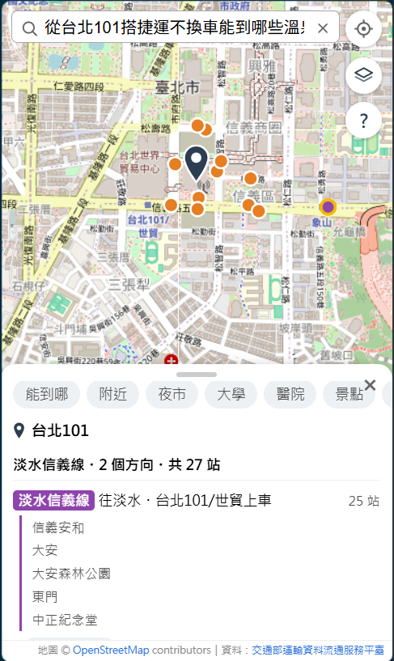
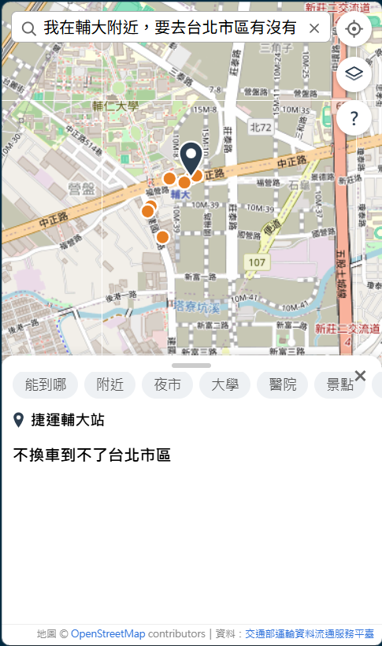

# 2026-11-06 他人一鍵部署、模擬題目評估、規則與地名定位的修正

## 今日目標

- [x] 驗收第 9 項重做：請實驗室同學照 README 部署
- [x] 一鍵部署：Windows、Mac 都能用，假設什麼都沒裝
- [x] 外部題目：改用 ChatGPT 模擬真人問法，標註先鎖定再跑
- [x] A／B／C 三組在模擬題目上的比較
- [x] 修正模擬題目找到的問題，並用新題目驗證修正
- [x] 地名定位找錯時，不再照常回答
- [x] 手機確認「百貨」「電影院」分頁

## 1. 第 9 項：請他人照 README 部署

**問題**：學長建議找別人照 README 部署一次。部署前用第一次部署的人的角度重看 README，發現幾個會卡住的地方：

- README 的驗證用 bash 的 `curl`；Windows PowerShell 的 `curl` 是另一個指令，換行、引號也不同。
- 步驟分散在好幾段，要自己 clone 另外兩個 repo、建立 `.env`。
- 資料庫第一次初始化時，約 3 秒（實測 2.5～5.9 秒）只有 Unix socket 可連、TCP 還連不上，健康檢查有機會剛好落在這段。

**行動**（deploy PR #2 與之後 3 個 commit）：

| 改動 | 內容 |
| --- | --- |
| `setup.cmd`＋`setup.ps1`（Windows）、`setup.sh`（Mac、Linux） | 檢查工具 → 下載 backend、frontend → 建立 `.env`（自動產生密碼）→ `docker compose up -d --build` → 自動檢查 |
| 自動檢查 `docker compose run --rm check` | 在容器裡跑，各作業系統同一行：匯入筆數、網頁、`/api/reach`、`/api/ask` 共 11 項 |
| 健康檢查 | `pg_isready -h 127.0.0.1`＋`start_period: 120s` |
| README「事前準備」 | 假設什麼都沒裝：流程圖＋系統管理員 PowerShell 一次裝 WSL、git、Docker Desktop，重開機一次 |

Windows PowerShell 5.1 的眉角：`.ps1` 要存成 UTF-8 with BOM（不然中文讀成 Big5）、`.env` 要存成沒有 BOM、docker 寫到 stderr 的進度不能當成錯誤、`setup.cmd` 用 `-ExecutionPolicy Bypass` 執行。

**結果：通過**。同學在 Windows 10 執行 `setup.cmd`，1 分 30 秒完成，自動檢查 11 項全部通過，網頁長按、點圓點正常。卡住的地方（Docker Desktop 需要 WSL；資料夾放在 OneDrive 同步的桌面，`.env` 會被同步）都改進 README。紀錄見 [acceptance/2026-11-06-item9-deploy-by-others.md](../acceptance/2026-11-06-item9-deploy-by-others.md)。

## 2. 外部題目：ChatGPT 模擬真人問法

**問題**：學長建議請其他人出題，避免題目和規則有同樣的盲點。同學部署完後建議改用 AI 出題。

**參考與決定**：

- **不用 Gemini 出題**：系統解析問題用的就是 Gemini，它出的題是它習慣的說法，等於自己出題給自己考。改用 ChatGPT。
- **不讓出題的模型知道規則**：提示詞只用一句話介紹 App，不列分頁類別、不給範例問法。
- **不挑題、標註先鎖定**：開新對話、只生成一次；標註在跑系統之前 commit（backend `acea647`、`8847fc5`）。

第一組 30 題（長句）看完覺得句子太長，再用同一份提示詞加「每句 15 個字以內」出第二組（短句）。提示詞、標註與判斷理由見 [experiments/external-questions.md](../experiments/external-questions.md)。

**結果**（完整流程：規則 → Gemini）：

| | 長句 X1～X30 | 短句 Y1～Y30 |
| --- | --- | --- |
| 只跑規則：接手 | 10 題 | 2 題 |
| 只跑規則：接手後**答錯** | **6** | 0 |
| 完整流程正確 | 16／30（標註更正後 17） | 26／30 |

自己出的題目（dev、heldout）規則接手後答錯 0 題，模擬題目答錯 6 題：**規則確實只熟悉自己出的說法**。

## 3. 錯誤分類

**規則很有把握地答錯**：遇到看不懂的字直接忽略，回答另一個問題，沒有交給 Gemini。例如「哪些**觀光**景點」「不**換線**」「哪些**溫泉區**」。

（X24「從台北101搭捷運不換車能到哪些溫泉區？」：沒有溫泉這一類，規則忽略「溫泉區」，照樣列出捷運能到的站。）

**回答會誤導使用者**：

| 題目 | 使用者看到 | 原因 |
| --- | --- | --- |
| X3 松山車站…景點有啥 | 「到不了清單裡的景類」 | Gemini 偶爾寫錯類別（「景類」「景景點」）。同一題跑 5 次錯 2 次 |
| X13 輔大…台北市區 | 「不換車到不了台北市區」 | 「台北市區」不是一個地點，查不到就說到不了 |
| Y23 和平醫院到台大 | 「和平醫院（新竹市北區）不在台北市範圍內」 | Nominatim 找到新竹的同名醫院 |

## 4. A／B／C 比較（修正前）

| | A 舊版（LLM 寫回答） | B 一律 LLM 選參數 | C 規則 → LLM（現在） |
| --- | --- | --- | --- |
| 長句正確 | 5（不算舊版沒有的參數：16） | **20** | 16 |
| 短句正確 | 19（21） | **27** | 26 |
| 耗時中位數（長） | 3.7 秒 | 1.5 秒 | **1.4 秒** |
| Gemini 呼叫（長） | 55 次 | 32 次 | **21 次** |

長句 C 輸 B 的 4 題**全在規則**：C 由規則接手的 11 題，B 對 9、C 對 5；交給 Gemini 的 19 題兩組一樣（11 對 11）。

A、B 第一次跑到一半遇到 Gemini 504（DEADLINE_EXCEEDED）中斷：評估程式改成遇到 5xx 等 30 秒整題重跑並記下次數，60 題整批重跑。正式服務原本也只重試 429、503，504 會讓使用者看到錯誤，一起修。

## 5. 修正：規則看不懂就交給 Gemini（backend PR #16）

**問題**：規則出錯有兩種。看不懂、交給 Gemini 是安全的（只是慢一點）；以為看懂、直接回答是危險的（錯得看不出來）。

**行動**：原則是「看不懂就交出去」，不把測試題目裡的詞（觀光、親子、換線）加進規則——那是照著考題調，換一批題目又有新的詞。

- 「哪些」後面不是類別、站或地方 → 交給 Gemini。
- 「能到哪」的問題拿掉起點和認得的字之後還有剩 → 交給 Gemini。
- 只提到公車、沒提到捷運 → 只搭公車。
- 另外：Gemini 給的類別不在 7 類裡時，含有正確說法就改正、對不上就當成沒填（`valid_category`）；Gemini 504 也重試；範圍外的同名地點提示「在地名前加上台北」。

**結果**：

| | 修改前 | 修改後 |
| --- | --- | --- |
| 規則測試 56 種問法 | 56／56 | 56／56 |
| dev、heldout：規則接手／答錯 | 29／0 | 29／0（完全沒變） |
| 長句：規則接手後答錯 | 6 | 1 |
| 完整流程 長句／短句 | 16／26 | 20／27 |

代價：X20「…哪些地方？帶小孩」原本規則答對，現在多呼叫一次 Gemini。修正後的數字是看著這 60 題修的，**報告用修正前的成績**。

## 6. 用新題目驗證修正

**問題**：同一份考卷修完再考，只能證明「這幾題修好了」。

**行動**：同一份長句提示詞再出 30 題（Z1～Z30），標註 commit 鎖定（`17df166`）後，修正前、修正後各跑一次。

- ChatGPT 登入後的暫存對話出的題目，和短句那組高度相似（「台北車站到九份怎麼搭」≈ Y26），判斷受帳號之前的對話影響，**不採用**；改用無痕視窗、不登入。
- 不改用 Gemini 出題：修正的效果來自「交給 Gemini」，Gemini 出的題對 Gemini 特別順，偏差剛好往「修正有效」的方向。

**結果**：

| | 修正前 | 修正後 |
| --- | --- | --- |
| 規則接手後答錯 | 3 | 1 |
| 完整流程正確 | 15／30 | 17／30 |

前後不同的 6 題逐題看：Z5「大醫院」、Z6「不換線」是修正的效果（修正時沒看過這兩種說法）；另外 4 題兩次都由 Gemini 解析，+2、−2 剛好抵消，是 Gemini 結果不固定。新找到的漏洞：Z2「**捷運直達**可以去哪些景點」規則沒認出只搭捷運，記錄、不修。

13 題錯誤裡，**起點定位佔 5 題**，成為修正規則後最大的錯誤來源。

## 7. 地名定位：名字對不上就不採用（backend PR #17）

**問題**：資料庫認不得的地名交給 Nominatim，第 1 個結果直接採用。

| 地名 | Nominatim 第 1 個結果 | 使用者看到 |
| --- | --- | --- |
| 台北市政府 | 文山區的政大附中（差 6 km） | 「搭公車不換車沒辦法到松山機場」，看不出錯 |
| 內湖科學園區 | 大安區的腳踏車停車區（差 7 km） | 照常回答，看不出錯 |

**參考**：別的地圖 App 讓使用者從候選清單挑（我們的邊打字邊建議已經是這樣，但只涵蓋資料庫裡的地點）、結果附信心分數太低就不採用、一次拿多個候選再挑。限定只找台北（`bounded=1`）不採用：「九份」會變成北投的「九份溝」，錯得像對的。

**行動**：拿 5 個候選，取第一個**名字對得上**的（查詢的字依序出現在名字裡，或反過來）；名字包含 OSM 的別名、正式名稱、舊名（`namedetails`）。都對不上就回「找不到，請換個名稱或改用門牌」。先量再改：102 個地標的名稱與簡稱（180 個）跳過資料庫直接問 Nominatim，比較 7 種挑法（[experiments/geocode-2026-11-06/](../experiments/geocode-2026-11-06/README.md)）。

**結果**：

| | 對 | 錯但看得出來 | 找不到 | **錯了卻看不出來** |
| --- | --- | --- | --- | --- |
| 修改前（第 1 個） | 133 | 9 | 26 | **12** |
| 修改後 | 130 | 7 | 38 | **5** |

- 只比對 `name` 會擋掉很多對的：「通化夜市」在 OSM 叫「臨江街觀光夜市」，別名才有「通化夜市」。
- 剩下 5 個：動物園 3 種寫法是量測誤差（園區中心離大門超過 500 m）；「榮總」被 OSM 記成捷運石牌站的別名；「三總」找到汀州院區。
- 反向比對 2 個字就算的版本多救回 3 個，但多 2 個看不出的錯（「台北榮總」靠別名對到石牌站），不採用。
- 8080 實測：「台北市政府」→ 找不到；「和平醫院」→ 新竹（範圍外，提示加台北）；「台北和平醫院」→ 找得到。

## 最重要的發現

**錯得看得見，比錯得像對的安全。** 今天三個修正都是同一件事：規則看不懂就交給 Gemini、Gemini 給的類別對不上就當成沒填、Nominatim 的名字對不上就說找不到。目標不是讓每一題都答對，而是讓系統知道自己沒把握，不要很有把握地答錯。

## 學到的觀念

- **修正有沒有效，要用沒看過的題目量**：看著題目修完再考同一批，數字一定變好；用新題目、標註先鎖定，才分得出是修正的效果還是剛好。
- **能逐題說出原因的差距，比總數可信**：Gemini 每次的結果不完全固定，差 1、2 題分不出是實力還是運氣；長句 C 輸 B 的 4 題每一題都對得到規則的錯，才可信。
- **數字要講清楚範圍**：「在 30 題 ChatGPT 模擬的長句上答對 16 題」，題目從哪來、幾題、答對幾題都要講；真實使用者的正確率沒有資料。
- **改動前先量現況，改完用同一批量**：地名定位先把 190 個地名的候選存下來，離線比較 7 種挑法，選擇有數字根據。

## 明日計畫

- 投影片 `[__]` 填入今天的數字（第 9 項、A／B／C、修正前後）
- 報告「限制」與「AI 產出的程式哪裡改過」補今天的內容
- 部署驗收結束後，把同學移出 `transit-reach`（時間待定）
