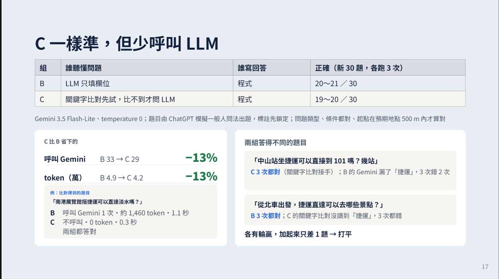
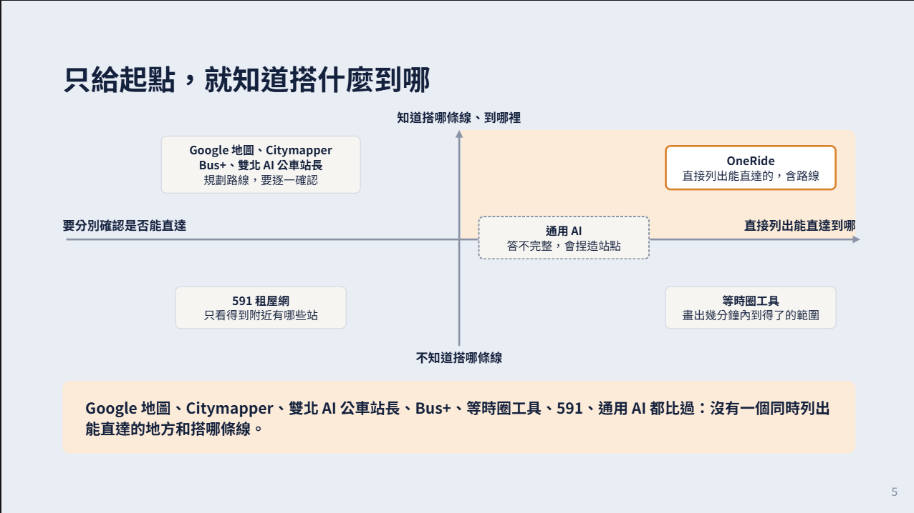

# 2026-11-15 學長批註修正與簡報定稿

> 11/12～11/14 沒有另寫筆記，11/13 的簡報調整一起記在這裡。

## 今日目標

- [x] 講稿逐頁改通順（第 16 頁之後）
- [x] 處理學長對前一版簡報的 47 則批註
- [x] 驗收紀錄、AI 改動對照表補齊
- [x] 確認展示流程在 8080 還能照劇本跑
- [ ] 完整預演、記下每步秒數（移到明天報告前）

## 1. 學長批註：先處理「證據」

**問題**：學長用 Claude Code 對簡報 PDF 加了 47 則批註（用詞／版面／證據／論述），其中「證據」類指出幾處數字或說法和紀錄對不上。

**行動**：每一則都拿驗收紀錄、實驗筆記核對，對得上才改。

**結果**：

| 批註 | 原本 | 核對後改成 |
| --- | --- | --- |
| 驗收第 2 項 | 寫「重算 3,415 筆一致」 | 標準是 Bus+ 抽查 15 組；改成「Bus+ 抽查 15 組全對」，重算放第二行 |
| 驗收第 7 項 | 寫「中位數 1.9 秒」 | 標準是每題 10 秒內；改成「實測最慢 6.3 秒」（新 30 題 × 3 次，走 Gemini 的 78 次都在 10 秒內），小字註明 Gemini 很忙時仍可能變慢 |
| 驗收第 8 項 | 紀錄寫「非實機」 | 補上 11/4 晚上 iPhone 實機（Tailscale HTTPS）的測試 |
| 轉乘 | 「多 7 倍」 | 「約是 7 倍（以興隆路二段 218 號為例）」 |
| 第 4、17 頁 | 沒寫實驗設定 | 頁底補上日期、模型、提問方式、怎麼算對 |
| 換人出題 | 實際是 ChatGPT 出題 | 統一寫「改用 ChatGPT 出題」 |
| AI 改動 19 項 | 「能講」欄都沒勾 | 逐項確認講得出原因後全部打勾，拿掉「草稿」 |

其他用詞、版面批註也照做：「規則」改成「關鍵字比對」、「選擇題」改成「把問句轉成欄位」、加頁碼、補 TDX 全名、站位定義、等時圈說明等。

## 2. 第 17 頁：總耗時 −20% 不能當成設計的效果

**問題**：學長問每題要等多久。拆開 B、C 各三輪的資料才發現，總耗時平均少 20%，大部分是運氣。

**結果**：

| | 第 1 輪 | 第 2 輪 | 第 3 輪 |
| --- | --- | --- | --- |
| B 總耗時 | 54.7 秒 | 41.1 秒 | 91.4 秒（Gemini 很忙） |
| C 總耗時 | 69.4 秒 | 40.9 秒 | 39.3 秒 |
| B 呼叫 Gemini | 34 | 33 | 33 |
| C 呼叫 Gemini | 29 | 29 | 29 |

- 每題中位數兩組都約 1.3 秒；確定由設計省下的只有關鍵字比對接手的 4 題（每輪約 4 秒，約 7%）。
- 呼叫次數和 token 每一輪都穩定少 13%，這才是可以講的。
- 投影片改成兩個穩定的數字，加一題實例：「南港展覽館搭捷運可以直達淡水嗎」，B 呼叫 Gemini、1.1 秒；C 不呼叫、0.3 秒，兩組都對。右邊放兩組各輸一題的例子，說明為什麼算打平。

## 3. 產品定位：補上比過的所有工具

**問題**：定位圖只畫 4 個框，結論卻列了 7 個工具；而且查到香港的「巴士到站時間－就是這裏」App 在 10/20 版本加入台灣公車、捷運，並有「直達目的地」功能。

**參考**：App Store 版本紀錄（2026.50，10/20）；dev-notes 是 10/21 建立，對方的台灣版早一天上架。

**行動**：Citymapper、雙北 AI 公車站長併進左上（要先知道目的地），591 放進左下（只看得到附近的站）。雙北 AI 公車站長 10/30 補測時答對「到士林夜市」，但問「能到哪」只列本站路線，所以放左上合理。「就是這裏」在台灣能不能用、要不要付費沒有實測，報告時被問到再口頭說明。

## 4. 簡報結構與講稿

- 第 9 頁資料模型：ER 圖直接填 109 的實際資料（routes 1 列、route_patterns 2 列、route_stops 4 列），PK／FK 改成欄位下面另一行；下面的直線圖和表格用同色圓點對應。
- 第 14 頁：改成「改進前兩條路 vs 改進後一條路」的對照圖，講清楚為什麼要讓所有入口走同一個查詢。
- 第 19 頁觀念標題改成自己的經驗（數字別讓 LLM 寫、不是每題都要問 LLM、一個個修永遠修不完）；第 20 頁改成「AI 輔助開發：怎麼分工」，第二個例子換成「溫泉區」。
- 限制頁移到備用；備用頁從 18 頁精簡到 8 頁（第 22～29 頁），只留正文答不出來的問題。
- 講稿第 1～20 頁全部順過，預估約 21 分鐘。

## 5. VM 與展示

**問題**：VM 重開機後手機連不上網站。Docker 本身有開機啟動，但容器的重啟設定是 `no`，一直停在關機時的狀態。

**行動**：deploy 的 `compose.yaml` 對 db、api、web 加 `restart: unless-stopped`（import 不加，資料在 volume 裡）。另外把新手指引改成每次打開網頁都出現（展示用）。

**結果**：重建後三個容器都是 `unless-stopped`；展示第 1～6 步對 8080 重跑，數字和 `report/demo.md` 一致（348 個站、5 個夜市、師大夜市 4 站、公館捷運 1 站、5 個電影院、信義威秀回台科大 8 站走 Gemini 1.2 秒）。

## 最重要的發現

- 平均值會騙人：總耗時 −20% 是真的量出來的，但三輪裡有一輪碰上 Gemini 很忙；拆開每一輪才知道哪些是設計的效果、哪些是運氣。能穩定重現的指標（呼叫次數、token）才拿來當結論。
- 驗收要對照「標準本身」：第 2 項標準是和 Bus+ 比對，第 7 項是每題上限；拿另一個也通過的數字代替，看起來沒錯，其實回答的是別的問題。

## 學到的觀念

- 說「沒有工具做到」之前，要把比過的工具都列出來，也要持續追蹤；競品會更新（「就是這裏」10/20 才加台灣）。
- 投影片上的比喻（選擇題、助理、專家）讓聽眾要自己換算，直接寫做了什麼（轉成三個欄位、關鍵字比對）比較好懂。

## 明日計畫

- 11/16 15:30 最終報告：報告前完整預演一次並計時（目標 20 分鐘）。
- 手機確認：Tailscale VPN 開著、從主畫面打開 OneRide 會跳新手指引、定位鍵可用；錄影當備案。
