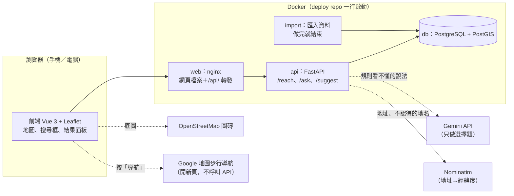
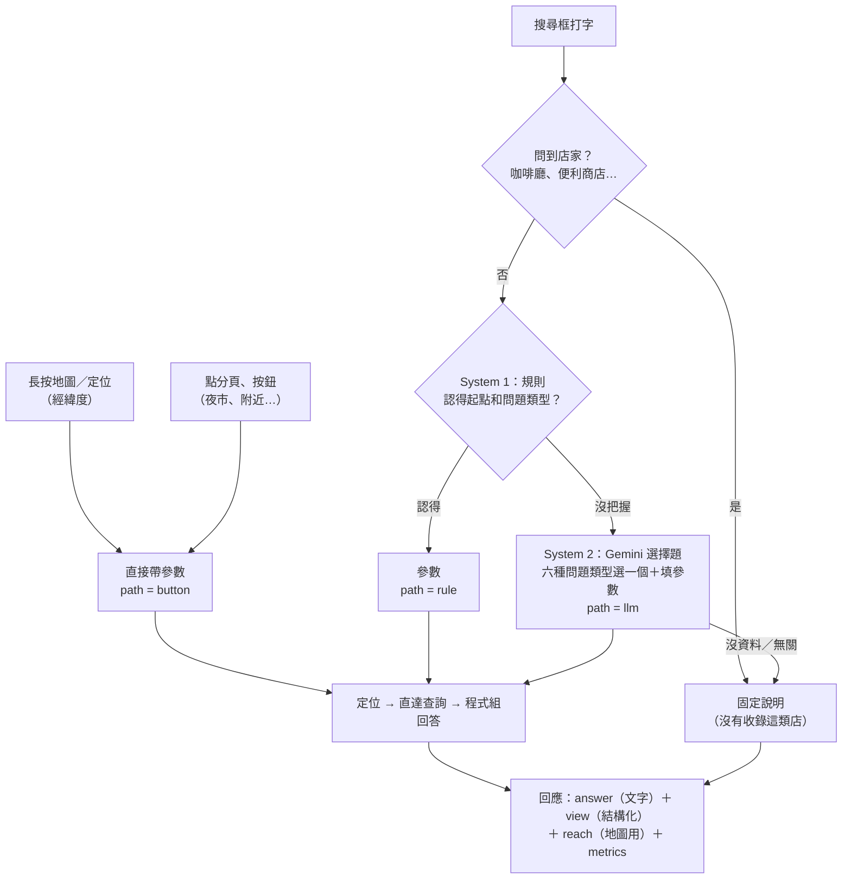
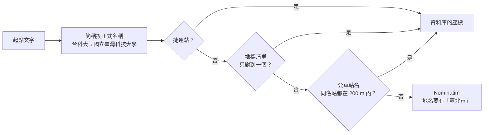
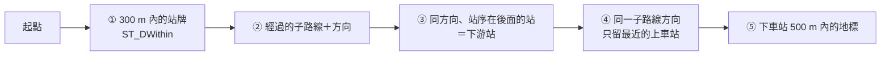
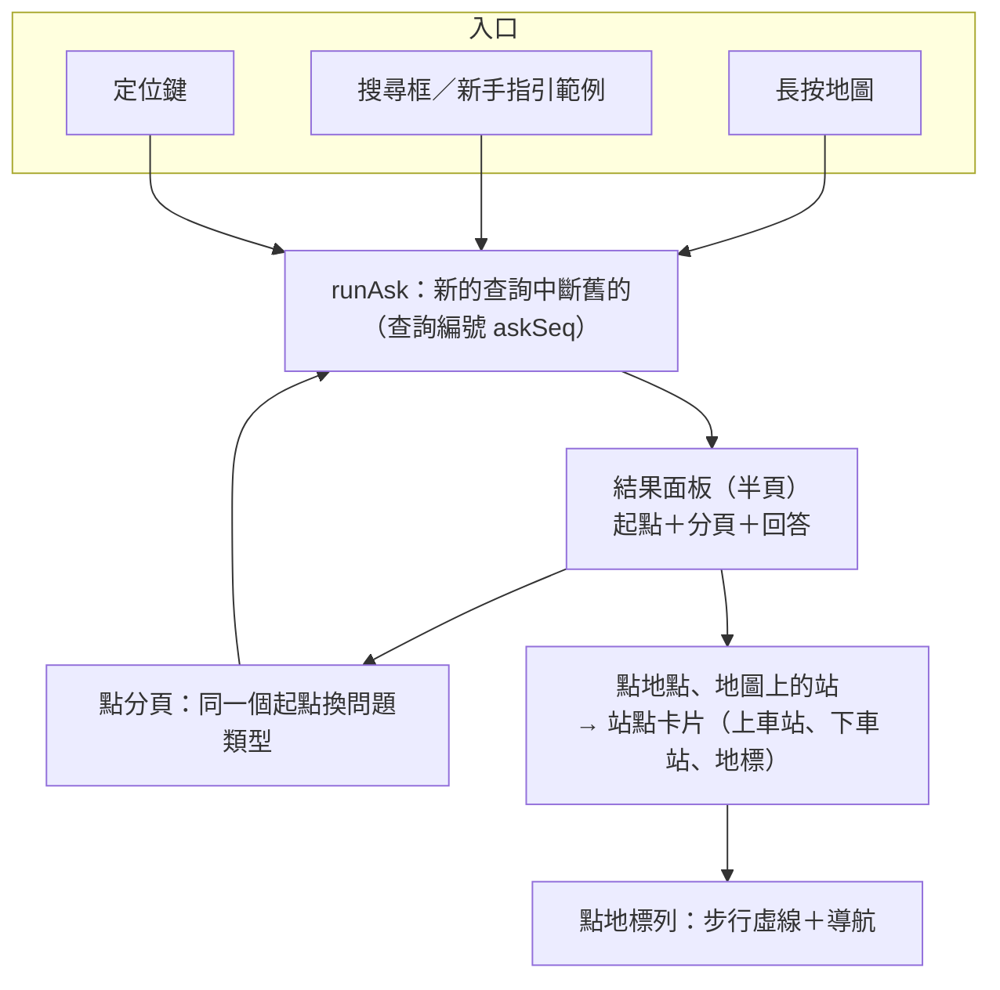
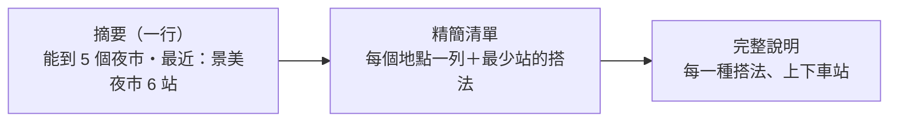

# 系統架構（實作後的做法）

> 2026-11-05 整理。[提案](../proposal.md)是 10/21～10/22 的構想，這份是實作、驗收之後的實際做法；兩者的差異整理在提案文末的「實作後的調整」。資料庫結構見 [database.md](database.md)。

## 一、整體架構

| 部分 | 技術 | 重點 |
| --- | --- | --- |
| 資料 | TDX 公車、捷運（固定版本）＋ 地標清單 | 不即時呼叫 TDX，驗證數字可重現 |
| 後端 | FastAPI + psycopg | 直達查詢是一段 SQL；回答由程式產生 |
| LLM | Gemini Flash Lite | 只在規則看不懂時呼叫，一題最多一次，只回傳參數 |
| 前端 | Vue 3 + Vite + Leaflet | 手機優先：長按設起點、可拖拉的結果面板、PWA |
| 部署 | Docker compose（db → import → api → web） | 填好 `.env` 後一行指令啟動 |

## 二、查詢流程

三種入口最後都走到同一個查詢（`POST /ask`），差別只在起點和問題類型從哪裡來：

- **規則寧可漏接也不猜錯**：只有「起點」和「問題類型」都有把握才接手，否則交給 Gemini。漏接只是慢一點，猜錯就答錯。
- **沒說起點**（「能到哪些夜市？」）：沿用畫面上目前的起點（前端送 `context`）；沒有起點就請使用者選。
- **問題類型**（`intent`）：`overview` 能到哪、`nearby` 附近、`category` 某一類地點、`destination` 能不能到某地、`route` 路線之後的站、`metro_only` 只搭捷運。

### 定位：地名 → 經緯度

資料庫認得的名稱先用資料庫，因為 Nominatim 曾把「101」找成新北市三芝區、「萬芳醫院站」找成房屋仲介。

### 直達查詢（SQL）

完整寫法見 backend `sql/practice/07_direct_reach.sql`。計算單位是「子路線＋方向」，同一個站牌往兩個方向能到的地方不同。

## 三、LLM 的角色

> 為什麼這樣設計、和其他做法（Agent、LLM 產生 SQL…）的比較與取捨，見 [llm-design.md](llm-design.md)。

| | 提案時 | 現在 |
| --- | --- | --- |
| 解析問題 | LLM | 規則先試，看不懂才給 LLM |
| LLM 回傳什麼 | 參數＋最後的回答 | 只回傳參數（選問題類型、填起點與條件） |
| 寫回答 | LLM 根據查詢結果寫 | 程式依問題類型組回答 |
| 一題呼叫幾次 | 2 次（解析、寫回答） | 0 次（規則）或 1 次 |

**為什麼改**：驗收時 LLM 寫回答會出錯，例如把 375 個下車站寫成 52 個，把 20 站縮成「辛亥至南港展覽館」；超過 10 秒的題目也都是 LLM 寫回答的。改成程式產生回答後，`verify_no_fabrication.py` 逐筆核對，捏造 0。

**System 1／System 2**：常見問法用規則（快、結果固定），規則看不懂的說法才交給 LLM 做「選擇題」（`temperature` 0）。11/4 的實驗（34 題）：全對，28 題不用 LLM，耗時中位數 0.8 秒（[紀錄](../experiments/system1-2026-11-04/C-log.txt)）。

## 四、前端互動

所有改動照 8 條互動原則，並用「入口 × 操作」表逐格檢查每個入口的行為一致（見 frontend `CLAUDE.md`）：

1. 結果一致：同一個輸入永遠得到同一種結果。
2. 點一下＝收起一層，長按＝設起點。
3. 提示一定看得到。
4. 卡片跟著選取走，而且能回到原本的回答。
5. 面板手勢一致：每一層都能拖拉。
6. 字少分層：一行摘要 → 精簡清單 → 完整說明。
7. 不搶使用者的控制：自動移動畫面時，使用者一動就停。
8. 視覺先預覽再決定；出處標示不能拿掉。

回答分三層顯示（原則 6）：

## 五、API

| API | 用途 |
| --- | --- |
| `GET /reach?lng=&lat=&radius_m=` | 直達查詢：附近上車站（`boarding`）、下車站（`destinations`，含路線、方向、站數、附近地標） |
| `POST /ask` | 自然語言或分頁按鈕：回傳 `answer`、`view`（結構化）、`origin`、`reach`、`metrics`（path、Gemini 次數、token、各階段耗時） |
| `GET /suggest?q=` | 搜尋框邊打字邊建議：地標（含簡稱）→ 捷運站 → 公車站，最多 8 個 |

## 六、資料範圍與限制

- 範圍：台北市公車（416 條路線）＋台北捷運（5 條線），只算不換車；附近 300 m、地標 500 m。
- 地標 102 個：夜市、大學、醫院、景點、交通（手動 48 個），百貨商場、電影院（OpenStreetMap 54 個）。餐廳、咖啡廳、便利商店到處都有，不收，問到時說明原因。
- 車程以站數表示（提案時決定 MVP 先不做時間）；步行時間用直線距離估算（× 1.3 ÷ 每分鐘 80 m），畫面寫「約」，精確時間交給 Google 地圖導航。
