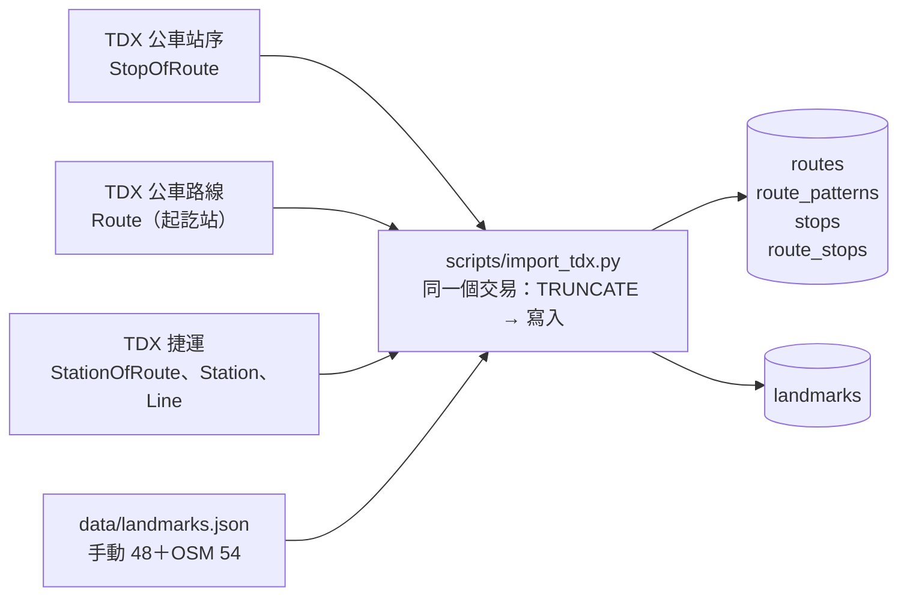
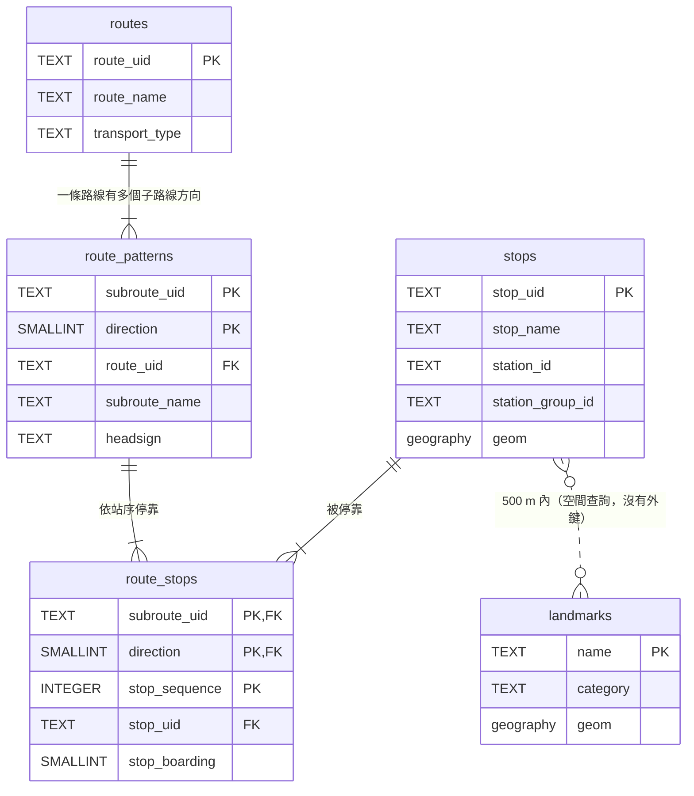

# 資料庫設計

資料來源為 TDX 的台北市公車與台北捷運站序，加上地標清單；schema 定義在 `backend/db/init/01_schema.sql`。

> 11/5 更新：10/27 的設計只有公車。11/3 加入捷運（同一組表，`transport_type` 區分）與 `landmarks` 表，11/4 加 `route_patterns.headsign`（方向名稱），11/5 地標加百貨商場、電影院。

TDX 原始資料固定版本放在 backend 的 `data/raw/`（不即時呼叫 TDX），驗證數字才能重現。

## ER 圖

**圖例**：PK 為主鍵，FK 為外鍵（指向另一張表的主鍵），空白表示一般欄位。連線兩端的符號表示數量：`||` 為恰好一個，`|{` 為一個以上，`o{` 為零個以上；虛線表示沒有外鍵，查詢時用距離關聯。

## 欄位說明

| 欄位 | 說明 |
| --- | --- |
| `route_name` | 路線號碼，例如 606 |
| `transport_type` | `bus` 或 `metro` |
| `direction` | 0 去程、1 返程 |
| `headsign` | 方向名稱（「往陽明山」），公車來自 TDX `Route` 的起訖站：去程往迄站、返程往起站；捷運、起訖站相同的環狀線是 NULL，查詢時改用最後一站 |
| `stop_sequence` | 第幾站 |
| `station_id` | 實體站位，用來合併同一地點的站牌 |
| `geom` | 站牌經緯度，`geography(Point, 4326)` |
| `stop_boarding` | 上下車限制，資料有矛盾，保留但暫不使用 |
| `landmarks.category` | 夜市、大學、醫院、景點、百貨商場、電影院、交通 |

## 各表說明

| 表 | 一筆資料代表 | 公車 | 捷運 | 合計 |
| --- | --- | --- | --- | --- |
| `routes` | 一個路線號碼，例如 606、文湖線 | 416 | 5 | 421 |
| `route_patterns` | 一個子路線的一個方向，例如「606 去程」 | 1,241 | 22 | 1,263 |
| `stops` | 一個站牌 | 28,823 | 122 | 28,945 |
| `route_stops` | 某個子路線方向的第幾站是哪個站牌 | 43,235 | 370 | 43,605 |
| `landmarks` | 一個地標，例如士林夜市 | | | 102 |

## 設計重點

- **計算單位是「子路線 ＋ 方向」**：同一個路線號碼可能有區間車、繞駛等不同跑法，去程和返程停的站也不同。站序只有在同一個子路線、同一個方向內才有意義，所以 `route_patterns` 用 `subroute_uid` + `direction` 當主鍵。

- **`route_stops` 是多對多的中介表**：一個子路線方向停很多站，一個站也可能被多個子路線方向停靠，因此用中介表記錄「誰在第幾站停哪裡」。主鍵包含 `stop_sequence`，因為每條路線都有第 1、2、3 站，單靠站序會重複。

- **`stop_uid` 與 `station_id` 的分工**：台北市資料中，`StopUID` 屬於個別路線，同一個實體站牌上的不同路線各有一個 `StopUID`；`StationID` 才代表實體站位（站序 43,235 筆中，不重複的 `StationID` 只有 5,375 個）。半徑搜尋用每個 `stop_uid` 的座標，畫面顯示時再用 `station_id` 合併。

- **空間欄位**：`geom` 使用 PostGIS 的 `geography(Point, 4326)`，距離單位直接是公尺；建立 GIST 空間索引，加速「半徑 300 m 內的站牌」這類查詢。

- **捷運放進同一組表**：用 TDX 的 `StationOfRoute`（支線分開，例如 O-2 蘆洲），不用 `StationOfLine`（支線混在同一條線，會算出迴龍直達三重國小）。ID 一律加 `TRTC-` 前綴（`TRTC-BL12`），不和公車撞號。捷運站只有一個座標，出口分散的大站可能離座標超過 300 m。

- **地標用距離關聯**：下車站 500 m 內的地標算「附近」（士林夜市的中心離劍潭站 460 m，300 m 會漏掉），所以 `landmarks` 不和站牌建外鍵，查詢時用 `ST_DWithin`。座標是人工確認過的（大範圍地標用大門門牌）；百貨商場、電影院來自 OpenStreetMap。

- **直達查詢的核心**：在 `route_stops` 中，找出與上車站同一個子路線、同一個方向，且 `stop_sequence` 比上車站大的站，就是不換車可到達的下游站。
