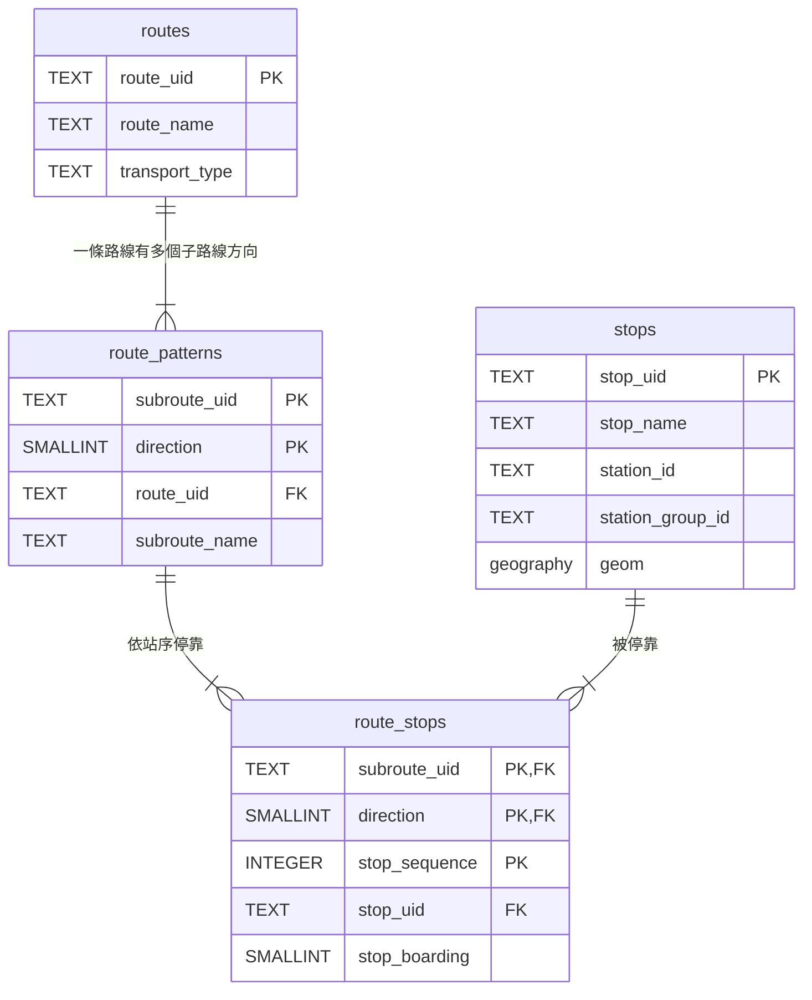

# 資料庫設計

資料來源為 TDX 的台北市公車站序，schema 定義在 `backend/db/init/01_schema.sql`。

## ER 圖

**圖例**：PK 為主鍵，FK 為外鍵（指向另一張表的主鍵），空白表示一般欄位。連線兩端的符號表示數量：`||` 為恰好一個，`|{` 為一個以上。

## 欄位說明

| 欄位 | 說明 |
| --- | --- |
| `route_name` | 路線號碼，例如 606 |
| `transport_type` | `bus` 或 `metro` |
| `direction` | 0 去程、1 返程 |
| `stop_sequence` | 第幾站 |
| `station_id` | 實體站位，用來合併同一地點的站牌 |
| `geom` | 站牌經緯度，`geography(Point, 4326)` |
| `stop_boarding` | 上下車限制，資料有矛盾，保留但暫不使用 |

## 各表說明

| 表 | 一筆資料代表 | 筆數（台北市公車） |
| --- | --- | --- |
| `routes` | 一個路線號碼，例如 606 | 416 |
| `route_patterns` | 一個子路線的一個方向，例如「606 去程」 | 1,241 |
| `stops` | 一個站牌 | 28,823 |
| `route_stops` | 某個子路線方向的第幾站是哪個站牌 | 43,235 |

## 設計重點

- **計算單位是「子路線 ＋ 方向」**：同一個路線號碼可能有區間車、繞駛等不同跑法，去程和返程停的站也不同。站序只有在同一個子路線、同一個方向內才有意義，所以 `route_patterns` 用 `subroute_uid` + `direction` 當主鍵。

- **`route_stops` 是多對多的中介表**：一個子路線方向停很多站，一個站也可能被多個子路線方向停靠，因此用中介表記錄「誰在第幾站停哪裡」。主鍵包含 `stop_sequence`，因為每條路線都有第 1、2、3 站，單靠站序會重複。

- **`stop_uid` 與 `station_id` 的分工**：台北市資料中，`StopUID` 屬於個別路線，同一個實體站牌上的不同路線各有一個 `StopUID`；`StationID` 才代表實體站位（站序 43,235 筆中，不重複的 `StationID` 只有 5,375 個）。半徑搜尋用每個 `stop_uid` 的座標，畫面顯示時再用 `station_id` 合併。

- **空間欄位**：`geom` 使用 PostGIS 的 `geography(Point, 4326)`，距離單位直接是公尺；建立 GIST 空間索引，加速「半徑 300 m 內的站牌」這類查詢。

- **直達查詢的核心**：在 `route_stops` 中，找出與上車站同一個子路線、同一個方向，且 `stop_sequence` 比上車站大的站，就是不換車可到達的下游站。
