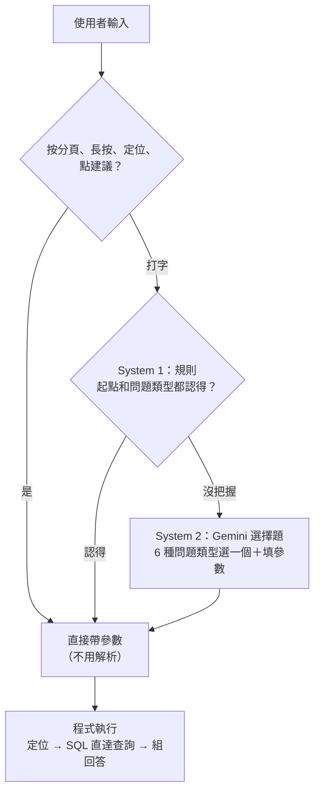

# LLM 的角色：System 1／System 2 與設計取捨

> 2026-11-05 整理。系統整體見 [architecture.md](architecture.md)。這份回答三個問題：System 1／System 2 怎麼套用、System 2 為什麼不讓 LLM 想得更久、和其他做法比起來的取捨。

## 一、LLM 用在哪：一開始 vs 現在

兩個時期都只用在**自然語言查詢**（搜尋框打字），差別在 LLM 負責的範圍。

| | 一開始（10/22 提案、11/2 第一版） | 現在（11/4 改版後） |
| --- | --- | --- |
| 解析問題 | LLM | 規則先試，看不懂才交給 LLM |
| LLM 回傳什麼 | 參數＋最後的回答（含「AI 摘要」） | 只回傳參數：6 種問題類型選一個＋填起點、條件；或選「沒辦法查」的原因 |
| 回答、摘要的文字 | LLM 根據查詢結果寫 | 全部由程式產生 |
| 一題呼叫 Gemini | 2 次 | 0 次（規則）或 1 次 |

現在完全不用 LLM 的部分：長按地圖、定位、分頁按鈕、點站、邊打字邊建議、問到店家（規則直接說明）、所有回答文字。

**為什麼縮小**：11/4 驗收時 LLM 寫回答把 375 個下車站寫成 52 個、同一題每次結果不同，超過 10 秒的題目也都是 LLM 寫回答的。

## 二、System 1／System 2 怎麼套用

概念來自心理學的雙系統：System 1 快、直覺、處理熟悉的情況；System 2 慢、費力，System 1 處理不了才出動。放到 AI 系統上是「便宜、確定的方法先試，沒把握才交給貴的 LLM」；學長再加一層：**交給 LLM 時也把推論題變成選擇題**。

| 層 | 對應到 OneRide | 設計重點 |
| --- | --- | --- |
| 輸入就消除歧義 | 分頁按鈕、長按、定位、邊打字邊建議 | 讓使用者直接選確定的東西，不需要解析 |
| System 1 | `app/fastpath.py` 的規則：門牌地址、資料庫認得的地名（含簡稱）、問題類型 | **寧可漏接也不猜錯**：起點和問題類型都有把握才接手；漏接只是慢一點，猜錯就答錯 |
| System 2 | Gemini，一題最多 1 次 | **推論題變選擇題**：問題類型、參數都是固定選項，`temperature` 0；看不懂也只選原因（`explain`） |
| 執行 | 定位、SQL、組回答 | 要算、要查的都不交給 LLM |
| 指標 | 每題的 `metrics`：path（rule／llm／button）、Gemini 次數、token、各階段耗時 | 學長建議的 AI agent 指標；A／B／C 實驗用這些數字比較 |

11/4 實驗（34 題）：全對，28 題（82%）不用 LLM，耗時中位數 0.8 秒，平均每題約 196 token。

和一般說法不同的地方：

- 一般說的 System 2 是「想得更久、推理更多步」；OneRide 的 System 2 反而**限制得更緊**，只做分類和填參數，所以它是「語意解析的備援」，不是 agent。
- System 1 原本有快取，實驗中命中 0 次，而且 LLM 解析錯時會被重複使用，所以拿掉。
- System 1 前面多一層「介面上消除歧義」，很多輸入根本不需要解析。

## 三、為什麼 System 2 不讓 LLM 想得更久

想得更久、推理更多步的前提是**問題本身需要推理**。OneRide 的問題拆成兩半：

| 部分 | 性質 | 適合誰做 |
| --- | --- | --- |
| 聽懂使用者想問什麼 | 語言理解，答案只有 6 種問題類型＋幾個參數 | LLM，但這是**分類**，不是推理 |
| 算出能直達哪裡 | 精確計算：站序、方向、距離、篩選、排序 | SQL 和程式 |

難的部分（直達計算）有確定的解法，答案在資料庫裡；LLM 想再久也不會多出資料，只多出出錯的機會。專案中實際遇到的：

1. **捏造**：LLM 讀結果再寫回答，375 寫成 52；步驟越多，抄錯、算錯的機會越多。
2. **不一致**：「台科大」出現四種結果；多步推理每一步都有隨機性，違反「同一個輸入，同一種結果」。
3. **變慢**：Gemini 延遲波動大（同一個極短請求 15～18 秒，幾分鐘後 1 秒），多一步就多一次等待；11/2 也發生過工具被重複呼叫 5 次、用完輪數上限。
4. **難驗證**：選擇題的輸出能逐題對答案（`eval_modes.py`、`eval_phrasings.py`），自由推理的過程很難判定對錯。
5. **額度**：免費額度每天 500 次、每分鐘 15 次。

而且範圍本來就不做轉乘、A 到 B 規劃，沒有需要多步規劃的問題。

## 四、其他做法比較

| 做法 | 怎麼做 | 優點 | 問題 |
| --- | --- | --- | --- |
| ① 通用 AI | 直接問 ChatGPT、Gemini、Claude | 不用開發 | 基準實驗站牌涵蓋率 0～50%，會捏造 |
| ② LLM 解析＋寫回答 | 提案與改版前（A 組） | 回答文字自然 | 捏造、慢、同一題結果不同 |
| ③ 全部交給 LLM 做選擇題 | 不用規則（B 組） | 開發簡單、接受各種說法 | 每題都呼叫，較慢較貴；Gemini 掛掉就全掛 |
| ④ Agent（多步工具呼叫） | LLM 自己決定先定位、再查詢、再篩選、再整理 | 能處理複合問題（先去 A 再去 B） | 延遲與隨機性隨步數放大，最難測試 |
| ⑤ LLM 產生 SQL | 問題直接翻成 SQL 執行 | 最有彈性 | 直達查詢有暗坑：JOIN 少比對方向會多出錯誤組合（71 列，正確 36 列）**而且不報錯**；有安全風險 |
| ⑥ 小型分類模型 | 訓練或 embedding 判斷問題類型 | 快、便宜、穩定 | 需要大量標註資料，目前只有幾十題 |
| ⑦ 只用規則 | 不用 LLM | 最快、最穩定 | 規則接手約 85%，其餘說法要一直補規則 |
| ⑧ LLM 自我檢查 | 寫完再讓 LLM 檢查一次 | 抓得到部分錯誤 | 呼叫變多，而且是 LLM 檢查 LLM；用程式驗證更可靠 |
| **現在** | ⑦ 先試，看不懂才 ③，計算和文字交給程式 | 見下 | 見下 |

## 五、為什麼這個做法適合（不是「比較好」）

**適合的原因**

- **正確**：計算和文字都由程式產生，捏造 0（逐筆核對 280 筆）。
- **一致**：常見問法走規則，同一個輸入永遠同一種結果。
- **快**：多數問題不呼叫 LLM（11/4：34 題中 28 題，中位數 0.8 秒）。
- **可以測**：規則和選擇題都能逐題對答案，做得出回歸測試。
- **能降級**：沒有金鑰或 Gemini 忙碌時，主要功能照常可用。
- **有彈性**：規則看不懂的說法仍有 LLM 接住，不用把所有說法寫成規則。

**代價**

- 不能處理複合問題（「到台科大再去附近的醫院」）或需要轉乘的問題，這是 ④ Agent 的強項。
- 規則要維護，而且可能和自己出的題目有同樣的盲點 → 請沒看過規則的同學另外出題。
- 新增問題類型（例如末班車）要改程式，LLM 不會自己學會。

**什麼時候值得讓 LLM 多想**：範圍擴大到轉乘、行程規劃，或使用者常問複合問題時。即使那樣，計算仍交給演算法（轉乘用圖搜尋），LLM 只負責把問題拆成子查詢。

**一句話**：選擇哪種做法，取決於問題中哪一部分需要智慧；這個工具需要的智慧只在「聽懂問題」，所以 LLM 只做這件事。A／B／C 實驗（A＝②、B＝③、C＝現在）用數字驗證這句話。
