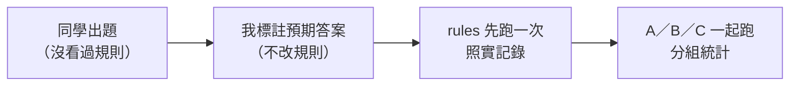

# 外部題目：請沒看過規則的人出題（A／B／C 實驗第三組）

> 學長 11/5 建議：第 5 項的 10 句是自己出的，規則也是看著這些問法調的，可能有同樣的盲點；請其他人出題，分開計算結果。

## 給同學的說明（直接傳）

> 我在做一個「從某個地點搭公車或捷運，不換車能到哪裡」的查詢系統，想請你幫忙出 10 句左右的問題，用你平常會怎麼問就怎麼問，不用管系統看不看得懂。
>
> 範圍：台北市公車＋台北捷運，只算不換車直達。可以問的方向例如：
> - 從某個地方能直達哪裡
> - 能不能直達某個地方
> - 附近有哪些公車站、捷運站
> - 某一類地方（夜市、大學、醫院、景點、百貨公司、電影院、車站）
> - 加條件：只搭捷運、幾站以內
>
> 起點請用真實的台北地點（地址、學校、捷運站、地標都可以），也可以出 1～2 題故意刁難的（範圍外、和搭車無關、說法很模糊）。
>
> 請直接把問題貼給我就好，**不要先試用系統**，謝謝！

## 收到的題目

| 出題者 | id | 問題 | 預期（收到後由我標註） |
| --- | --- | --- | --- |
| | X1 | | |

## 標註與執行

1. 收到後由我標註預期答案（問題類型、起點、條件；範圍外、不該查詢），寫進 backend `scripts/eval_questions.json`，`set` 填 `external`，`id` 用 X1、X2…。
2. **標註前不改規則**；標完先跑 `uv run scripts/eval_modes.py rules` 看規則接手幾題、答錯幾題，照實記錄，再決定要不要改。
3. A／B／C 三組一起跑（Gemini 每題間隔 6 秒，注意每天 500 次），`eval_modes.py` 會分 dev、heldout、external 印出統計。

