# 實驗：通用 AI 回答大眾運輸直達問題的侷限性與涵蓋率

## 目的

驗證通用 AI（ChatGPT、Claude、Gemini）在回答「從某地不換車能搭到哪裡」這類問題時：

1. **涵蓋率**：真實存在的路線或站點，AI 提到了多少。
2. **侷限性**：AI 做不到什麼，例如只列部分路線、不分方向、沒有考慮所有站牌。

假設：AI 能正確回答單一路線的資訊，但需要彙整多個站牌、多條路線時，涵蓋率會明顯下降。

## 測試條件

| 項目 | 設定 |
| --- | --- |
| 測試日期 | 2026-10-22 |
| ChatGPT | 免費版，GPT-5.6 Luna |
| Gemini | 免費版，Gemini 3.5 Flash-Lite，思考程度：低（預設） |
| Claude | Sonnet 5.5，思考程度：Medium |
| 記憶功能 | 全部關閉 |
| 對話 | 每個問題開新對話，不追問 |
| 重複次數 | 每題問 1 次 |
| 網路搜尋 | 依模型預設；記錄每次回答是否有搜尋 |

另於 2026-10-28 補測台灣可用的地圖 App AI 功能，見[補充測試：Google Maps](#補充測試google-maps)與[補充測試：Citymapper](#補充測試citymapper)；2026-10-30 補測雙北 AI 公車站長，見[補充測試：雙北 AI 公車站長](#補充測試雙北-ai-公車站長)。

## 測試題目

| 題號 | 問題 | 測什麼 | 層級 |
| --- | --- | --- | --- |
| Q1 | 臺北市文山區興業里興隆路二段218號附近的公車站有哪些公車經過？ | 能否找出地點附近**所有站牌**與**所有路線**（涵蓋率） | 彙整多站牌 |
| Q2 | 從興隆國小站搭673公車往大鵬新城方向，之後會經過哪些站? | 單一路線、指定方向的站序是否正確 | 對照組（單一路線） |
| Q3 | 從臺北市文山區興業里興隆路二段218號搭公車，不換車能到士林夜市嗎？ | 是非題的結論是否正確，以及給出的理由（路線、上下車站）是否正確 | 結論判斷 |
| Q4 | 從臺北市文山區興業里興隆路二段218號不換車能搭到哪些地方？ | 能否彙整所有路線、分方向列出下游站（本專案的核心問題） | 彙整多路線下游站 |
| Q5 | 從萬芳醫院站搭捷運不換車能到哪些站？ | 捷運路網單純又常見，預期 AI 答得較好 | 對照組（捷運） |

**範圍定義**：Q1、Q3、Q4 的「附近」以地址周圍步行 300 公尺內的站牌為準，計算正確答案時使用同一個範圍。

## 正確答案

| 題號 | 資料來源 | 查詢日期 |
| --- | --- | --- |
| Q1～Q3 | Bus+ App（iOS） | 2026-10-22 |
| Q4 | 暫無（預計以 TDX 公車站序資料計算） | |
| Q5 | 臺北捷運文湖線路線圖 | 2026-10-22 |

### Q1 正確答案

Bus+「探索附近」查詢「興隆路二段218號」，300 公尺內共 6 個站名、12 個站牌：

| 站名 | 站牌數 | 距離 |
| --- | --- | --- |
| 興隆國小 | 2 | 65 m |
| 福興路口 | 2 | 206 m |
| 興德國小 | 2 | 217 m |
| 興隆公園 | 1 | 225 m |
| 中國科技大學(辛亥) | 2 | 235 m |
| 興隆路口(辛亥) | 3 | 272 m |

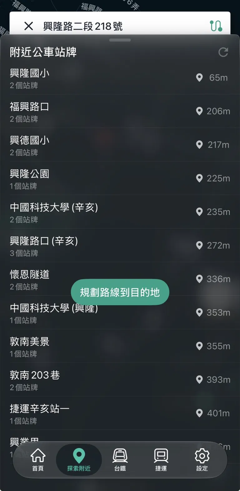

### Q2 正確答案

673 往大鵬新城方向，興隆國小站之後的站（共 12 站）：

興德國小 → 興隆市場 → 靜心高中 → 景興國中 → 景華公園 → 景美國小(景興) → 江陵二村 → 慈濟醫院 → 民權工業區一 → 遠東工業城 → 莊敬中學/人權博物館 → 中正環河路口（終點站）

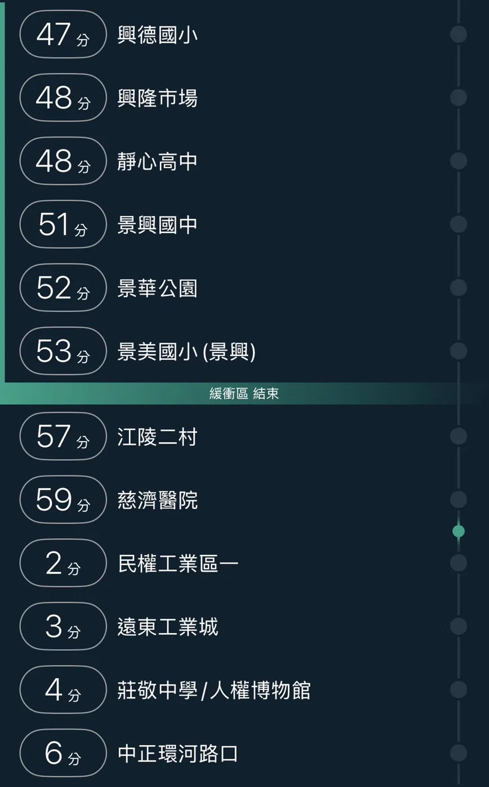

### Q3 正確答案

**能。** 搭 **606**，從**興隆國小**上車、**銘傳大學**下車，再步行約 9 分鐘到士林夜市（基河路 101 號）。全程約 1 小時 15 分鐘，票價 NT$30。

Bus+ 路線規劃共找到 6 個方案，只有 606 是不換車的方案，其餘 5 個都需要轉乘：

| 方案 | 路線 | 時間 | 票價 | 是否換車 |
| --- | --- | --- | --- | --- |
| 1 | 0南 → 淡水信義線 | 約 57 分鐘 | NT$40 | 換車 |
| 2 | 羅斯福路幹線 → 淡水信義線 | 約 51 分鐘 | NT$55 | 換車 |
| 3 | 676 → 淡水信義線 | 約 58 分鐘 | NT$55 | 換車 |
| 4 | **606** | 約 1 小時 15 分鐘 | NT$30 | **不換車** |
| 5 | 羅斯福路幹線 → 淡水信義線 | 約 49 分鐘 | NT$55 | 換車 |
| 6 | 676 → 203 | 約 1 小時 7 分鐘 | NT$45 | 換車 |

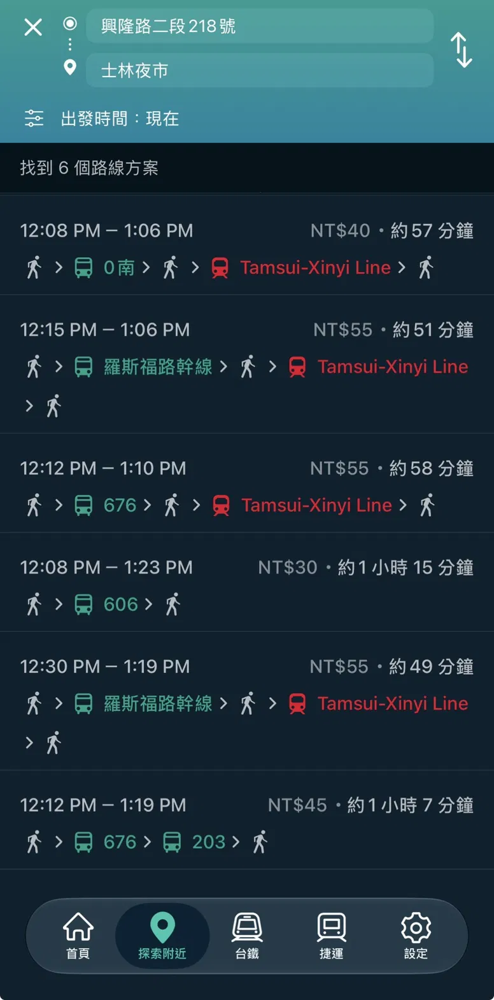
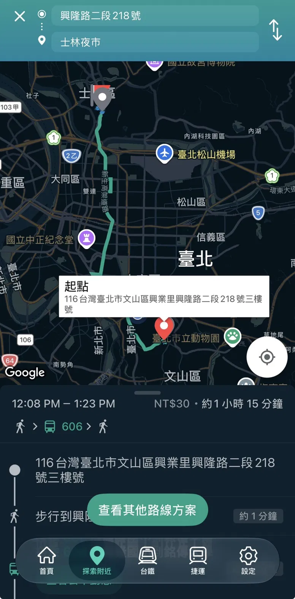
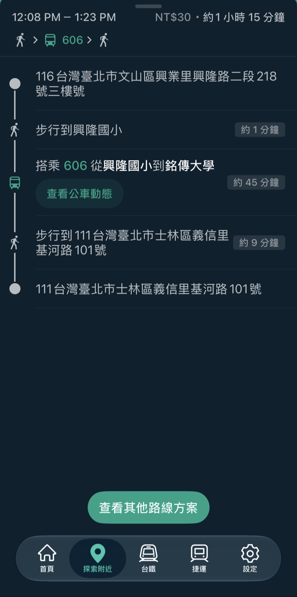

### Q4 正確答案

**暫無。** 需要把 Q1 所有站牌、所有路線、每個方向的下游站逐一查詢後彙整，手動查詢的負擔太大。預計取得 TDX 金鑰後以程式計算。

### Q5 正確答案

萬芳醫院站位於**文湖線**，不換車可到其餘 **23 站**：

- 往動物園方向（3 站）：萬芳社區、木柵、動物園
- 往南港展覽館方向（20 站）：辛亥、麟光、六張犁、科技大樓、大安、忠孝復興、南京復興、中山國中、松山機場、大直、劍南路、西湖、港墘、文德、內湖、大湖公園、葫洲、東湖、南港軟體園區、南港展覽館
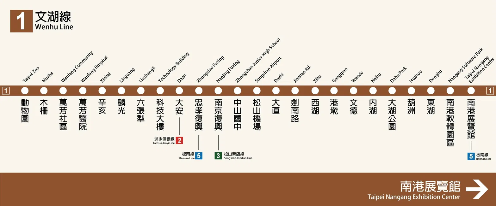

## 現有工具的使用觀察

查詢正確答案的過程，本身也反映現有工具的限制：

| 題號 | 觀察 |
| --- | --- |
| Q1 | Bus+ 只列出附近站牌與距離，要知道經過哪些路線，必須逐一點開每個站牌 |
| Q3 | Bus+ 查詢路線規劃前需觀看十餘秒廣告；結果混合了轉乘與不換車方案，需自行逐一判斷哪個不用換車 |
| Q4 | 需要逐站、逐路線、逐方向查詢再自行彙整，手動查詢負擔過大，無法在合理時間內完成 |

**Citymapper（2026-10-28 補測）**：手機版無法直接輸入地址，需手動拖曳準星到興隆路二段 218 號。「公車」頁面列出附近 6 站全部站牌，每個站牌下列出路線、終點方向與即時到站時間，比 Bus+ 少了逐站點開的步驟。但只顯示終點站，下游停靠站仍需逐條點開；沒有地標，也沒有列出「不換車能到哪裡」的功能。步行時間以目前位置計算，而非準星位置；列表以即時班次為主，沒有班次的路線方向不會顯示。

## 回答紀錄

每個回答都截圖，存在 `images/llm-baseline/`。

### ChatGPT

| 題號 | 有搜尋 | 回答摘要 | 對照正確答案 |
| --- | --- | --- | --- |
| Q1 | 有 | 列出 3 個站：興隆市場、興德國小、興業里。前兩站給了完全相同的路線清單（0南、209、236、236區、253右、棕2、棕3、棕6、指1），興業里為市民小巴 5 | 300 m 內 6 個站只提到**興德國小**；**漏掉最近的興隆國小**（65 m）；興隆市場、興業里不在 300 m 內 |
| Q2 | 有 | 依序列出 12 站，從興德國小到中正環河路口 | **12 站全對，順序正確** |
| Q3 | 有 | 表示「目前還不能確認」有直達路線，反問使用者要從哪個站牌上車 | **沒有給出結論**；正確答案是能（606，興隆國小上車） |
| Q4 | 有 | 以區域回答：公館／臺大（0南、253、羅斯福路幹線）、師大／東門（0南）、台北車站（253、羅斯福路幹線）、市政府／信義（284）、木柵／動物園（羅斯福路幹線） | 無標準答案；只給區域、未分方向、未列具體站點，並以「可查」「要先確認」保留 |
| Q5 | 有 | 往動物園 3 站、往南港展覽館 20 站，逐站列出 | **23 站全對**；但描述文字有誤：稱文湖線為「BR 藍線？」、「環狀折返」 |

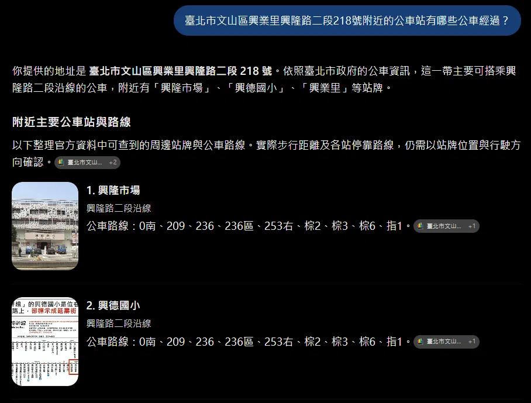
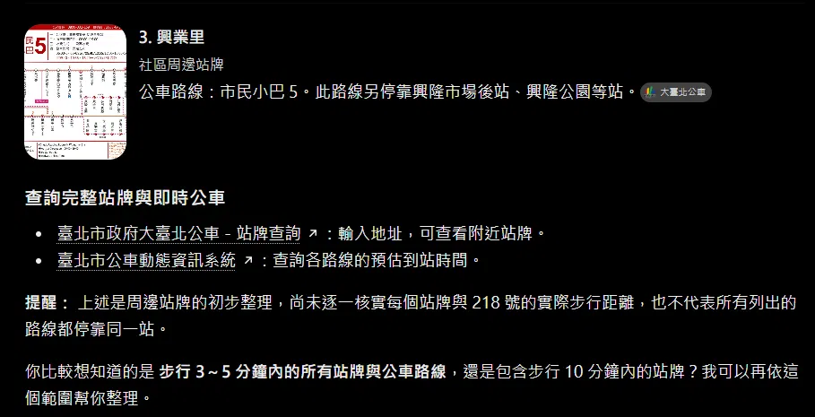
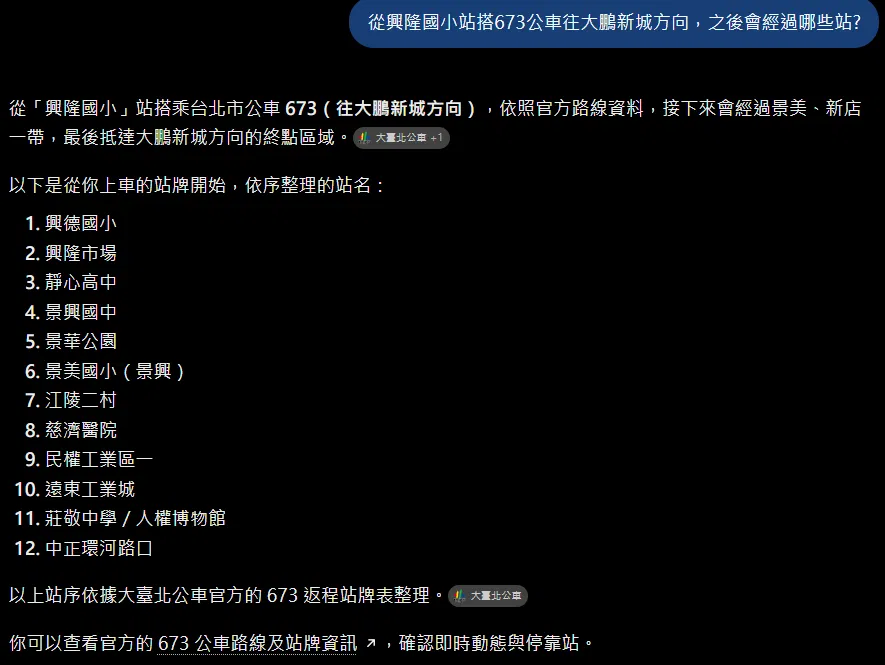
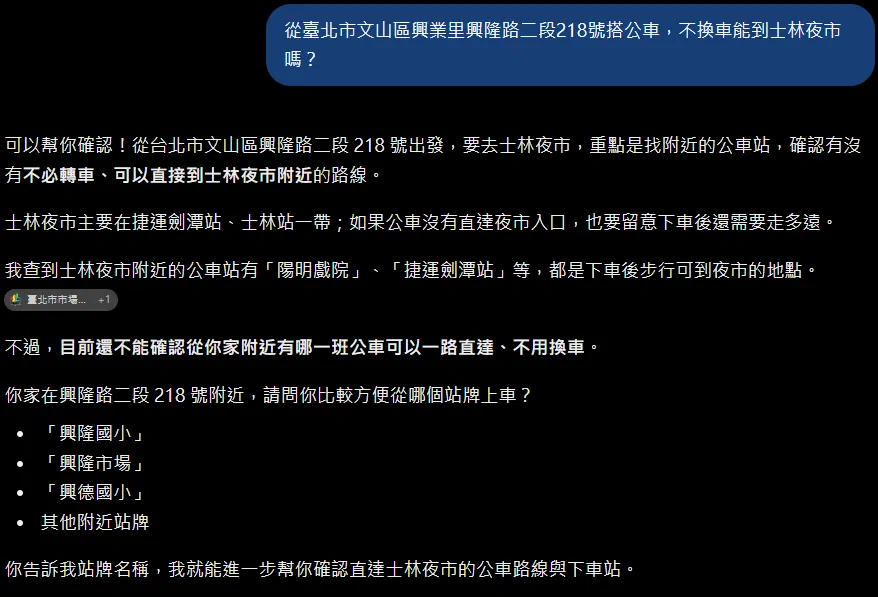
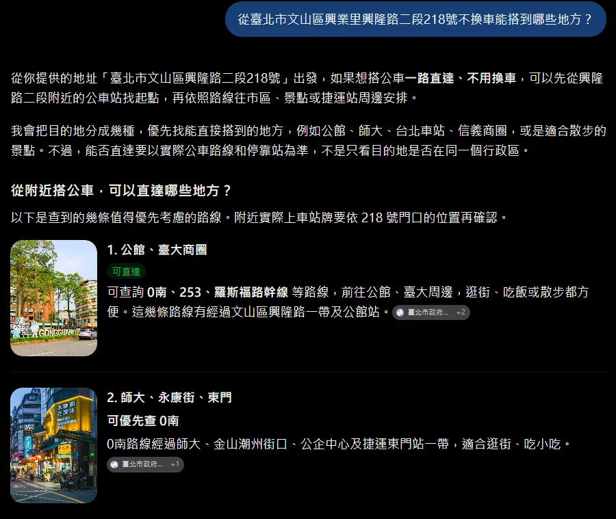
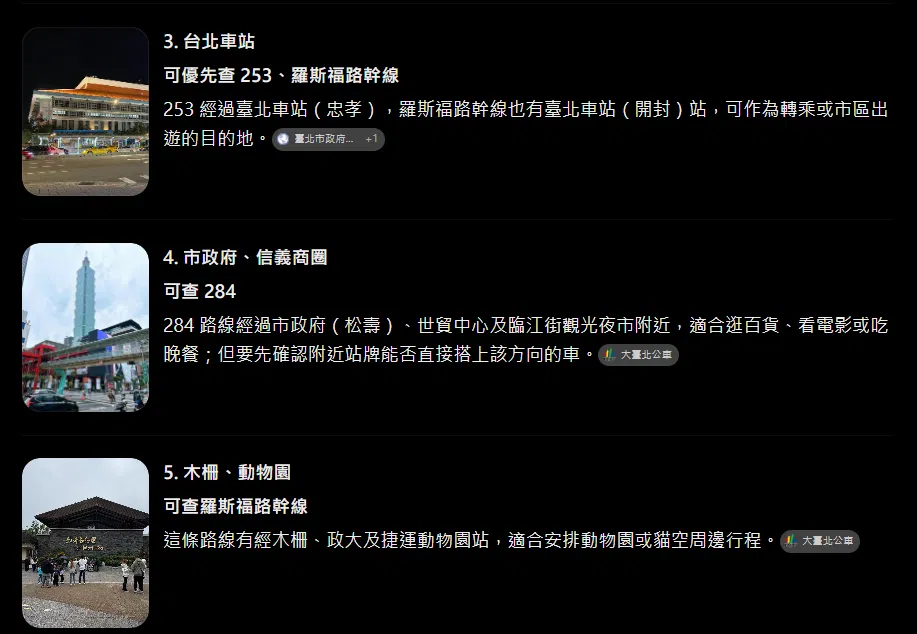
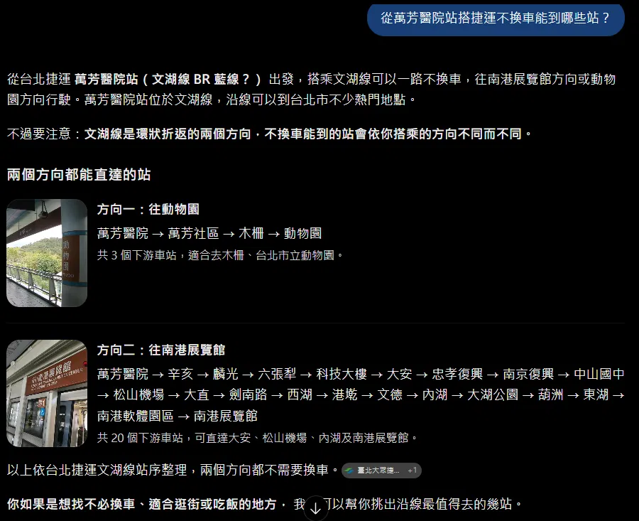

**跨題可驗證的遺漏**：由 Q2 正確答案與 606 站序可知，673 與 606 都會停靠興德國小，但 ChatGPT 在 Q1 列出的興德國小路線清單中**兩條都沒有**；Q1、Q4 也完全沒提到 606 與士林方向。

### Gemini

| 題號 | 有搜尋 | 回答摘要 | 對照正確答案 |
| --- | --- | --- | --- |
| Q1 | 畫面無來源標示 | 稱最近的站牌為「興隆市場後站」與「興隆市場」，列出 14 條路線：0南、109、236區、253、530、606、671、673、676、棕2、棕6、棕11、羅斯福路幹線、市民小巴5 | 300 m 內 6 站**一個都沒提到**，**漏掉最近的興隆國小**；路線清單有包含 606、673 |
| Q2 | 有 | 依序列出 12 站，標註中正環河路口為終點站 | **12 站全對，順序正確** |
| Q3 | 有（呼叫 Google 地圖） | 可以。搭 606（往榮總方向），於興德國小或興隆市場上車，於捷運劍潭站(中山)、小北街或士林站下車 | **結論正確，但下車站有誤**：606 站序中沒有「小北街」「士林」，也沒有「捷運劍潭站(中山)」（606 的站名為「劍潭」）。上車站興德國小、興隆市場確實是 606 停靠站，但不是最近的興隆國小 |
| Q4 | 有 | 列出 13 條路線名稱（與 Q1 相同，少了市民小巴5） | 無標準答案；**只列路線，沒有回答能到哪些地方**，未分方向、未列下游站 |
| Q5 | 有 | 稱共 23 站；往動物園方向「共 3 站」卻列出辛亥、萬芳社區、木柵、動物園 4 站；往南港展覽館方向 19 站 | 23 站都有出現，但**辛亥被放錯方向**（辛亥在往南港展覽館方向），標題「3 站」與實際列出 4 站不一致 |

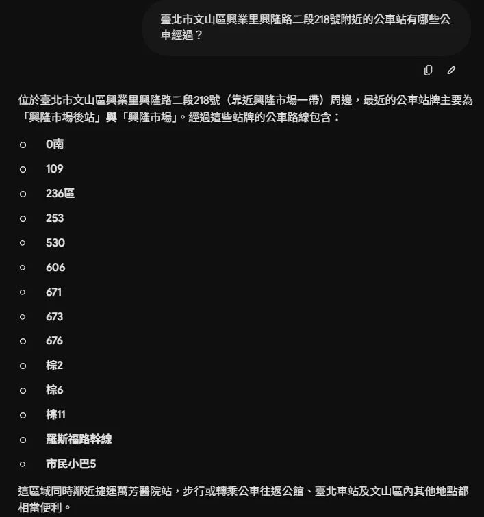
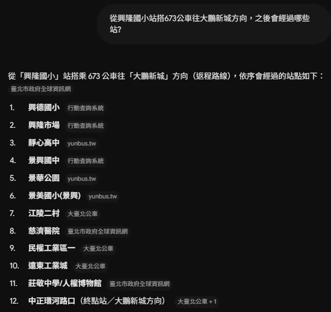
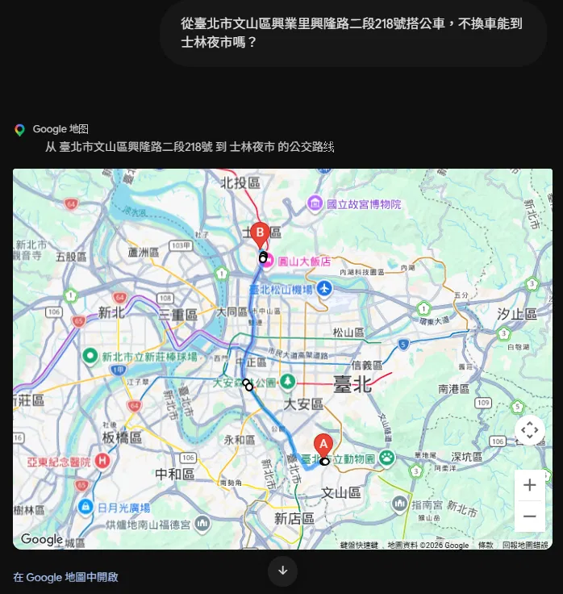
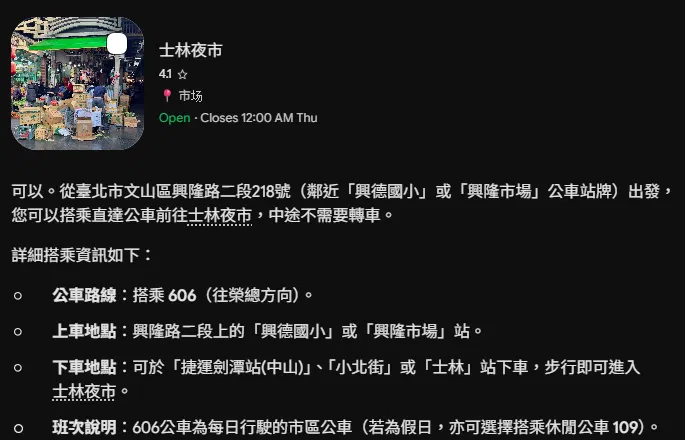
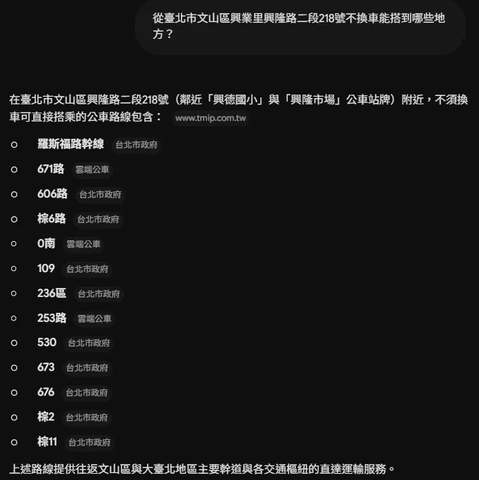
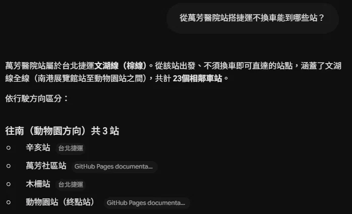
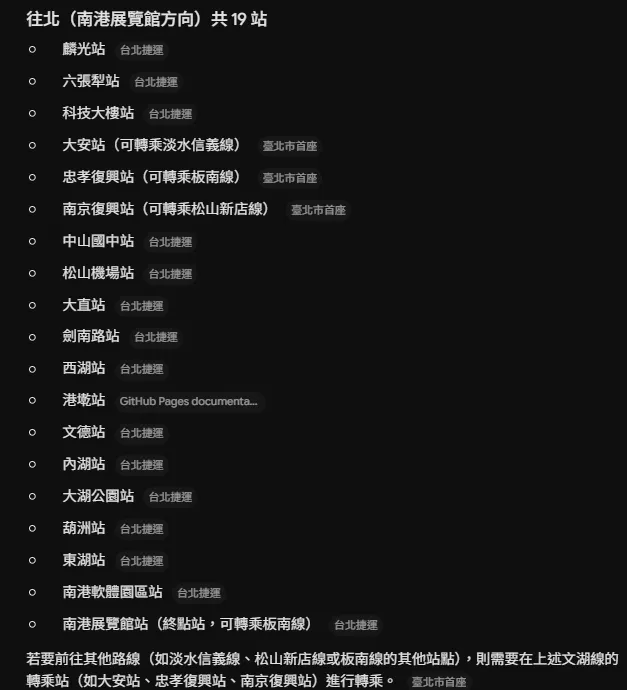

### Claude

| 題號 | 有搜尋 | 回答摘要 | 對照正確答案 |
| --- | --- | --- | --- |
| Q1 | 有 | 先說明「沒找到這個門牌專屬的站牌與路線清單」。列出興隆市場後站、敦南203巷、興隆市場、興隆國小、興德國小、福興路口、敦南美景；路線只確認興隆國小可搭 0南、530、606，其他站表示查不到，建議用 Google 地圖或 App 自行查詢 | 300 m 內 6 站提到 **3 站**（興隆國小、興德國小、福興路口）；漏掉興隆公園、中國科技大學(辛亥)、興隆路口(辛亥)。來源多為 591、信義房屋等租屋物件頁 |
| Q2 | 有 | 列出 12 站後，**自行補上第 13 站「大鵬新城（終點站）」**，並說明官方站序只到中正環河路口，是依方向名稱推測補上 | 12 站全對；**多補 1 個實際不存在於此方向的站** |
| Q3 | 有 | 可以。搭 606 往榮總方向，推測最近的上車站為興隆國小或中國科技大學(興隆)，在劍潭或銘傳大學下車；另附班距、車程約 45 分鐘、兩段票，並說明 109 只在假日行駛 | **結論正確**，下車站與 Bus+ 一致（銘傳大學）；所述停靠順序（公館、東門、民族東路口、劍潭、銘傳大學）與 606 站序一致；有說明上車站是推測 |
| Q4 | 有 | 依上車站分組：興隆國小／中國科技大學(興隆) 可搭羅斯福路幹線、606、236區間車、棕2，並列出沿途主要地點與反方向；興隆路口(辛亥) 可搭 237、298、673、棕12、棕22；辛亥站一帶另有 294、295、611，以表格列出可到的地方 | 無標準答案；三家中最詳細，有分上車站與方向，但只列主要地點、未完整列出下游站；606 只寫到「終點榮總」，**沒有提到 Q3 自己說的劍潭、士林**；辛亥站一帶超出 300 m |
| Q5 | **沒有搜尋**（回答註明「憑既有資料整理，沒有即時查證」） | 往動物園 3 站；往南港展覽館方向第一站寫成「**輔大醫院**」，其餘 19 站正確 | **辛亥被替換成不存在於文湖線的「輔大醫院」**，涵蓋 22/23；轉乘說明也有誤：松山機場站不能轉松山新店線、南港展覽館站不能轉台鐵與高鐵 |

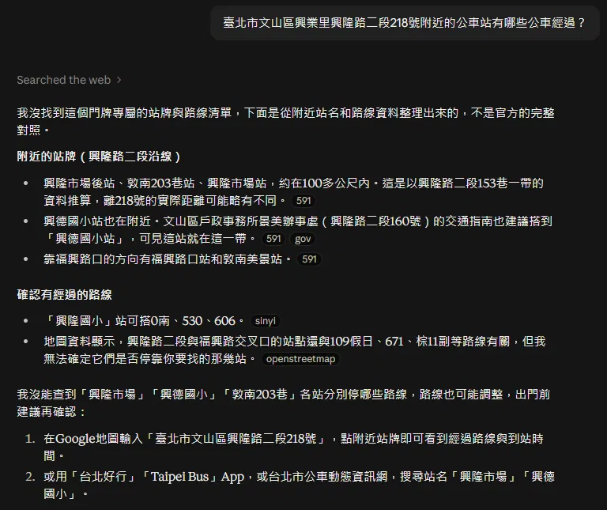
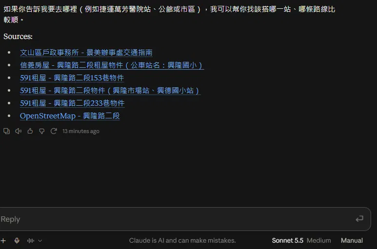
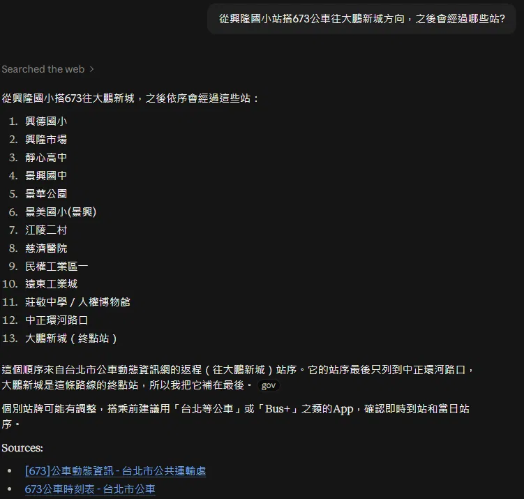
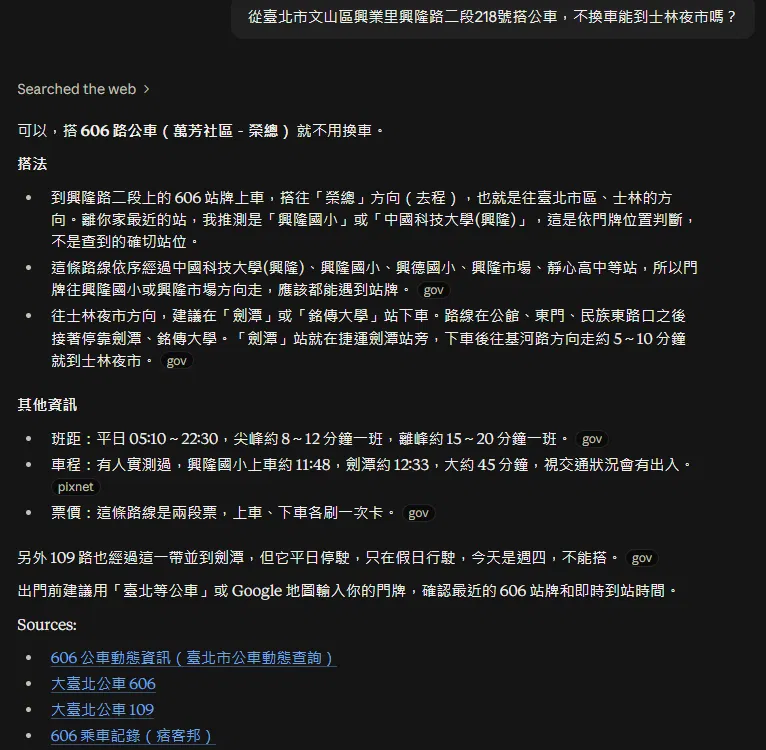
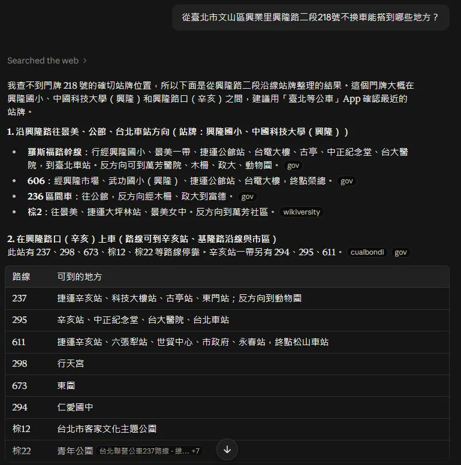
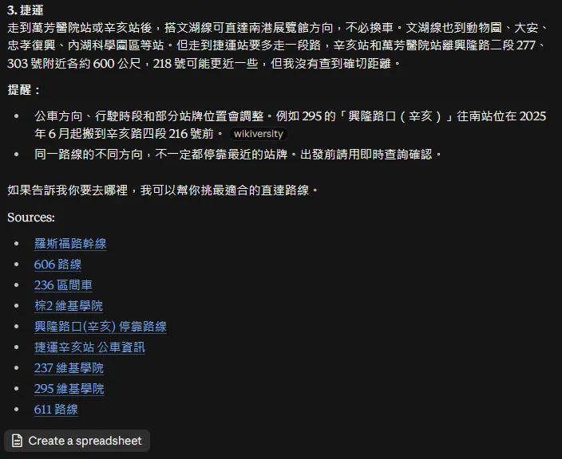
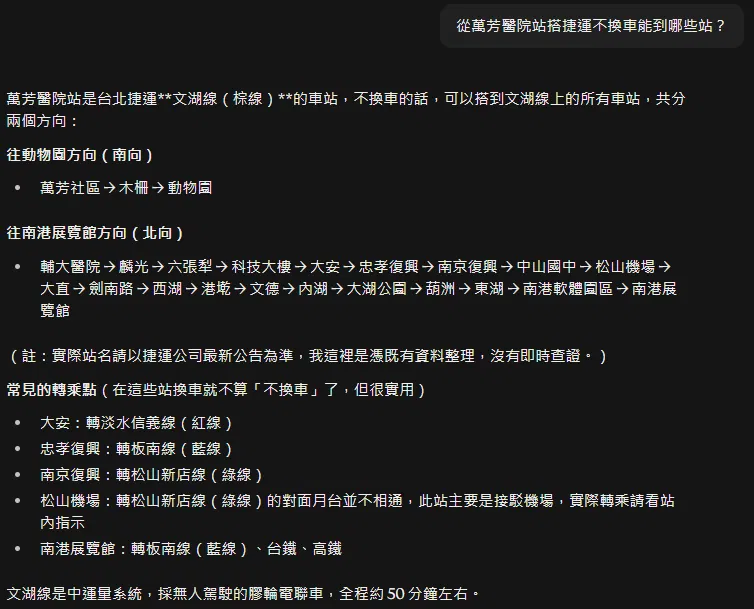

### 補充測試：Google Maps

台灣目前無法使用 Ask Maps（Gemini 對話式搜尋），改測 Google Maps App 中可用的兩種入口。只測 Q1，因為 Q1 最能看出是否彙整附近所有站牌。

| 項目 | 設定 |
| --- | --- |
| 測試日期 | 2026-10-28 |
| 裝置 | 手機版 Google Maps App |
| 入口 1 | 搜尋框輸入文字 |
| 入口 2 | 導航途中點選右下角 Gemini 按鈕，以語音提問 |

#### 入口 1：搜尋框

畫面沒有 Gemini 標示，也沒有生成的文字回答，結果是地圖標記與地點清單，屬於地點搜尋。

| 問法 | 結果 | 對照正確答案 |
| --- | --- | --- |
| Q1「…218號附近的公車站有哪些公車經過？」 | 列出 4 站：興隆路口(辛亥)、興業里、興得閱覽室、敦南大地(文山森林公園) | 涵蓋率 1/6，正確率 1/4；「公車經過」未被回答。「興業里」與問句中的里名相同 |
| 簡化問法「…218號附近的公車站有哪些?」 | 列出 6 站：興隆國小、福興路口、興德國小、興隆公園、中國科技大學(辛亥)、興隆路口(辛亥)；點選站牌可看經過路線 | 涵蓋率 6/6，正確率 6/6；路線需逐站點開 |

左:簡化、右:Q1

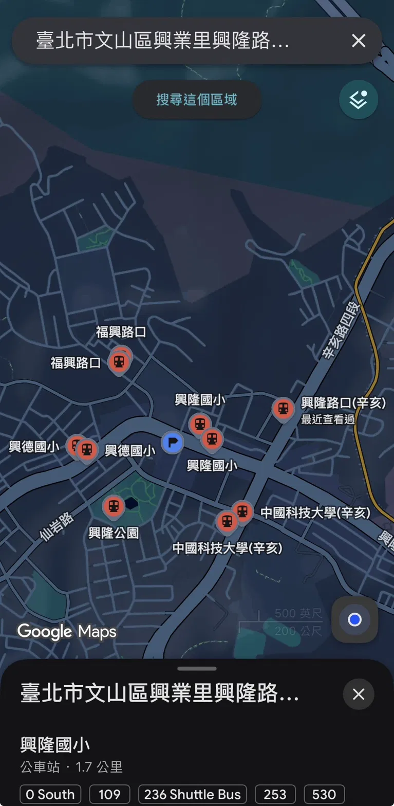
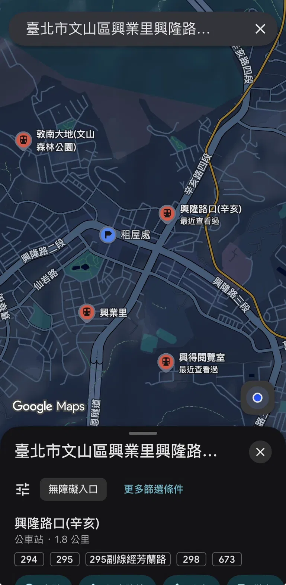

#### 入口 2：導航中的 Gemini（語音）

| 問法 | 結果 | 對照正確答案 |
| --- | --- | --- |
| Q1「…218號附近的公車站有哪些公車經過？」 | 語音回答最近的站為興隆國小，並唸出停靠路線；地圖未顯示其他資訊 | 涵蓋率 1/6，正確率 1/1 |
| 簡化問法「…218號附近的公車站有哪些?」 | 語音回答興隆路口(辛亥)、興隆市場；畫面下方顯示搜尋詞「興隆路二段 公車站」 | 涵蓋率 1/6，正確率 1/2；漏掉最近的興隆國小，興隆市場不在 300 m 內 |

左:簡化、右:Q1

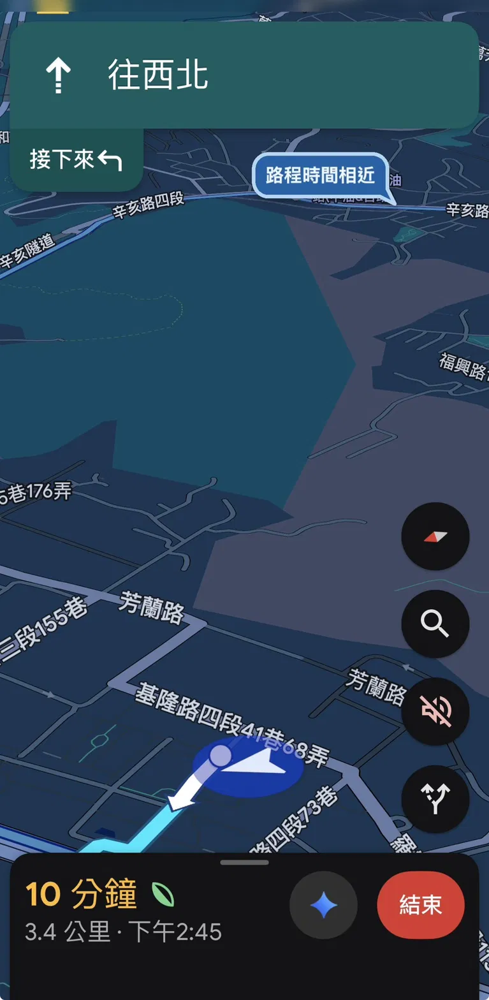
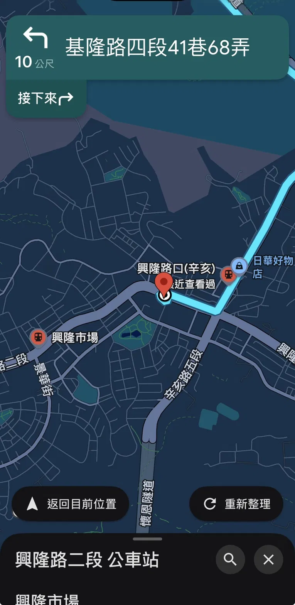

#### 觀察

- **搜尋框對問法很敏感**：問句簡單時能找出全部 6 站，加上「有哪些公車經過」後只剩 1 站正確，並出現與問句里名相同的「興業里」。它回傳的是排序後的地點清單，不會針對問題生成回答。
- **Gemini 把問題改寫成一般搜尋**：畫面顯示搜尋詞為「興隆路二段 公車站」，門牌號碼被丟掉，結果因此偏離起點。這和本專案的架構相同（LLM 理解問題後呼叫工具），差別在於它呼叫的是一般地點搜尋，而不是依站序、方向計算的直達查詢；LLM 回答的品質取決於背後的工具。
- **使用情境不同**：導航中的 Gemini 以語音簡短回答，設計給駕駛使用，不適合在地圖上探索與比較可直達的地點。

### 補充測試：Citymapper

Citymapper 的 AI 功能「專屬推薦」只用在 A 到 B 路線規劃（畫面標示「結合 AI，由我們親手打造」），因此只能測需要目的地的 Q3。

| 項目 | 設定 |
| --- | --- |
| 測試日期 | 2026-10-28 |
| 裝置 | 手機版 Citymapper App |
| 起點／終點 | 興隆路二段 218 號／士林夜市（基河路 101 號） |
| 模式 | 專屬推薦 |

| 方案 | AI 說明 | 路線 | 時間 | 票價 |
| --- | --- | --- | --- | --- |
| 你的最佳路線 | 「最快抵達，且公車班次非常多」 | 公車（0南、236區、253…）→ 捷運松山新店線 → 淡水信義線 | 53 分鐘 | NT$37 |
| 不錯的替代路線 | 「想省錢或不想走路的首選，一車直達免轉乘」 | **606**：興隆國小上車，坐 30 站至銘傳大學，步行 7 分鐘 | 87 分鐘 | NT$15 |

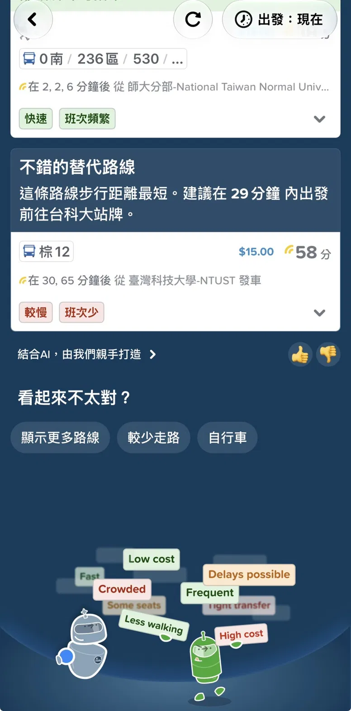

Q3:回答正確

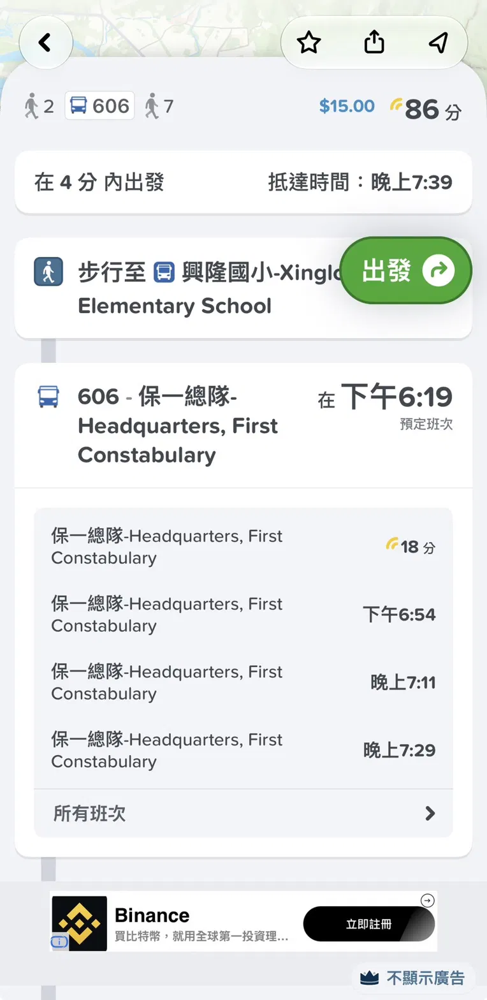

**對照正確答案**：答對。直達路線、上車站、下車站都與 Bus+ 一致，並明確標示「一車直達免轉乘」與站數。

#### 觀察

- **必須先知道目的地**：AI 能判斷「到士林夜市能不能直達」，但無法回答「從這裡能直達哪些地方」（Q4）。
- **直達不是優先考量**：AI 以時間排序，直達的 606 排在需轉乘兩次的方案之後。
- **以站數表示車程**：與本專案 MVP 的做法相同。

### 補充測試：雙北 AI 公車站長

雙北 AI 公車站長（talk2bus.5284.taipei）只能在站牌掃 QR Code 開啟，位置由掃到的站牌帶入，不解析使用者輸入的地址。除了 Q1～Q4，另外追問三題，確認它的限制。

| 項目 | 設定 |
| --- | --- |
| 測試日期 | 2026-10-30 |
| 開啟方式 | 興隆國小站（往萬芳方向那一側）掃 QR Code |
| 提問方式 | 文字，繁體中文 |
| 正確答案 | 本專案資料庫（TDX 公車站序）查詢結果 |

興隆國小有兩個站位（`station_id`），經過的路線不完全相同：

| 站位 | 離起點 | 只停這一側的路線 |
| --- | --- | --- |
| 1000035（往士林方向） | 70 m | 253 |
| 2538（往萬芳方向，本次掃描的一側） | 99 m | 671 |

#### Q1：附近公車站有哪些公車經過

只列出掃到的站位的 15 條路線：棕2、530、236區、606、0南、羅斯福路幹線、676、棕6、棕11副、671、棕11、673、市民小巴5、606通勤、109。方向全部是往萬芳那一側。

**對照正確答案**：15 條與資料庫中 2538 的路線逐條一致，但沒有只停對面的 253，也沒有涵蓋其他 5 個站名。300 m 內的 6 個站名、11 個站位，只涵蓋 1 個站位。回答開頭是「有路線可前往 本站。」，語意不通。

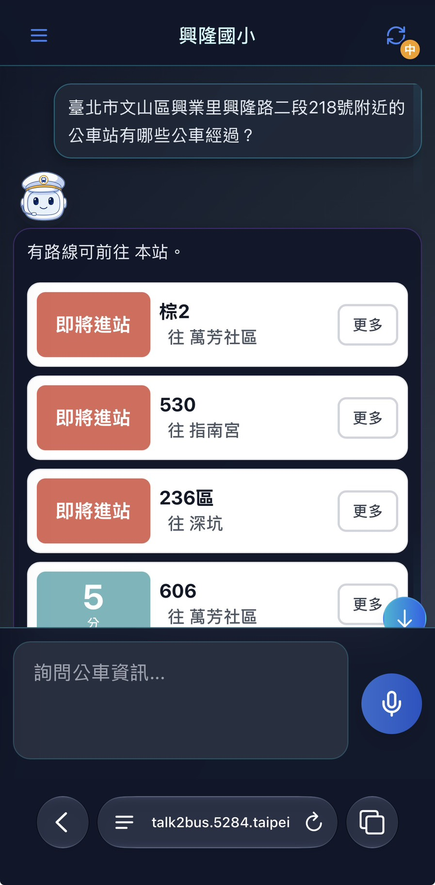
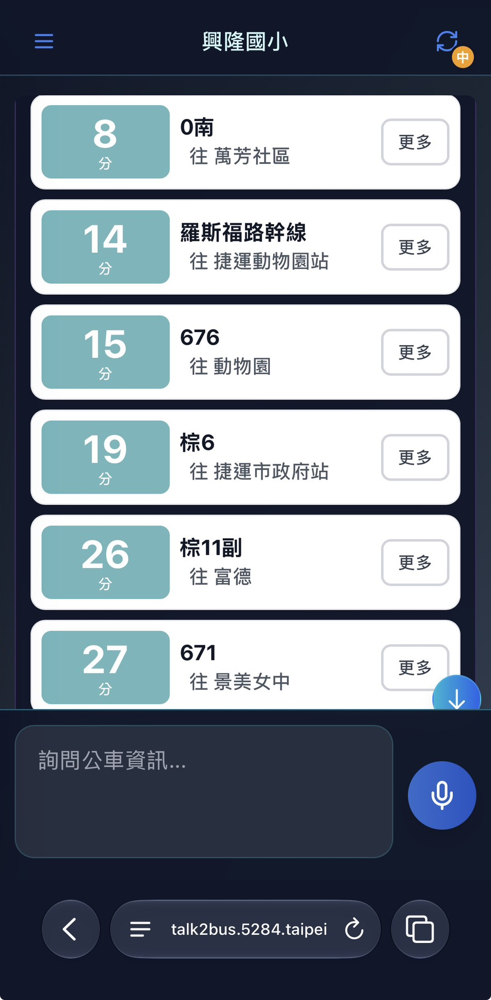
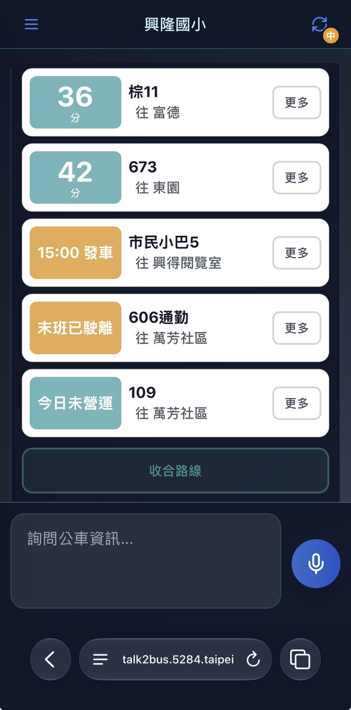

#### Q2：673 往大鵬新城方向，之後會經過哪些站

回覆一張 673 的靜態路線圖，兩個方向都畫在同一張圖上，沒有用文字列出下游站。追問「請用文字列出」，仍然只回路線圖，並說「673 會從大鵬新城一路開到東園」，方向和問題相反。

**對照正確答案**：資料庫中，673 返程從興隆國小（1000035）之後有 12 站：興德國小、興隆市場、靜心高中、景興國中、景華公園、景美國小(景興)、江陵二村、慈濟醫院、民權工業區一、遠東工業城、莊敬中學/人權博物館、中正環河路口（資料庫只有台北市的站，新北市的站未列入）。這份清單與路線圖一致：返程經過景美國小(景興)，不經過只有去程停靠的景美國小(景文)、文山二分局、景美國中。資訊在圖裡，但要使用者自己分辨方向、讀出站名。

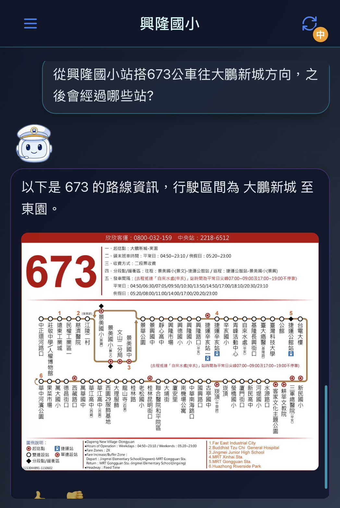
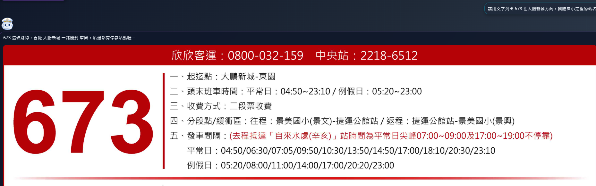
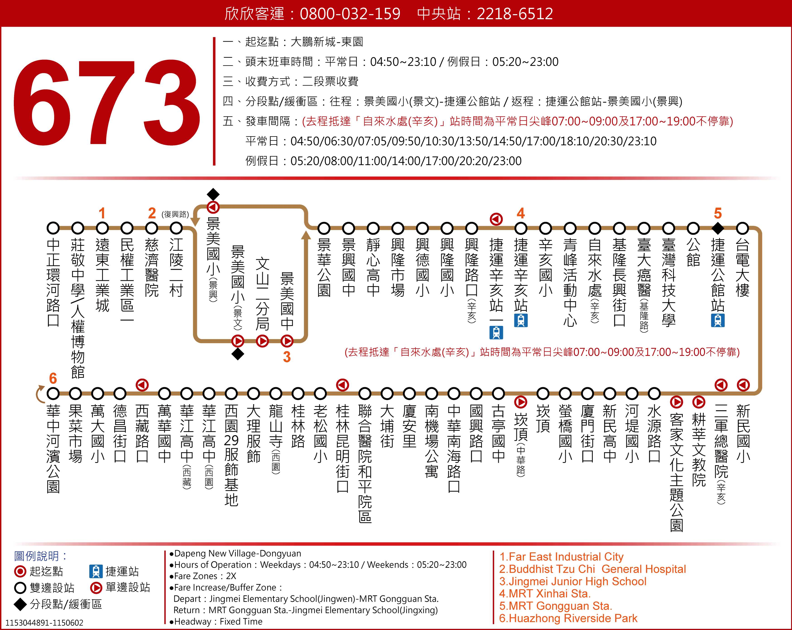

#### Q3：到士林夜市

規劃為步行 59 m 到興隆國小，搭 606 往榮總，在銘傳大學下車，再步行 128 m，乘車 55 分鐘。另列出 109，標示「今日未營運」。

**對照正確答案**：答對。上車站、路線、方向、下車站都與資料庫一致，上車站是對面的站位（1000035），代表規劃路線時有考慮兩側。606通勤沒出現，畫面上同時段標示「末班已駛離」，推測被即時資料濾掉。車程以時間表示，沒有站數。

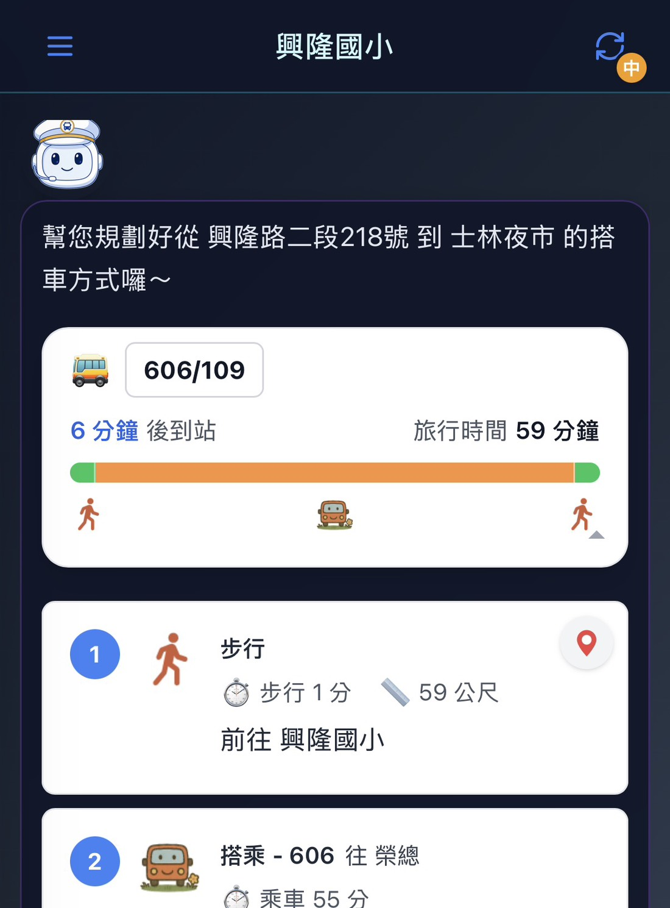
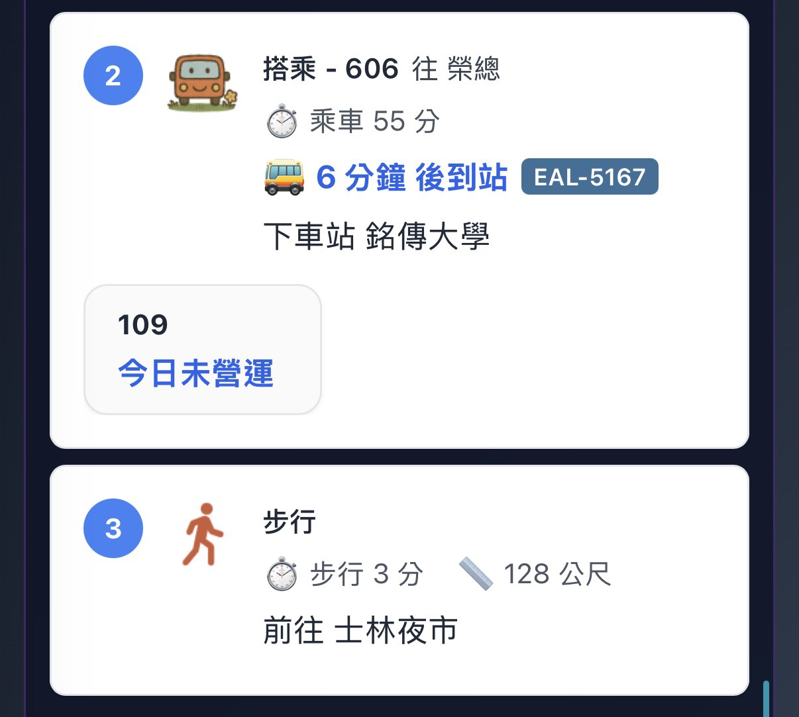

#### Q4：不換車能到哪些地方

問「從這裡不用轉車可以到哪些地方？」，回答「有路線會經過 本站」，列出和 Q1 相同的 15 條路線，沒有任何目的地。

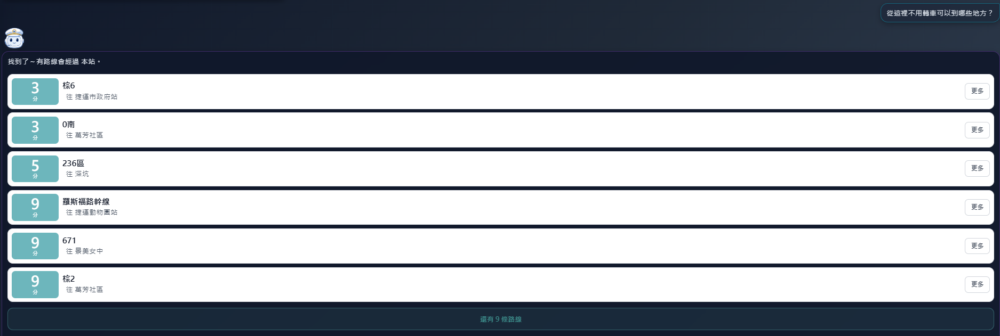

#### 追問

| 問題 | 回答 | 對照 |
| --- | --- | --- |
| 從興隆國小可以不用轉車直接到故宮嗎？ | 「目前沒有適合銜接的班次，所以這次暫時沒有辦法幫您安排轉乘路線」 | 資料庫中，起點直達的下車站沒有站名含「故宮」的站。它沒有捏造直達路線，但也沒有回答「能不能直達」，而是當成轉乘規劃，用即時班次判斷 |
| 253 有停這站嗎？ | 「本站無法搭乘此路線」 | 錯誤。253 停在興隆國小對面的站位（1000035），比掃到的那一側離起點更近 |

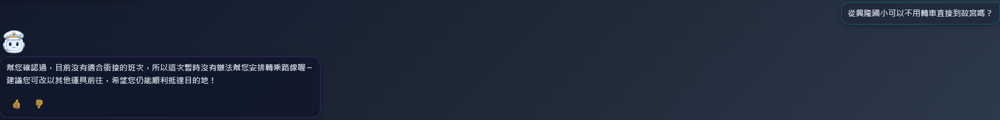

#### 觀察

- **只認得掃到的那一個站位**：同名站的對面、附近其他站牌都不算，253 因此答錯。但 Q3 規劃路線時會用到對面的站位，兩種功能的範圍不一致。
- **不能分方向列出下游站**：只給路線圖，要求文字也一樣。
- **不給目的地就無法回答 Q4**：只會列出本站路線，和 Citymapper 的 AI 一樣必須先知道目的地。
- **以即時資訊為主**：Q3 的路線受當下班次影響（606通勤未列出）；問能不能直達故宮時，回答也混入了即時班次的判斷。

## 侷限性檢核

每個回答逐項檢查，有出現就打勾。

| 侷限 | ChatGPT | Gemini | Claude |
| --- | --- | --- | --- |
| 只列部分路線，以「等」「例如」帶過 | ✓（Q1 開頭「等站牌」、Q4 「等路線」） | ✓（Q1 稱最近站牌「主要為」興隆市場後站與興隆市場） | ✓（Q4「等路線停靠」） |
| 沒有說明搭乘方向 | ✓（Q1、Q4） | ✓（Q1、Q4） | ✓（Q1） |
| 只講大概區域，沒有列出具體站點 | ✓（Q4） | ✓（Q4 只列路線名稱） | ✓（Q4 只列主要地點） |
| 漏掉範圍內的站牌 | ✓（Q1 漏掉興隆國小等 5 站） | ✓（Q1 範圍內 6 站全漏） | ✓（Q1 漏掉 3 站） |
| 捏造不存在的路線或站點 | 待 TDX 資料驗證路線 | ✓（Q3 下車站「小北街」「士林」不在 606 站序中）；其餘路線待 TDX 資料驗證 | ✓（Q2 補上大鵬新城、Q5 輔大醫院） |
| 沒有附來源，或來源過時 | 有附來源 | Q1 無來源標示，其餘有 | Q5 未搜尋；Q1 來源多為租屋網站，非官方資料 |
| 同一模型跨題回答矛盾 | ✓（Q2 列出 673 停興德國小，Q1 興德國小的路線清單卻沒有 673） | | ✓（Q3 說 606 可到劍潭、銘傳大學，Q4 的 606 只寫到終點榮總） |
| 要求使用者自行查詢或補充資訊 | ✓（Q1 附查詢連結並反問範圍、Q3 反問上車站牌） | | ✓（Q1 建議自行用 Google 地圖或 App 查詢） |
| 描述性事實錯誤 | ✓（Q5 稱文湖線為藍線、環狀） | | ✓（Q5 轉乘站說明錯誤） |
| 方向錯誤 | | ✓（Q5 辛亥放錯方向） | |

## 結果彙整

**涵蓋率** = 正確提到的數量 ÷ 正確答案總數

**正確率** = 正確提到的數量 ÷ AI 列出的總數

題目

Q1. 臺北市文山區興業里興隆路二段218號附近的公車站有哪些公車經過？ 目前以**站牌**計分（正確答案為 300 m 內 6 個站名）

Q2. 從興隆國小站搭673公車往大鵬新城方向，之後會經過哪些站?

Q3. 從臺北市文山區興業里興隆路二段218號搭公車，不換車能到士林夜市嗎？

Q4. 從臺北市文山區興業里興隆路二段218號不換車能搭到哪些地方？

Q5. 從萬芳醫院站搭捷運不換車能到哪些站？

| 題號 | 正確答案總數 | ChatGPT | Gemini | Claude |
| --- | --- | --- | --- | --- |
| Q1 | 6 站 | 涵蓋率 1/6（17%）；正確率 1/3 | 涵蓋率 0/6（0%）；正確率 0/2 | 涵蓋率 3/6（50%）；正確率 3/7 |
| Q2 | 12 站 | 涵蓋率 12/12（100%） | 涵蓋率 12/12（100%） | 涵蓋率 12/12（100%）；正確率 12/13 |
| Q3 | 是非題：能 | 未作答 | 結論答對（606），但下車站有誤 | 答對（606），上下車站正確 |
| Q4 | 暫無 | 只給 5 個區域，無法計分 | 只列 13 條路線，無法計分 | 分上車站列出 12 條路線與主要地點，無法計分 |
| Q5 | 23 站 | 涵蓋率 23/23（100%） | 涵蓋率 23/23（100%）；方向正確 22/23 | 涵蓋率 22/23（96%）；捏造 1 站（未搜尋） |

## 結論

### 1. 需要彙整時，涵蓋率明顯下降

| 題目類型 | 題號 | 三家表現 |
| --- | --- | --- |
| 單一資訊（對照組） | Q2、Q5 | 站點涵蓋率 96%～100% |
| 彙整多站牌 | Q1 | 站牌涵蓋率 0%～50% |
| 彙整多路線下游站 | Q4 | 三家都沒有分方向完整列出下游站，分別只給區域、路線名稱或主要地點 |

結果符合假設：通用 AI 能回答單一路線的資訊，但需要彙整多個站牌、多條路線時就無法完整回答。

### 2. 問題不在查不到資料，而在沒有組合起來

三家多數回答都有搜尋網路並附上來源，個別資訊其實查得到，卻沒有整合進答案：

- ChatGPT 在 Q2 正確列出 673 會停興德國小，但 Q1 列出興德國小的路線時沒有 673，也沒有同樣停靠該站的 606。
- Claude 在 Q3 說 606 可到劍潭、銘傳大學，但 Q4 列出 606 的去處時沒有提到士林一帶。
- ChatGPT 與 Gemini 在 Q1 都漏掉距離最近（65 m）的興隆國小站，而 606 正是從這一站上車直達士林夜市（Q3 正確答案）。

### 3. 錯誤形式各不相同，連對照組也會出錯

| 模型 | 錯誤 |
| --- | --- |
| ChatGPT | Q5 稱文湖線為「藍線」「環狀折返」 |
| Gemini | Q3 結論正確，但建議的下車站「小北街」「士林」不在 606 站序中；Q5 把辛亥放錯方向 |
| Claude | Q2 依方向名稱自行補上不存在的終點站；Q5 未搜尋，把辛亥寫成不存在於文湖線的「輔大醫院」 |

這些回答語氣流暢，部分還附有來源，使用者無法從回答本身判斷哪些內容正確。

### 4. 現有工具也無法直接回答

以 Bus+ 查詢正確答案時，Q1 需逐一點開站牌，Q3 需看廣告並自行從轉乘方案中挑出直達方案，Q4 則因資料量太大無法手動完成。

Google Maps 搜尋框用簡單問法能找出附近全部站牌，但原 Q1 問法只對 1 站，且路線同樣要逐站點開；導航中的 Gemini 把問題改寫成一般搜尋後丟失門牌號碼，Q1 站牌涵蓋率只有 1/6。Citymapper 能列出附近全部站牌與路線方向，其 AI 也答對 Q3，但 AI 只用在 A 到 B 規劃，必須先知道目的地。雙北 AI 公車站長同樣答對 Q3，但只認得掃到的那一個站位（Q1 只涵蓋 1/11 個站位），Q2 只給路線圖，Q4 只列出本站路線。

### 對本專案的意義

通用 AI 與現有 App 都無法完整回答「從這裡不換車能到哪裡」。本專案以資料庫計算直達結果來確保涵蓋率，LLM 只負責理解問題與整理結果，不自行產生路線。

### 實驗限制

- 每題只測 1 次，LLM 每次的回答可能不同。
- 只測試 1 個地點（興隆路二段 218 號）與 1 個捷運站。
- Q1 以站牌計分；各家列出的路線是否正確，以及 Q4 的完整答案，需待取得 TDX 資料後驗證。
- Q1～Q3 的正確答案來自 Bus+，其路線規劃不一定列出所有直達方案。
- 各模型皆使用免費版與預設設定，結果反映一般使用者的情境，不代表各模型的最佳表現。
- Google Maps 只補測 Q1，Citymapper 的 AI 只補測 Q3；Ask Maps 在台灣尚未開放，無法測試。
- 雙北 AI 公車站長只在興隆國小的一側測試，結果可能受當下的即時班次影響。
