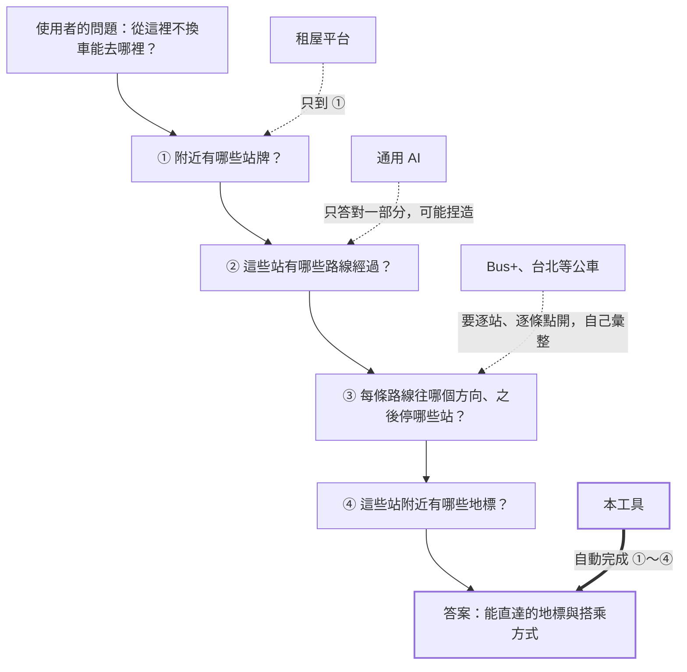
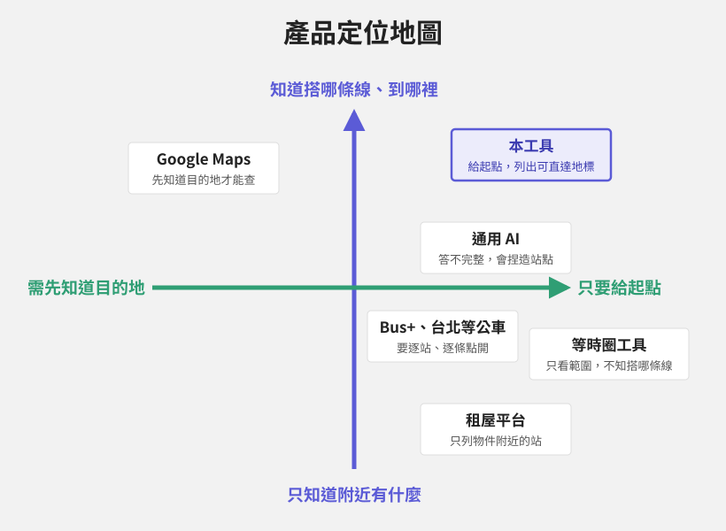
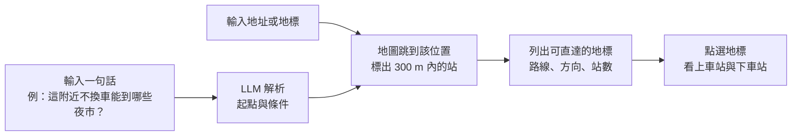
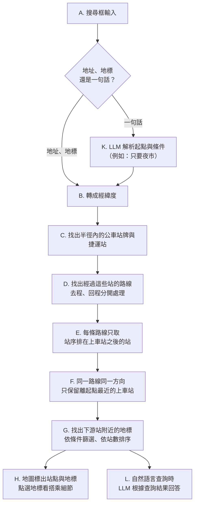
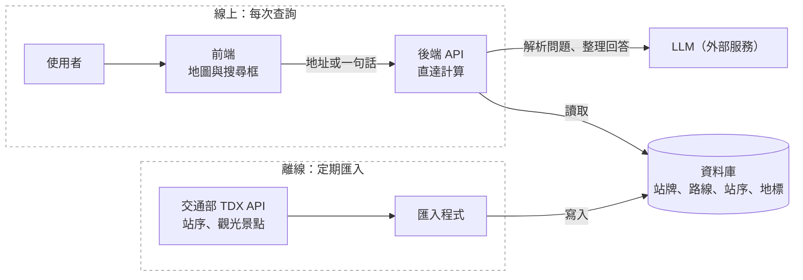
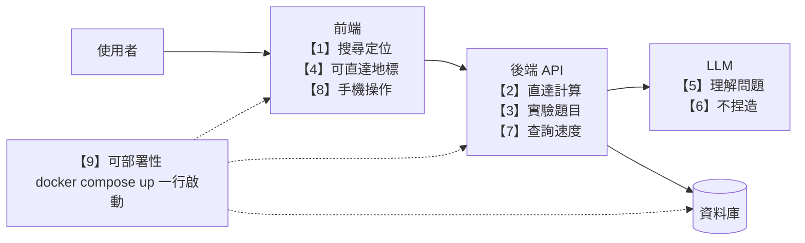

# 專題提案：大眾運輸直達地圖

## 定位與問題

輸入一個地址或地標，地圖會顯示附近的公車站與捷運站，以及從這裡**不換車**能直達哪些地標、要搭哪一條路線、往哪個方向、坐幾站。

現有工具都從「我要去哪裡」出發，所以必須先知道目的地，才能查怎麼搭。但很多決策需要反過來問：「從這裡能去哪裡？」，這部分目前只能靠使用者一條一條點開路線站序自己拼湊。

| 項目 | 內容 |
| --- | --- |
| 目標使用者 | 找房子時想評估交通的人；到陌生地點、想知道下一站能直接去哪裡的人 |
| 核心價值 | 把附近所有站牌、所有路線、每個方向的下游站彙整成一張地圖，資料完整且可查證 |
| 不做什麼 | 不做 A 到 B 路線規劃、不做轉乘、不做即時到站 |

## 使用情境

- **找房子**：評估物件地點不換車能到哪些地方。
- **出遊**：到了某個景點後，看下一站可以直接去哪裡。

## 競品比較

現有工具最多告訴你「附近有什麼站」或「能到哪個範圍」，沒有一個工具彙整「這些站能帶你去哪裡、搭哪條線」。

| 工具 | 能做什麼 | 缺什麼 |
| --- | --- | --- |
| Google Maps | A 到 B 點對點規劃 | 必須先知道目的地 |
| 台北等公車、Bus+ | 附近站牌、單一路線的站序 | 要一條一條點開，無法彙整 |
| Mapnificent 等等時圈工具 | 畫出一定時間內可到達的範圍 | 看不出是哪條線帶你去 |
| 591 租屋網、樂屋網等租屋平台 | 列出物件附近的捷運站、公車站與距離，以及購物、學校等生活機能 | 只告訴你附近有哪些站，不知道這些站能直達哪裡 |
| ChatGPT、Gemini、Claude 等通用 AI | 上網搜尋後拼湊答案 | 回答不完整，甚至捏造站點、給錯方向（見[基準實驗](experiments/llm-baseline.md)） |

回答「從這裡不換車能去哪裡」需要四個步驟，現有工具都只做到其中一部分：

本工具補的是右上角的空缺：只要給起點，就知道搭哪條線能到哪裡。

（位置為定性比較）

**差異化**：以路線為單位、不需換車，每個可到達的地標都標出是哪條線、哪個方向、坐幾站。只需要知道「附近有沒有站」的使用者，租屋平台的資訊已經足夠。

本工具服務的是想進一步知道「從這裡能去哪裡」的使用者。

## MVP（最小可行產品）功能與 AI 角色

範圍限定台北市公車加台北捷運，只計算不換車的直達。介面以地圖為主，搜尋框同時支援地址、地標與自然語言。

兩種輸入最後都走到同一個地圖畫面：輸入地址直接定位；輸入一句話時，先由 LLM 解析出起點與條件。

1. **搜尋與定位**：輸入地址或地標，地圖跳到該位置，標出半徑內（預設 300m）的公車站牌與捷運站。
2. **直達計算**：只取同一方向、站序在上車站之後的站；同一路線同一方向只保留最近的上車站。
3. **可直達地標**：找出下游站附近的地標，列出每個地標可搭的路線、方向與站數，依站數由少到多排序。
4. **搭乘細節**：點選地標後，顯示上車站、路線、方向、下車站、坐幾站。
5. **自然語言查詢**：在同一個搜尋框輸入問題，例如「這附近不換車能到哪些夜市？」，由 LLM 解析出起點與條件，呼叫後端的直達查詢，再根據查詢結果回答，並同步更新地圖。
6. **AI 摘要（次要）**：把查詢結果整理成一段簡短說明，例如「可直達 3 個商圈、2 個夜市」。

**AI 設計原則**：路線資料只來自資料庫，LLM 只負責理解問題與整理結果，不自行產生路線，避免虛構不存在的公車。

### 查詢邏輯

關鍵在 E 與 F：同一個站牌往兩個方向能到的地方不同，所以要按方向和站序取「下游站」；半徑內常有好幾個站牌都停同一條線，只留最近的一個，結果才不會重複。

## 資料來源與初步構想

**資料來源**：

- 交通部 TDX 平台的公車路線站序與捷運站序（含方向、站序、經緯度）。已申請學研會員，免費額度足夠。
- 地標資料：預計使用 TDX 觀光景點資料，涵蓋範圍（例如是否包含夜市、商圈）待取得資料後確認。

**初步構想**：定期把 TDX 的靜態資料匯入自己的資料庫，查詢時只讀資料庫，不每次即時呼叫 TDX，以避開 API 頻率限制（每分鐘 5 次）。

架構分成兩條路徑：

1. 離線路徑定期從 TDX 抓資料存進資料庫。

2. 線上路徑處理使用者查詢，只讀自己的資料庫。LLM 只負責解析問題與整理回答，路線資料一律來自後端的查詢結果。

**技術工具**：包含前端框架、後端 API 框架、PostgreSQL、Docker 與 git/GitHub，具體工具將在設計階段比較後決定，並記錄於技術筆記。

資料庫設計與 ER 圖見 [design/database.md](design/database.md)。

## 先不做的項目

| 項目 | 原因 |
| --- | --- |
| 通勤直達檢查（輸入兩個地址） | 屬於 A 到 B 規劃，Google Maps 已能做得更完整（含轉乘、時間、即時資訊） |
| 轉乘一次 | 計算量與資料複雜度大幅增加 |
| 以時間顯示車程 | MVP 先以站數代替；TDX 是否有完整的台北市公車站間行駛時間，待取得資料後確認 |
| 即時到站資訊 | 現有 App 已做得很好，且會增加 API 呼叫量 |
| 跨縣市 | 先在台北驗證可行性，資料結構相同，之後好擴充 |
| 整合租屋平台資料 | 591 無公開 API，有授權問題。使用者直接貼地址即可 |
| 原生 App | 以手機版網頁（RWD）實作，符合網頁技術棧要求 |

## 驗收標準

下圖標出每項標準驗收的是系統的哪個部分：

**功能正確性**

| # | 項目 | 驗收方式 | 通過標準 |
| --- | --- | --- | --- |
| 1 | 搜尋定位 | 輸入 3 個測試地點，與 Bus+「探索附近」比對 | 300 m 內的站牌全部列出 |
| 2 | 直達計算 | 3 個測試地點各抽查 5 個「路線＋方向」（需包含去程與返程、多站共用的路線、單向路線），與 Bus+ 站序比對 | 上車站、方向、下游站與站數 100% 正確，同路線同方向不重複 |
| 3 | 實驗題目 | 以[基準實驗](experiments/llm-baseline.md) Q1～Q5 測試本系統，與 ChatGPT、Gemini、Claude 比較 | Q1、Q2、Q5 涵蓋率與正確率 100%；Q3 答「能」並給出正確的路線與上下車站；Q4 產出完整清單 |
| 4 | 可直達地標 | 檢查結果列表與點選後的細節 | 每個地標都標示路線、方向、站數，點選後顯示上下車站 |

**自然語言查詢**

| # | 項目 | 驗收方式 | 通過標準 |
| --- | --- | --- | --- |
| 5 | 理解問題 | 準備 10 句測試問題，含條件篩選（例如只要夜市、10 站以內） | 至少 8 句正確解析出起點與條件 |
| 6 | 不捏造 | 檢查 LLM 回答中的每條路線與站名 | 全部都能在後端查詢結果中找到，捏造數為 0 |

**效能與部署**

| # | 項目 | 驗收方式 | 通過標準 |
| --- | --- | --- | --- |
| 7 | 查詢速度 | 量測回應時間 | 一般查詢 1 秒內；自然語言查詢 10 秒內 |
| 8 | 手機操作 | 用手機瀏覽器操作完整流程 | 搜尋、看地圖、點選地標都能正常使用 |
| 9 | 可部署性 | 請他人照 README，在乾淨環境從 clone 開始 | 填好 `.env` 後以 `docker compose up` 一行指令啟動 |
