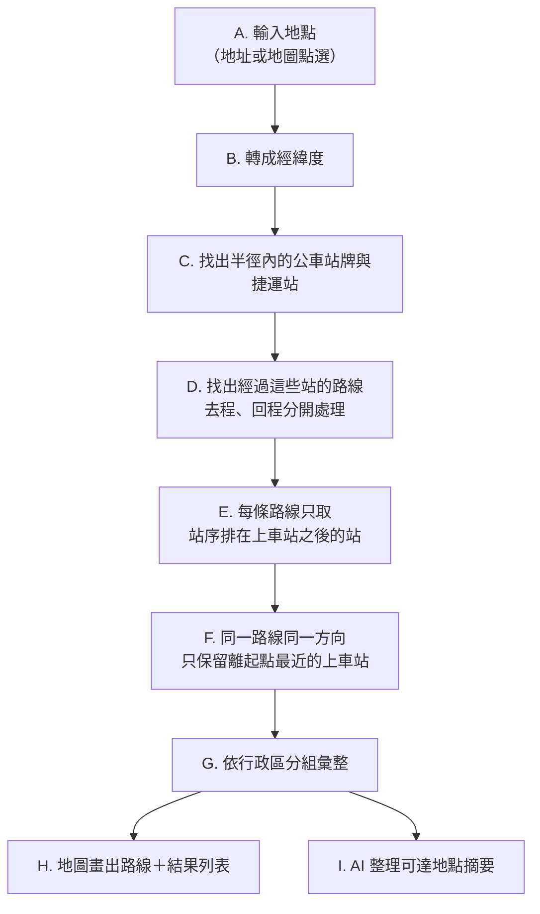
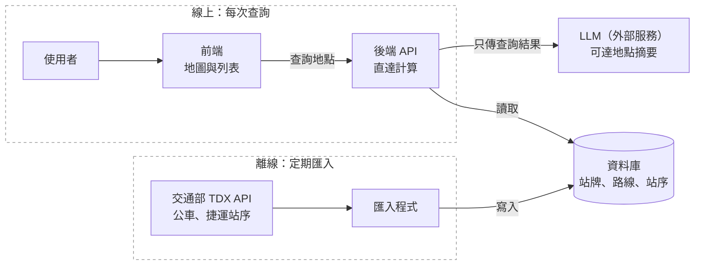

# 專題提案：大眾運輸直達地圖

## 定位與問題

輸入一個地點，顯示從這裡**不換車**能直達哪些地方，以及要搭哪一條公車或捷運、往哪個方向。

現有工具都從「我要去哪裡」出發，所以必須先知道目的地，才能查怎麼搭。但很多決策需要反過來問：「從這裡能去哪裡？」，這部分目前只能靠使用者一條一條點開路線站序自己拼湊。

## 使用情境

- **找房子**：評估物件地點不換車能到哪些地方。
- **出遊**：到了某個景點後，看下一站可以直接去哪裡。

## 競品比較

現有工具最多告訴你「附近有什麼站」或「能到哪個範圍」，沒有一個工具彙整「這些站能帶你去哪裡、搭哪條線」。

| 工具 | 能做什麼 | 缺什麼 |
| --- | --- | --- |
| Google Maps | A 到 B 點對點規劃 | 必須先知道目的地 |
| 台北等公車、Bus+ | 附近站牌、單一路線的站序 | 要一條一條點開，無法彙整 |
| Mapnificent 等等時圈工具 | 畫出一定時間內可到達的範圍 | 看不出是哪條線帶你去 |
| 591 租屋網、樂屋網等租屋平台 | 列出物件附近的捷運站、公車站與距離，以及購物、學校等生活機能 | 只告訴你附近有哪些站，不知道這些站能直達哪裡 |

**差異化**：以路線為單位、不需換車，每個可到達的地點都標出是哪條線、哪個方向、坐幾站。只需要知道「附近有沒有站」的使用者，租屋平台的資訊已經足夠。

本工具服務的是想進一步知道「從這裡能去哪裡」的使用者。

## MVP 功能與 AI 角色
// MVP: Minimum Viable Product

範圍限定台北市公車加台北捷運，只計算不換車的直達。

1. **地點查詢**：輸入地址或在地圖上點選，找出半徑內（預設 300m）的站牌與捷運站。
2. **直達計算**：只取同一方向、站序在目前站之後的站；同一路線只保留最近的站牌。
3. **結果呈現**：地圖畫出路線，列表依行政區分組，標示路線、方向、坐幾站。
4. **AI 可達地點摘要**：結合 TDX 觀光景點資料，由 LLM 把可達站點整理成「可直達 3 個商圈、2 個夜市…」。PS:有餘力可以再加自然語言查詢的功能。

**AI 設計原則**：路線資料只來自資料庫，LLM 只負責理解問題與整理結果，不自行產生路線，避免虛構不存在的公車。

### 查詢邏輯

關鍵在 E 與 F：同一個站牌往兩個方向能到的地方不同，所以要按方向和站序取「下游站」；半徑內常有好幾個站牌都停同一條線，只留最近的一個，結果才不會重複。

## 資料來源與初步構想

**資料來源**：交通部 TDX 平台的公車路線站序與捷運站序（含方向、站序、經緯度）。已申請學研會員，免費額度足夠。

**初步構想**：定期把 TDX 的靜態資料匯入自己的資料庫，查詢時只讀資料庫，不每次即時呼叫 TDX，以避開 API 頻率限制（每分鐘 5 次）。

架構分成兩條路徑：

1. 離線路徑定期從 TDX 抓資料存進資料庫

2. 線上路徑處理使用者查詢，只讀自己的資料庫。LLM 只收到後端算好的結果，不直接接觸原始路線資料。

**技術工具**：包含前端框架、後端 API 框架、PostgreSQL、Docker 與 git/GitHub，具體工具將在設計階段比較後決定，並記錄於技術筆記。

## 先不做的項目

| 項目 | 原因 |
| --- | --- |
| 通勤直達檢查（輸入兩個地址） | 屬於 A 到 B 規劃，Google Maps 已能做得更完整（含轉乘、時間、即時資訊） |
| 轉乘一次 | 計算量與資料複雜度大幅增加 |
| 以時間計算可達範圍 | 需要班表與站間行駛時間，屬於等時圈工具的領域 |
| 即時到站資訊 | 現有 App 已做得很好，且會增加 API 呼叫量 |
| 跨縣市 | 先在台北驗證可行性，資料結構相同，之後好擴充 |
| 整合租屋平台資料 | 591 無公開 API，有授權問題。使用者直接貼地址即可 |
| 原生 App | 以手機版網頁（RWD）實作，符合網頁技術棧要求 |

## 驗證方式

- **正確性**：挑 3 個熟悉的地點，用台北等公車人工核對直達結果。
- **效能**：量測查詢回應時間，目標 1 秒內。
- **可部署性**：請他人照 README 在另一台機器從 clone 開始，以一行指令啟動。
