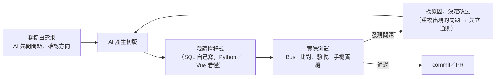

# AI 產出的程式：哪裡改過、為什麼改（草稿）

> 學長 11/5 建議：報告寫出 AI 產出的程式哪裡改過、為什麼改。
> **草稿，待確認**：最後一欄請只勾自己講得出來的；沒勾的不放進報告。

## 開發方式

- 動手前、過程中請 AI 主動問問題，先確認方向和細節；視覺上的選擇先做預覽頁並排比較，再由我決定（`preview.html` 第一～八批）。
- 前端問題 AI 一次只修眼前一個，同一個功能從不同入口進來還是不一致 → 先和 AI 確認、立通則：8 條互動原則＋「入口 × 操作」表，之後每次改介面照表逐格檢查。
- 確認方式：和 Bus+ 逐筆比對站牌和站數、`verify_no_fabrication.py` 把回答裡每條路線和數字對回資料庫、改完程式跑自動測試（`eval_phrasings.py` 56 種問法、`full_test.py`）。

## 改動對照表

依發現的時間排序；「怎麼發現」對應驗收紀錄或每日筆記。

| # | AI 初版的做法 | 怎麼發現 | 改成 | 為什麼 | 能講 |
| --- | --- | --- | --- | --- | --- |
| 1 | Nominatim 用 `bounded=1` 限定台北範圍 | 測「桃園機場」，找到台北市內的「桃園機場捷運台北車站」，回答看起來很合理（11/2） | 不限定範圍，找到後由程式檢查是否在台北市 | 錯得很像對的：限定範圍會把範圍外的地點換成範圍內同名的東西 | ☐ |
| 2 | 路線數交給 LLM 自己數 | 萬芳醫院站答「13 條路線」，實際兩個站位 6＋9 條（11/2） | 程式算好路線數、最少站數，LLM 直接用 | LLM 會數錯 | ☐ |
| 3 | LLM 依 prompt 排序、篩選、寫格式 | 地標實測：460 m 排第一、亂填 `category`、出現 `###`、Gemini 503 時前端只看到 500（11/3） | 排序、篩選由程式做；503／429 重試後回固定訊息 | prompt 要求擋不住；能由程式做的就不交給 LLM | ☐ |
| 4 | nginx 用預設設定 | 第 9 項重新部署，搜尋框回 504，剛好 60 秒（11/3） | `proxy_read_timeout 180s` | nginx 預設等後端 60 秒，Gemini 忙時一題 40 秒以上；開發模式沒有這個限制所以之前沒遇到 | ☐ |
| 5 | prompt 沒規定「附近沒有站牌」怎麼回答 | 查「國立臺灣大學」（定位在校區中央），回答「走路約 0 公尺」，結果裡根本沒有這個數字（11/3） | 程式直接回固定答案 | LLM 會套用別的規則、捏造數字 | ☐ |
| 6 | 方向名稱取站序最後一站 | 第 3 項 Q2「673 往大鵬新城」答不出來（11/4） | 用 TDX `Route` 的起訖站（`headsign`），579 個方向檢查都符合 | 資料的最後一站和車頭公告的名稱不同 | ☐ |
| 7 | LLM 根據查詢結果寫回答（一題 2 次） | 第 3 項 Q4 把 375 個站寫成 52 個；Q5 把 20 站縮成「辛亥至南港展覽館」；超過 10 秒的都是這類題目（11/4） | 回答全部由程式產生，LLM 只回傳參數；捏造 0（141 筆逐筆核對） | 要算、要抄的都不能交給 LLM | ☐ |
| 8 | 起點一律查 Nominatim | 「101」找成新北市三芝區、「萬芳醫院站」找成房屋仲介（11/4） | 先比對資料庫（捷運站、地標、公車站名），對不到才查；地名要有「臺北市」 | 經緯度方框擋不住找錯的地點 | ☐ |
| 9 | 「能到哪裡」列出全部地標 | 站在使用者角度看：22 個地標、每行約 60 字，手機要滑好幾頁（11/4） | 一行摘要 → 精簡清單 → 完整說明 | 資訊過量 | ☐ |
| 10 | System 1 加快取 | 實驗中 C 組命中 0 次，而且 LLM 解析錯會被重用（11/4） | 拿掉快取 | 沒有效益又有風險 | ☐ |
| 11 | 只有地名時交給 Gemini 判斷 | 「台科大」出現四種結果：能到哪、到不了台科大、附近站牌、查不到（11/4） | 簡稱表＋規則：只有地名固定當「能到哪」；Gemini `temperature` 0 | 同一個輸入要得到同一種結果 | ☐ |
| 12 | 前端一次修一個入口 | 新手指引查完點地圖不會收起、提示被面板蓋住（11/4） | 8 條互動原則＋「入口 × 操作」表，照表逐格檢查 | 缺一塊補一塊會一直重複出現同類問題 | ☐ |
| 13 | 看不懂的問題由 Gemini 自己寫回答 | 問「章魚燒」，Gemini 舉了系統答不出來的例子（11/5） | Gemini 只選原因（`explain`），說明由程式產生，附可以點的按鈕 | 只有 LLM 寫的字會亂承諾 | ☐ |
| 14 | 規則的正規表示式 | 48 種問法回歸測試：「台科大能到那些夜市」答成能到哪、「去吃饒河夜市」答成查不到（11/5） | 「那些」當「哪些」、補規則；48 種做成 `eval_phrasings.py` | 改規則容易改壞別的問法 | ☐ |
| 15 | 沒有 Gemini 金鑰時直接建立 client | 部署演練（不填金鑰）：交給 Gemini 的問題回 HTTP 500（11/5） | 回固定說明，常見問法照常可用 | 別人部署時金鑰是選填 | ☐ |
| 16 | README 的驗證步驟用 bash 的 `curl`，步驟分散 | 用「第一次部署的人」的角度重看：Windows PowerShell 的 `curl` 是另一個指令（11/6） | `setup.cmd`／`setup.sh` 一鍵部署＋容器裡跑的自動檢查（11 項）；同學 Windows 10 實測 1 分 30 秒通過 | 各作業系統要同一行指令；部署的人不該需要懂 bash | ☐ |
| 17 | 規則遇到不認得的字直接忽略 | ChatGPT 模擬題目：「哪些**溫泉區**」「不**換線**」照樣回答「能到哪」；長句規則接手後答錯 6 題，自己出的題目 0 題（11/6） | 看不懂就交給 Gemini（不把這些詞加進規則）；新出 30 題驗證：答錯 3 → 1 | 以為看懂的錯看不出來；加詞是照著考題調 | ☐ |
| 18 | Gemini 給的類別直接拿去查 | 同一題跑 5 次錯 2 次，寫成「景類」，回答「到不了清單裡的景類」（11/6） | 不在 7 類裡就改正或當成沒填 | schema 的選項對 Gemini 只是提示 | ☐ |
| 19 | Nominatim 第 1 個結果直接採用 | 新題目：「台北市政府」找成政大附中，照常回答「搭公車沒辦法到松山機場」（11/6） | 拿 5 個候選，名字（含 OSM 別名）對得上才採用，否則說找不到；地標名稱 180 個：看不出的錯 12 → 5 | 借鑑地圖 App：沒把握就不替使用者決定 | ☐ |

## 報告呈現建議

- 不用全部講：挑 #7（捏造）、#4（部署）、#11＋#12（一致性、立通則）三個，各一張投影片，其他放附錄。
- 每個例子照「發現 → 原因 → 改法 → 驗證數字」講，重點放在怎麼發現。
