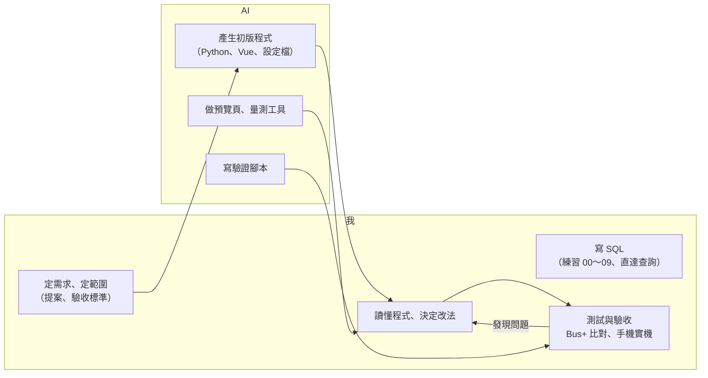
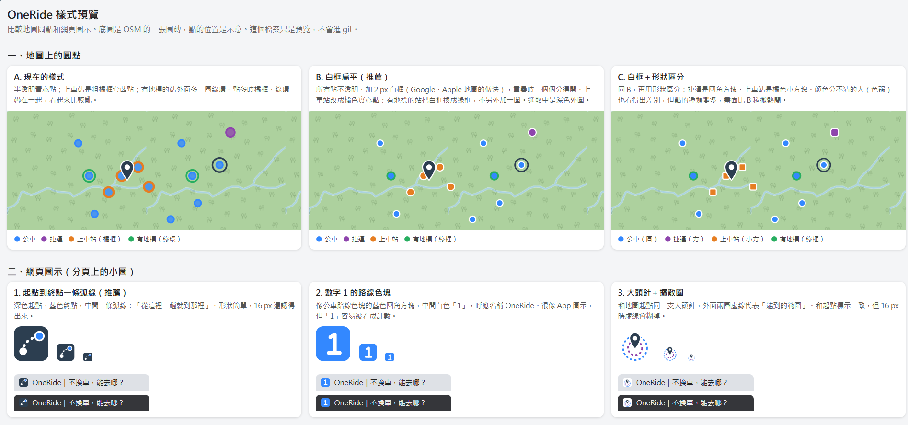
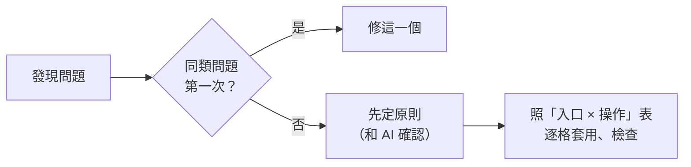
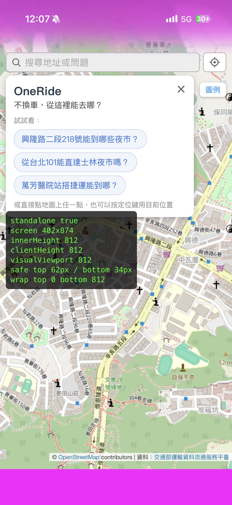

# 我怎麼用 AI 輔助開發（報告第 5 節草稿）

> 素材：[ai-changes.md](ai-changes.md)（15 項改動對照）、`images/ai-usage/`。呈現原則：AI 產生初版，由我理解、測試、決定改法。

## 分工

| 部分 | 誰寫 | 我的要求 |
| --- | --- | --- |
| SQL（直達查詢） | 我自己寫，AI 給填空和檢查 | 要能自己寫出來 |
| Python、Vue | AI 產生初版 | 逐段看懂、答得出執行順序 |
| 驗收、實測 | 我 | 每個數字對回 Bus+ 或資料庫 |

**為什麼這樣分**：時程短（提案到驗收約兩週），把時間花在理解設計和驗證結果上；專案的核心（直達查詢）是 SQL，所以 SQL 自己寫。

## 五個做法

### 1. 先問再做

請 AI 在動手前、過程中主動問我問題，先確認方向和細節，避免做完才發現方向不對。

### 2. 視覺先預覽再決定

有多種做法時，請 AI 做一頁並排比較（`preview.html`，共八批：圓點樣式、圖示、面板、載入畫面…），由我挑。

### 3. 重複出現的問題 → 先立通則

修前端問題時，AI 一次只修眼前那一個，同一個功能從不同入口進來行為還是不一致（新手指引查完點地圖不會收起、提示被面板蓋住、「台科大」每次結果不同）。我請它先跟我確認，整理出 **8 條互動原則**和一張「**入口 × 操作**」表，之後每次改介面都照表逐格檢查，避免缺一塊補一塊。

### 4. 用量的，不用猜的

iPhone 主畫面全螢幕時底部露出一條。原因不明時不讓 AI 用猜的改，而是請它做一個暫時的檢測框，在實機上顯示各種高度，量到 `innerHeight` 只有 812（螢幕 874），才找到要用 `100lvh`。

### 5. AI 的產出用獨立的方法驗證

| 驗證方式 | 驗什麼 | 結果 |
| --- | --- | --- |
| 和 Bus+ 逐筆比對 | 附近站牌、路線、方向、站數 | 範圍內 13/13；抽查 15 組全對 |
| `verify_reach_raw.py`：直接從原始資料重算 | 直達查詢 | 3,415 筆一致 |
| `verify_no_fabrication.py`：回答裡每條路線和數字對回資料庫 | 不捏造 | 280 筆、0 個問題 |
| `eval_phrasings.py`、`full_test.py`：改完就跑 | 改 A 壞 B | 56 種問法、151 項檢查 |
| 請別人照 README 部署、請別人出題 | 自己看不到的盲點 | 進行中 |

驗證腳本也是 AI 寫的，所以也要驗證它：故意竄改回答，4 個錯都抓得到；11/5 也抓到檢查腳本自己的 bug（地點名稱有空白時比對失敗）。

## 學到的

- **AI 擅長局部，原則要人定**：一次修一個問題很快，但不會自己發現「同一類問題」；立了原則以後，它照原則做得很好。
- **錯得像對的最危險**：LLM 把 375 寫成 52、Nominatim 把「101」找到新北市，結果看起來都很合理，只有獨立的驗證才抓得到。這也是系統設計的原則：要算、要查的都不交給 LLM。
- **改動要能追溯**：每個問題照「問題 → 參考 → 行動 → 驗證」記在每日筆記，報告的改動對照表（[ai-changes.md](ai-changes.md)）就是從筆記整理出來的。
