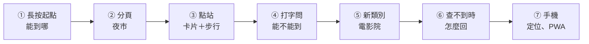

# 現場展示流程（草稿）

> 學長建議報告以現場跑一次系統為主。以下每一步都有預期結果，預演時逐項打勾；
> 除了標「Gemini」的那一步，其他都走規則或直接帶參數，**不依賴 Gemini**，Gemini 很慢或掛掉也能展示。

| # | 操作 | 預期結果 | 展示的重點 | 預演 |
| --- | --- | --- | --- | --- |
| 1 | 長按興隆路二段 218 號附近 | 大頭針＋面板半頁：不換車能到 375 個站，各類代表地點 | 給起點就知道能去哪（定位） | ☐ |
| 2 | 點分頁「夜市」 | 能到 8 個夜市・最近：景美夜市 6 站；地圖只畫每個夜市最推薦的那一站 | 分頁直接帶參數，結果一致 | ☐ |
| 3 | 點地圖上的銘傳大學（金黃框） | 卡片：109（27 站，往陽明山）、606、606通勤（30 站），上車站興隆國小；地標士林夜市約 4 分 217 m → 點那一列出現虛線、小旗、「導航」 | 路線、方向、站數、上下車站；步行到地標（延伸） | ☐ |
| 4 | 搜尋框：「從台北101能直達士林夜市嗎？」 | 能直達・最少 12 站（淡水信義線） | 自然語言，規則解析、不呼叫 Gemini | ☐ |
| 5 | 搜尋框：「台科大能到哪些電影院？」 | 能到 5 個電影院・最近：信義威秀影城 9 站 | 簡稱「台科大」、新類別 | ☐ |
| 6a | 搜尋框：「台科大能到哪些咖啡廳？」 | 查不到「咖啡廳」＋說明為什麼沒收錄＋可以點的分頁按鈕 | 查不到時不亂答 | ☐ |
| 6b | （Gemini）搜尋框：「我想從台科大去吃饒河夜市」 | 交給 Gemini 解析，回答能不能到饒河街觀光夜市 | System 2：規則看不懂才用 LLM | ☐ |
| 7 | 手機（主畫面的 OneRide）按定位鍵 | 面板：起點「你的位置」＋分頁 | 手機優先、PWA | ☐ |

時間：每步約 30 秒～1 分鐘，全部約 6～8 分鐘。可以搭配講 `metrics.path`（rule／llm／button）說明 System 1／System 2。

## 備案

| 狀況 | 備案 |
| --- | --- |
| Gemini 很慢或沒回應 | 跳過 6b，說明這就是常見問法改走規則的原因；改秀 [System 1 實驗紀錄](../experiments/system1-2026-11-04/C-log.txt) |
| 現場網路不通、連不到 VM | 播放事先錄好的影片（同上流程）；或用筆電本機跑 Docker（事先 build 好；底圖仍需要網路） |
| 底圖第一次打開全灰 | 等幾秒（有重試）或重新整理 |
| 手機連不到 Tailscale 網址 | 確認手機 VPN 開著、VM 的 `tailscale serve status`；改用筆電展示 |

## 報告前要準備

- [ ] 錄一支完整流程的影片（手機螢幕錄影＋筆電各一支）
- [ ] 決定展示裝置：手機投影（怎麼投？）或筆電瀏覽器
- [ ] 確認報告場地的網路，手機能不能開 Tailscale
- [ ] 預演一次，記下每步實際秒數
