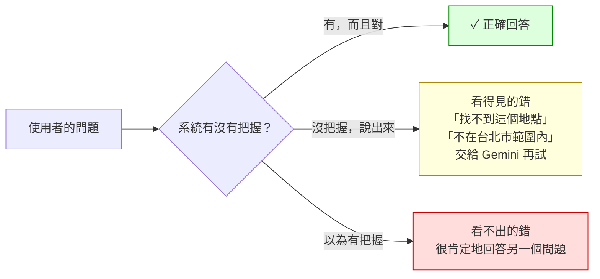
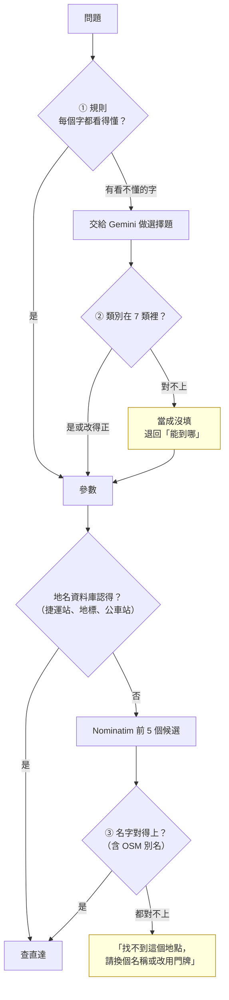
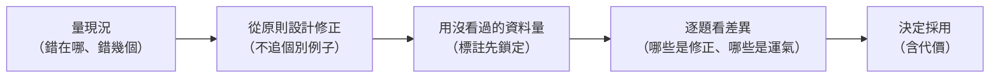
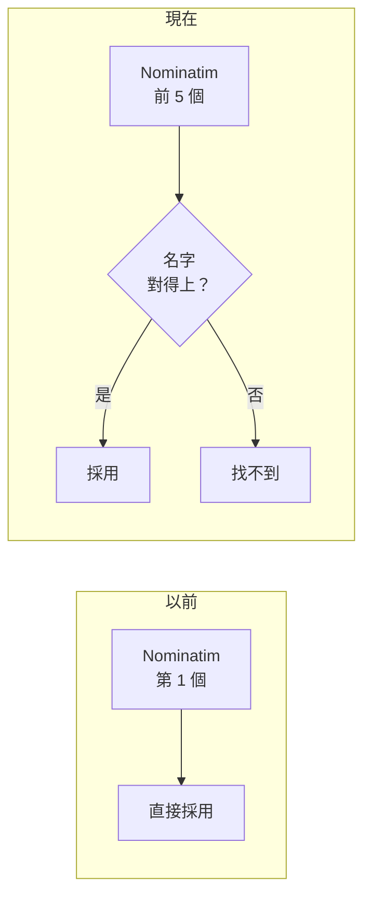

# 系統性降低答錯：錯得看得見，比錯得像對的好（草稿）

> 11/6 的修正整理。報告第 3 段「怎麼做到」的設計決策、第 4 段「驗收與實驗」都可以用。數字見 [experiments/simulated-2026-11-06/](../experiments/simulated-2026-11-06/README.md)、[experiments/geocode-2026-11-06/](../experiments/geocode-2026-11-06/README.md)。

## 1. 兩種答錯

系統一定會遇到看不懂的問法、找不到的地名。答錯有兩種，危險程度差很多：

| | 看得見的錯 | 看不出的錯 |
| --- | --- | --- |
| 例子 | 「和平醫院（新竹市北區）不在台北市範圍內」 | 「台北市政府」被找成政大附中，回答「搭公車沒辦法到松山機場」 |
| 使用者 | 知道要換個說法 | 相信錯的答案，可能在錯的地方等車 |

**目標不是每一題都答對（做不到），而是把「看不出的錯」變成「看得見的錯」。**

## 2. 三道關卡：沒把握就不替使用者決定

| 關卡 | 以前 | 現在 |
| --- | --- | --- |
| ① 規則 | 不認得的字直接忽略（「哪些**溫泉區**」→ 照樣列出能到的站） | 「哪些」後面不是類別、「能到哪」裡還有看不懂的字 → 交給 Gemini |
| ② Gemini 的類別 | 寫錯（「景類」）就照查，回答「到不了」 | 改得正就改，對不上就當成沒填 |
| ③ Nominatim | 第 1 個結果直接採用 | 名字對不上就說找不到 |

## 3. 不是用賭的

| 用賭的 | 系統性的 |
| --- | --- |
| 看到「台北市政府」錯，就把它加進資料庫；看到「換線」錯，就把它加進規則 | 一條規則對所有說法都有效：看不懂就交出去、名字對不上就不採用 |
| 改完用同一批題目再考，數字一定變好 | 用**沒看過**的題目和地名量：新出 30 題、標註先鎖定；102 個地標名稱 |
| 看總數變好就算 | 逐題看前後差異，每一題都說得出原因（Gemini 結果不固定的 +2、−2 要分開） |

## 4. 參考別的地圖 App

地名找錯是每個地圖 App 都會遇到的問題。龐大的地點資料學不來，但設計原則可以借：

| 別家的做法 | 誰在用 | 我們 |
| --- | --- | --- |
| 讓使用者從候選清單挑，不替他猜 | Google、Apple 地圖 | 邊打字邊建議（資料庫裡的地點）✓；Nominatim 的候選還沒列出（之後可改進） |
| 結果附信心分數，太低就不採用 | Google（部分符合）、Mapbox（相關度） | **名字檢查**（11/6）✓ |
| 一次拿多個候選再挑 | 幾乎所有地圖 App | 前 5 個候選（11/6）✓ |
| 自己的地點資料庫優先 | 公車 App（Bus+ 等） | 捷運站、102 個地標、28,945 個站牌名先比對 ✓ |
| 以使用者附近為優先 | Google（location bias） | 優先找台北（`viewbox`）✓；不限定只找台北，否則「九份」變成北投「九份溝」 |

## 5. 結果與代價

| | 修正前 | 修正後 | 代價 |
| --- | --- | --- | --- |
| ① 規則：模擬長句 30 題，規則接手後答錯 | 6 | 1 | 有些原本答對的也交出去（「…帶小孩」多呼叫一次 Gemini） |
| ① 規則：**沒看過的**新題目 30 題，規則接手後答錯 | 3 | 1 | — |
| 自己出的題目 34 題 | 答錯 0 | 答錯 0（完全沒變） | — |
| ③ 地名：102 個地標名稱與簡稱（180 個），看不出的錯 | 12 | 5 | 原本找對的 6 個變成找不到（OSM 名字完全不同，例如「樂聲影城」→「樂聲數位旗艦店」） |

剩下擋不住的：OSM 資料本身的別名（「榮總」被記成捷運石牌站的別名）、Gemini 偶爾漏掉條件。這些寫進[限制](limitations.md)。

## 報告呈現建議

- 第 3 段設計決策加一條「**沒把握就不替使用者決定**」：放第 2 節的三道關卡圖，口頭舉「台北市政府 → 政大附中」的例子。
- 第 4 段實驗放第 5 節的表，強調「用沒看過的題目驗證」和「報告用修正前的成績」。
- 被問「為什麼不把詞加進規則」：換一批題目又有新的詞，而且那批題目的成績就不再是沒看過的。
