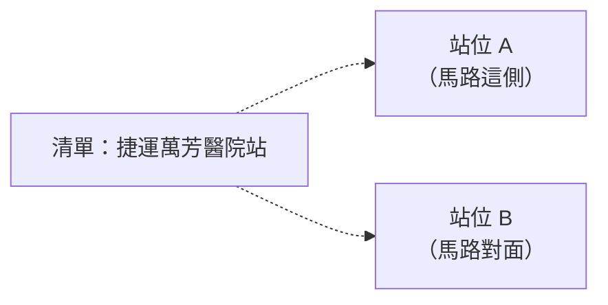

# 限制與之後的改進（草稿）

## 限制

### 資料與計算

| 限制 | 例子 | 目前的處理 |
| --- | --- | --- |
| 只算不換車的直達 | 轉一次車就能到的地方不會出現 | 範圍設計（提案「不做什麼」） |
| 車程用站數表示，站數最少不等於最快 | 捷運 12 站約 25 分鐘，公車 27 站可能要 1 小時 | 保留「其他搭法」讓使用者自己比較 |
| 資料是固定版本（公車 10/27、捷運 11/3） | 路線改道、新路線不會反映 | 驗證數字才能重現；正式上線要定期匯入 |
| 地標只有 102 個，不含店家 | 問咖啡廳、便利商店 | 說明這類店到處都有、沒有收錄 |
| 捷運站只有一個座標 | 公館站從出口旁量可能超過 300 m，捷運就不算進上車站 | 可改用出口座標 |
| 步行時間是直線估算 | 直線 × 1.3 ÷ 每分鐘 80 m | 畫面寫「約」，精確時間交給 Google 地圖導航 |

### 顯示（11/5 決定寫成限制，不再改程式）

**1. 同名不同站位的下車站，在清單裡看不出差別**

例如捷運萬芳醫院站兩個站位、公館一帶的公車站「捷運公館站」和捷運站「公館」。點地圖上的圓點才知道是哪一個。分開列要先決定怎麼命名（「往○○方向」？），畫面上的字會變多，和「字少分層」衝突。

**2. 下車站本身就在走路範圍內**

例如坐 1～2 站就到的福興路口、懷恩隧道：回答已經改成「走路可到」，但地圖上仍畫出這些下車站。資料本身沒錯（真的能坐車到），只是對使用者沒有意義；拿掉要定一個門檻（距離？站數？），市區 1 站約 300 m，走快速道路的 2 站可能超過 1 km。

### 定位

| 限制 | 例子 | 目前的處理 |
| --- | --- | --- |
| 大範圍地址（校園、公園、機場）的定位點因服務而異 | 羅斯福路四段 1 號（台大），本系統和 Bus+ 定位差 300 m，附近站牌跟著變 | 大頭針標出起點，使用者可以長按改起點；地標清單用大門門牌 |
| Nominatim 找錯但在台北市內 | 「信義區公所」找成六張犁派出所一帶；「火星基地」模糊比對成大安區的「星野銅鑼燒」（11/5 測試） | 面板顯示找到的起點名稱；常見地名先比對資料庫 |
| Nominatim 找到外縣市的同名地點 | 「和平醫院」找成新竹市的和平醫院，回答「不在台北市範圍內」（11/6 模擬題目 Y23） | 回答寫出找到的地點（看得出是新竹），提示在地名前加「台北」（「台北和平醫院」找得到）。不限定只找台北：「九份」會變成北投的「九份溝」、「桃園機場」變成台北車站的機場捷運站，錯得像對的 |

### 自然語言

| 限制 | 例子 | 目前的處理 |
| --- | --- | --- |
| 規則是看著自己出的題目調的 | 第 5 項的 10 句、held-out 都是自己出的；11/6 用 ChatGPT 模擬的長句 30 題，規則接手後答錯 6 題（自己出的題目 0 題） | 模擬題目另外計分、標註先鎖定（見 `experiments/simulated-2026-11-06/`）；規則改成看不懂就交給 Gemini。模擬題目仍是 AI 寫的，不等於真實使用者 |
| Gemini 延遲波動大 | 同一個極短請求 15～18 秒，幾分鐘後 1 秒 | 常見問法走規則不呼叫 Gemini；nginx 等 180 秒 |
| LLM 是語意解析的備援，不是多步驟 agent | 一題最多呼叫一次，只做選擇題 | 刻意的設計：結果一致、不捏造 |

## 之後可以改進

- 地圖點太多時做群集（目前縮小時一般公車站變小點）。
- 地標改用 OSM 的區域範圍（夜市、校園是一整塊，不是一個點），或擴充類別。
- 正式上線換圖磚來源（OSM 官方圖磚只適合小流量）或自架。
- 真正的步行路徑（自架 OSRM 或付費 API）。
- 邊打字邊建議擴充到地址。
- Android 實機測試；定期從 TDX 匯入新資料。
