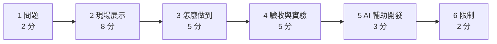

# 最終報告大綱（草稿）

> 11/16（一）15:30。學長建議以**現場跑一次系統為主**。形式：投影片（22 頁，claude.ai 上的 Slides，可下載 PPTX／PDF；11/6 已填入 A／B／C、第 5 項、第 9 項的數字，新增「降低答錯」「借鑑地圖 App」兩頁）。以下是內容順序與時間分配。

## 1. 問題與定位（2 分）

- 現有工具都從「我要去哪」出發；本工具反過來：「從這裡不換車能去哪」。
- 基準實驗：通用 AI 的站牌涵蓋率 0～50%，會捏造（[llm-baseline](../experiments/llm-baseline.md)）。
- 一張圖：提案的定位圖（`images/positioning-map.svg`）。

## 2. 現場展示（8 分）

照 [demo.md](demo.md) 的 7 步：長按 → 分頁 → 點站 → 打字問 → 新類別 → 查不到 → 手機。

## 3. 怎麼做到（5 分）

圖都在 [design/architecture.md](../design/architecture.md)：

- 整體架構圖（Docker 四個服務＋外部服務）。
- 查詢流程圖：三種入口 → System 1 規則 → System 2 Gemini 選擇題 → 程式組回答。
- 設計決策：
  1. **要算、要查的都不交給 LLM**：LLM 只做選擇題，回答由程式產生 → 捏造 0。
     - 被問「System 2 為什麼不多想」「為什麼不用 Agent」時：[design/llm-design.md](../design/llm-design.md) 的比較表與取捨。
  2. **結果一致**：同一個輸入同一種結果（規則、簡稱表、分頁帶參數、`temperature` 0）。
  3. **字少分層**：一行摘要 → 精簡清單 → 完整說明。
  4. **送出前消除歧義**：邊打字邊建議、資料庫先認地名。
  5. **出處**：TDX、OpenStreetMap 標示不拿掉。
  6. **沒把握就不替使用者決定**：規則看不懂交給 Gemini、Gemini 的類別對不上當成沒填、地名名字對不上說找不到；參考地圖 App 的做法，用沒看過的題目和地名驗證（[error-reduction.md](error-reduction.md)，三道關卡圖）。

## 4. 驗收與實驗（5 分）

| # | 項目 | 結果 |
| --- | --- | --- |
| 1 | 搜尋定位 | 範圍內 13/13（和 Bus+ 比對） |
| 2 | 直達計算 | 3,415 筆重算一致；Bus+ 抽查 15 組全對 |
| 3 | 實驗題目 Q1～Q5 | 全對 |
| 4 | 可直達地標 | 通過 |
| 5 | 理解問題 | 10/10；ChatGPT 模擬一般人問法 60 題 42/60（修正前） |
| 6 | 不捏造 | 捏造 0（269 筆逐筆核對） |
| 7 | 查詢速度 | `/reach` 0.24～0.36 秒；`/ask` 中位數 1.9 秒（Gemini 忙碌時 20～44 秒） |
| 8 | 手機操作 | iPhone 實機通過 |
| 9 | 可部署性 | 通過：實驗室同學在 Windows 10 照 README 一鍵部署，1 分 30 秒，自動檢查 11 項全過 |

- A／B／C 比較（ChatGPT 模擬 60 題，修正前）：A＝改版前（LLM 寫回答）40%（不算做不到的 62%）、3.3 秒、Gemini 111 次；B＝全部交給 LLM 解析 78%、1.6 秒、63 次；C＝規則＋LLM 備援 70%、1.5 秒、50 次。C 輸 B 的差距全在規則「以為看懂、直接答錯」（[experiments/simulated-2026-11-06/](../experiments/simulated-2026-11-06/README.md)）。
- 降低答錯、借鑑地圖 App：見 [error-reduction.md](error-reduction.md)，投影片「降低答錯」「不是用賭的」兩頁。

## 5. AI 輔助開發（3 分）

- 分工、五個做法、學到的：[ai-usage.md](ai-usage.md)；改動對照表：[ai-changes.md](ai-changes.md)。
- 挑 3 個例子（發現 → 原因 → 改法 → 驗證），其餘放附錄。

## 6. 限制與之後的改進（2 分）

[limitations.md](limitations.md)：只算直達、站數不等於時間、同名站位、走路就到的下車站、定位因服務而異、題目可能和規則有同樣的盲點。
